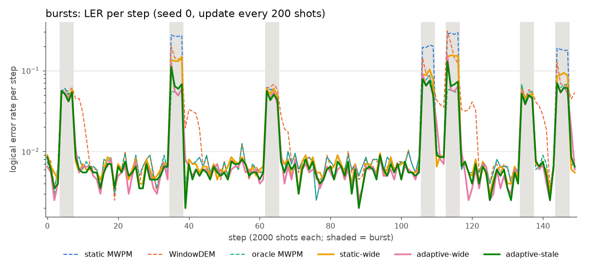
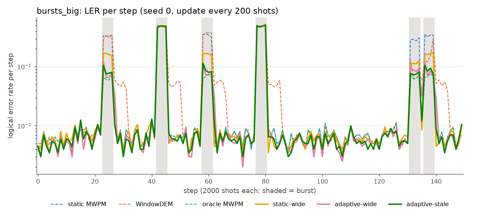
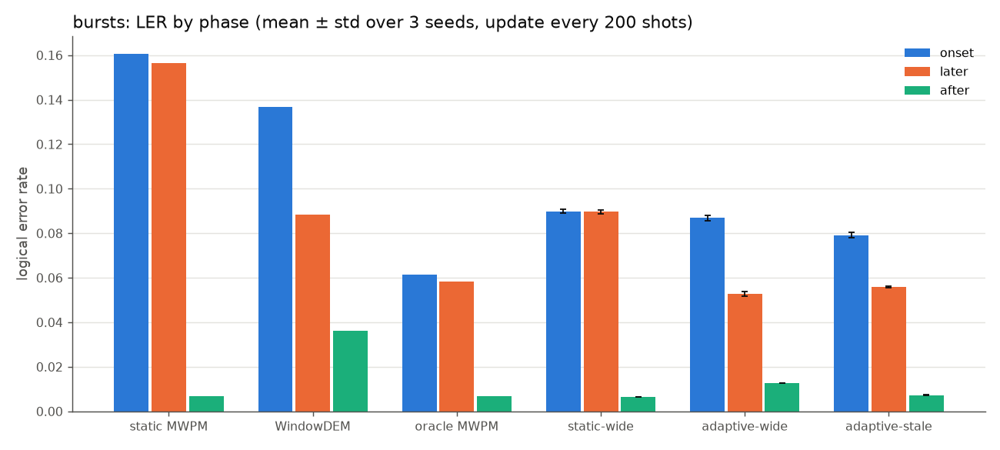
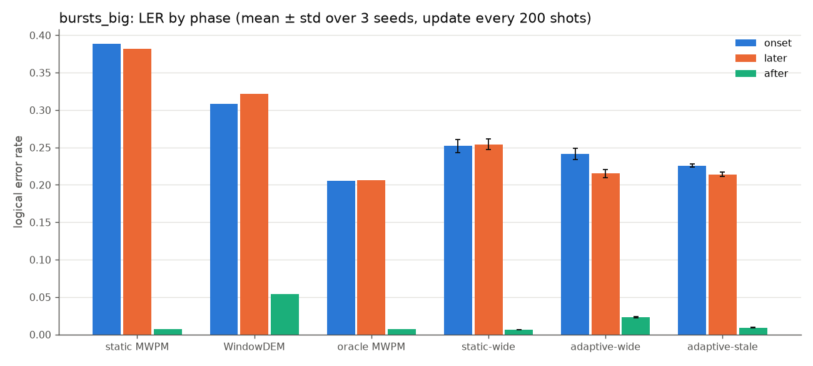

# d=3: stale-fingerprint augmentation and finer fingerprint updates

Tables are generated by `python report.py --data data/d3_wide` and written to `results/report_tables.md`.

## Summary

- Onset. On `bursts`, stale augmentation lowers the adaptive model's onset LER from 0.1145 to 0.0975 at the original update rate (every 2000 shots). This is still worse than static-wide (0.0899), and the gap is outside 2 SE. Augmentation alone does not fix the regression. With `--update-every 200` the stale model's onset LER is 0.0791, which beats static-wide (0.0899) and the unaugmented adaptive model at the same update rate (0.0868). Both differences are outside 2 SE.
- Later steps. The stale model keeps most of the advantage: 0.0557 vs 0.0896 for static-wide on later burst steps. It gives up a little against the unaugmented adaptive model (0.0557 vs 0.0527), which is a tie at update 2000 and a small but significant loss at update 200. The unaugmented adaptive model beats oracle MWPM on later steps (0.0527 vs 0.0581). The stale model only ties it (0.0557).
- After drift ends. Without augmentation, the first nominal step after a burst costs the adaptive model 0.0252, against 0.0065 for static-wide. Stale augmentation brings this to 0.0091 (update 2000) and 0.0073 (update 200, a tie with static-wide).
- Finer updating. Updating every 200 shots instead of every 2000 lowers onset and after-drift LER for every adaptive model and never hurts later steps. At onset it is the larger of the two effects (adaptive-wide: 0.1145 → 0.0868).
- Held-out `bursts_big`. Every neural model does much better than static MWPM (0.383) and WindowDEM (0.32) on drift LER and stays behind oracle MWPM (0.206). The stale model is the best non-oracle decoder (0.2252 / 0.2170 at update 2000 / 200). Two of its 6 bursts destroy the logical qubit for every decoder, oracle included (LER ≈ 0.49); see the supplementary table.
- Costs. When the fingerprint is accurate and the noise is localized, augmentation costs 5-6%: 0.0211 vs 0.0199 on the "2 hot qubits" test set, and 0.0210 vs 0.0199 on later `hot_qubit` steps. Both differences are outside 2 SE. On `telegraph`, `wander` and the nominal and scale x2 test sets it ties with the unaugmented adaptive model.

## Setup

| | |
|---|---|
| Code | rotated surface code memory-Z, d=3, 3 rounds, p=0.003 (SI-style depolarizing), 24 detectors |
| Streams (D) | `data/d3_r3_p0.003_s0`, manifest SHA-256 `c9b42a75fc30a20f…85f548775` (after adding `bursts_big`; before: `bc52e51adf418e17…`). The 10 files that already existed were checked byte-identical after `--streams-only`. `stream_bursts_big.npz` SHA-256 `30a3f324496a3937…`, seed 2292752895 |
| Training data (W) | `data/d3_wide`, manifest SHA-256 `0e398feb9d236751…f26bf70f`. 30000 train / 1000 val chunks, 1–6 hot qubits, hot_p 0.005–0.08, scale 0.5–2.5 |
| Test sets | W's saved test sets, 200000 shots per state, 2000 fingerprint shots. W and D were both made with `--seed 0`, so their test sets and streams are byte-identical |
| Models | 3D CNN, hidden 48, 4 layers, 195,681 params, fingerprint window 2000 shots |
| Training | 2 epochs = 60000 steps, batch 512, AdamW lr 1e-3, OneCycle. Seeds 0, 1, 2 for each model. static-wide and adaptive-wide existed already (not retrained). adaptive-stale: `--stale-prob 0.3`, otherwise the same settings, same data and same chunk order per seed |
| Eval | D's streams: 150 steps × 2000 shots. WindowDEM window 10000 shots (min 1000). Update every 2000 (original behaviour) and every 200 shots. Neural inference on CPU (results checked identical across thread counts). Test-set scoring on GPU (reproduces the tables `train.py` printed) |
| Versions | stim 1.16.0, pymatching 2.4.0, numpy 2.4.6, torch 2.15.0+cu132, Python 3.11.17 |
| Hardware | NVIDIA GeForce RTX 4050 Laptop GPU, 12 CPU threads |

Decoder names. static MWPM: PyMatching with nominal weights. oracle MWPM: PyMatching rebuilt from the true noise every step. WindowDEM: PyMatching reweighted from the last 10000 shots. static-wide, adaptive-wide, adaptive-stale: neural models trained on W (`decoder_static_d3_wide_s*`, `decoder_adaptive_d3_wide_s*`, `decoder_adaptive_d3_stale_s*`).

Phases. onset: the first off-nominal step after a nominal one. later: the other off-nominal steps. after: the first nominal step after an off-nominal one. LER (drift): all off-nominal steps.

Error bars and ties. "±" is the sample std over the 3 training seeds (ddof=1). MWPM decoders are deterministic and have no ±. Two decoders tie when |p_a − p_b| < 2·sqrt(SE_a² + SE_b²), with binomial SE_x = sqrt(p_x(1−p_x)/shots) and shots the number of shots in that phase of one run. The test is conservative, because all decoders see the same shots and a paired test would be tighter. It ignores seed-to-seed spread; compare against the ± column. "a better" means a has the lower LER.

Oracle MWPM is not an optimal decoder. It is MWPM with the true weights. The neural models beat it even on nominal noise (test sets below), so "beats the oracle" shows that the network is a better decoder, not necessarily a better adapter.

## Test sets (fixed noise, LER)

| decoder | nominal | scale x2 | 2 hot qubits |
|---|---|---|---|
| static MWPM | 0.00648 | 0.02433 | 0.05803 |
| oracle MWPM | 0.00648 | 0.02433 | 0.02269 |
| static-wide | 0.00605 ± 0.00003 | 0.02390 ± 0.00011 | 0.02661 ± 0.00078 |
| adaptive-wide | 0.00532 ± 0.00001 | 0.02127 ± 0.00013 | 0.01985 ± 0.00016 |
| adaptive-stale | 0.00554 ± 0.00003 | 0.02164 ± 0.00014 | 0.02106 ± 0.00049 |

| a vs b | nominal | scale x2 | 2 hot qubits |
|---|---|---|---|
| adaptive-stale vs adaptive-wide | +0.0002 tie | +0.0004 tie | +0.0012 b better |
| adaptive-stale vs static-wide | -0.0005 a better | -0.0023 a better | -0.0056 a better |
| adaptive-stale vs oracle MWPM | -0.0009 a better | -0.0027 a better | -0.0016 a better |
| adaptive-wide vs oracle MWPM | -0.0012 a better | -0.0031 a better | -0.0028 a better |

On fixed noise, the stale model ties the unaugmented adaptive model on nominal and scale x2. It is significantly worse on 2 hot qubits (+0.0012, about 6%), but still well below oracle MWPM there.

## Drift streams

Each regime has a results table (mean ± std over 3 seeds, for both update settings) followed by pairwise comparisons that use the tie rule above. Static MWPM, oracle MWPM and static-wide do not observe anything, so their numbers are the same for both update settings.

### hot_qubit

Shots per step 2000; drift 100 steps, onset 1 steps, later 99 steps, after 0 steps.

| decoder | update | LER | LER (drift) | onset | later | after |
|---|---|---|---|---|---|---|
| static MWPM | 2000 | 0.04106 | 0.05824 | 0.05800 | 0.05824 | – |
| static MWPM | 200 | 0.04106 | 0.05824 | 0.05800 | 0.05824 | – |
| WindowDEM | 2000 | 0.01872 | 0.02474 | 0.06100 | 0.02438 | – |
| WindowDEM | 200 | 0.01849 | 0.02442 | 0.04000 | 0.02426 | – |
| oracle MWPM | 2000 | 0.01714 | 0.02236 | 0.02250 | 0.02236 | – |
| oracle MWPM | 200 | 0.01714 | 0.02236 | 0.02250 | 0.02236 | – |
| static-wide | 2000 | 0.01987 ± 0.00049 | 0.02665 ± 0.00077 | 0.02750 ± 0.00100 | 0.02664 ± 0.00077 | – |
| static-wide | 200 | 0.01987 ± 0.00049 | 0.02665 ± 0.00077 | 0.02750 ± 0.00100 | 0.02664 ± 0.00077 | – |
| adaptive-wide | 2000 | 0.01527 ± 0.00016 | 0.02010 ± 0.00025 | 0.04367 ± 0.00208 | 0.01986 ± 0.00023 | – |
| adaptive-wide | 200 | 0.01517 ± 0.00016 | 0.01995 ± 0.00024 | 0.02633 ± 0.00058 | 0.01989 ± 0.00023 | – |
| adaptive-stale | 2000 | 0.01601 ± 0.00029 | 0.02113 ± 0.00047 | 0.03300 ± 0.00132 | 0.02101 ± 0.00046 | – |
| adaptive-stale | 200 | 0.01598 ± 0.00028 | 0.02107 ± 0.00046 | 0.02467 ± 0.00115 | 0.02103 ± 0.00046 | – |

Comparisons:

| a vs b | update | drift | onset | later | after |
|---|---|---|---|---|---|
| adaptive-stale vs static-wide | 2000 | -0.0055 a better | +0.0055 tie | -0.0056 a better | – |
| adaptive-stale vs static-wide | 200 | -0.0056 a better | -0.0028 tie | -0.0056 a better | – |
| adaptive-stale vs adaptive-wide | 2000 | +0.0010 b better | -0.0107 tie | +0.0011 b better | – |
| adaptive-stale vs adaptive-wide | 200 | +0.0011 b better | -0.0017 tie | +0.0011 b better | – |
| adaptive-wide vs static-wide | 2000 | -0.0066 a better | +0.0162 b better | -0.0068 a better | – |
| adaptive-wide vs static-wide | 200 | -0.0067 a better | -0.0012 tie | -0.0068 a better | – |
| adaptive-stale vs oracle MWPM | 2000 | -0.0012 a better | +0.0105 b better | -0.0014 a better | – |
| adaptive-stale vs oracle MWPM | 200 | -0.0013 a better | +0.0022 tie | -0.0013 a better | – |
| adaptive-stale vs static MWPM | 2000 | -0.0371 a better | -0.0250 a better | -0.0372 a better | – |
| adaptive-stale vs static MWPM | 200 | -0.0372 a better | -0.0333 a better | -0.0372 a better | – |
| adaptive-stale vs WindowDEM | 2000 | -0.0036 a better | -0.0280 a better | -0.0034 a better | – |
| adaptive-stale vs WindowDEM | 200 | -0.0033 a better | -0.0153 a better | -0.0032 a better | – |

### bursts

Shots per step 2000; drift 28 steps, onset 7 steps, later 21 steps, after 7 steps.

| decoder | update | LER | LER (drift) | onset | later | after |
|---|---|---|---|---|---|---|
| static MWPM | 2000 | 0.03487 | 0.15741 | 0.16043 | 0.15640 | 0.00686 |
| static MWPM | 200 | 0.03487 | 0.15741 | 0.16043 | 0.15640 | 0.00686 |
| WindowDEM | 2000 | 0.03012 | 0.10704 | 0.14614 | 0.09400 | 0.03643 |
| WindowDEM | 200 | 0.02853 | 0.10038 | 0.13671 | 0.08826 | 0.03629 |
| oracle MWPM | 2000 | 0.01649 | 0.05898 | 0.06150 | 0.05814 | 0.00686 |
| oracle MWPM | 200 | 0.01649 | 0.05898 | 0.06150 | 0.05814 | 0.00686 |
| static-wide | 2000 | 0.02174 ± 0.00017 | 0.08968 ± 0.00089 | 0.08990 ± 0.00089 | 0.08961 ± 0.00091 | 0.00648 ± 0.00011 |
| static-wide | 200 | 0.02174 ± 0.00017 | 0.08968 ± 0.00089 | 0.08990 ± 0.00089 | 0.08961 ± 0.00091 | 0.00648 ± 0.00011 |
| adaptive-wide | 2000 | 0.01806 ± 0.00023 | 0.06813 ± 0.00120 | 0.11450 ± 0.00223 | 0.05267 ± 0.00099 | 0.02517 ± 0.00048 |
| adaptive-wide | 200 | 0.01616 ± 0.00022 | 0.06121 ± 0.00096 | 0.08683 ± 0.00113 | 0.05267 ± 0.00102 | 0.01267 ± 0.00016 |
| adaptive-stale | 2000 | 0.01709 ± 0.00005 | 0.06614 ± 0.00028 | 0.09750 ± 0.00217 | 0.05569 ± 0.00056 | 0.00914 ± 0.00052 |
| adaptive-stale | 200 | 0.01615 ± 0.00004 | 0.06163 ± 0.00022 | 0.07914 ± 0.00119 | 0.05579 ± 0.00041 | 0.00729 ± 0.00019 |

Comparisons:

| a vs b | update | drift | onset | later | after |
|---|---|---|---|---|---|
| adaptive-stale vs static-wide | 2000 | -0.0235 a better | +0.0076 b better | -0.0339 a better | +0.0027 b better |
| adaptive-stale vs static-wide | 200 | -0.0281 a better | -0.0108 a better | -0.0338 a better | +0.0008 tie |
| adaptive-stale vs adaptive-wide | 2000 | -0.0020 tie | -0.0170 a better | +0.0030 tie | -0.0160 a better |
| adaptive-stale vs adaptive-wide | 200 | +0.0004 tie | -0.0077 a better | +0.0031 b better | -0.0054 a better |
| adaptive-wide vs static-wide | 2000 | -0.0216 a better | +0.0246 b better | -0.0369 a better | +0.0187 b better |
| adaptive-wide vs static-wide | 200 | -0.0285 a better | -0.0031 tie | -0.0369 a better | +0.0062 b better |
| adaptive-stale vs oracle MWPM | 2000 | +0.0072 b better | +0.0360 b better | -0.0025 tie | +0.0023 b better |
| adaptive-stale vs oracle MWPM | 200 | +0.0026 tie | +0.0176 b better | -0.0023 tie | +0.0004 tie |
| adaptive-stale vs static MWPM | 2000 | -0.0913 a better | -0.0629 a better | -0.1007 a better | +0.0023 b better |
| adaptive-stale vs static MWPM | 200 | -0.0958 a better | -0.0813 a better | -0.1006 a better | +0.0004 tie |
| adaptive-stale vs WindowDEM | 2000 | -0.0409 a better | -0.0486 a better | -0.0383 a better | -0.0273 a better |
| adaptive-stale vs WindowDEM | 200 | -0.0387 a better | -0.0576 a better | -0.0325 a better | -0.0290 a better |

### bursts_big

Shots per step 2000; drift 24 steps, onset 6 steps, later 18 steps, after 6 steps.

| decoder | update | LER | LER (drift) | onset | later | after |
|---|---|---|---|---|---|---|
| static MWPM | 2000 | 0.06687 | 0.38329 | 0.38817 | 0.38167 | 0.00692 |
| static MWPM | 200 | 0.06687 | 0.38329 | 0.38817 | 0.38167 | 0.00692 |
| WindowDEM | 2000 | 0.06563 | 0.32625 | 0.35258 | 0.31747 | 0.05258 |
| WindowDEM | 200 | 0.06418 | 0.31838 | 0.30792 | 0.32186 | 0.05375 |
| oracle MWPM | 2000 | 0.03855 | 0.20629 | 0.20525 | 0.20664 | 0.00692 |
| oracle MWPM | 200 | 0.03855 | 0.20629 | 0.20525 | 0.20664 | 0.00692 |
| static-wide | 2000 | 0.04598 ± 0.00120 | 0.25376 ± 0.00754 | 0.25208 ± 0.00869 | 0.25432 ± 0.00719 | 0.00617 ± 0.00008 |
| static-wide | 200 | 0.04598 ± 0.00120 | 0.25376 ± 0.00754 | 0.25208 ± 0.00869 | 0.25432 ± 0.00719 | 0.00617 ± 0.00008 |
| adaptive-wide | 2000 | 0.04483 ± 0.00092 | 0.23978 ± 0.00668 | 0.31439 ± 0.01133 | 0.21491 ± 0.00550 | 0.04761 ± 0.00318 |
| adaptive-wide | 200 | 0.04093 ± 0.00088 | 0.22167 ± 0.00563 | 0.24147 ± 0.00757 | 0.21507 ± 0.00551 | 0.02294 ± 0.00104 |
| adaptive-stale | 2000 | 0.04124 ± 0.00027 | 0.22519 ± 0.00165 | 0.25889 ± 0.00228 | 0.21396 ± 0.00264 | 0.01272 ± 0.00073 |
| adaptive-stale | 200 | 0.03978 ± 0.00044 | 0.21700 ± 0.00277 | 0.22586 ± 0.00213 | 0.21405 ± 0.00301 | 0.00928 ± 0.00013 |

Comparisons:

| a vs b | update | drift | onset | later | after |
|---|---|---|---|---|---|
| adaptive-stale vs static-wide | 2000 | -0.0286 a better | +0.0068 tie | -0.0404 a better | +0.0066 b better |
| adaptive-stale vs static-wide | 200 | -0.0368 a better | -0.0262 a better | -0.0403 a better | +0.0031 b better |
| adaptive-stale vs adaptive-wide | 2000 | -0.0146 a better | -0.0555 a better | -0.0009 tie | -0.0349 a better |
| adaptive-stale vs adaptive-wide | 200 | -0.0047 tie | -0.0156 a better | -0.0010 tie | -0.0137 a better |
| adaptive-wide vs static-wide | 2000 | -0.0140 a better | +0.0623 b better | -0.0394 a better | +0.0414 b better |
| adaptive-wide vs static-wide | 200 | -0.0321 a better | -0.0106 tie | -0.0393 a better | +0.0168 b better |
| adaptive-stale vs oracle MWPM | 2000 | +0.0189 b better | +0.0536 b better | +0.0073 b better | +0.0058 b better |
| adaptive-stale vs oracle MWPM | 200 | +0.0107 b better | +0.0206 b better | +0.0074 b better | +0.0024 b better |
| adaptive-stale vs static MWPM | 2000 | -0.1581 a better | -0.1293 a better | -0.1677 a better | +0.0058 b better |
| adaptive-stale vs static MWPM | 200 | -0.1663 a better | -0.1623 a better | -0.1676 a better | +0.0024 b better |
| adaptive-stale vs WindowDEM | 2000 | -0.1011 a better | -0.0937 a better | -0.1035 a better | -0.0399 a better |
| adaptive-stale vs WindowDEM | 200 | -0.1014 a better | -0.0821 a better | -0.1078 a better | -0.0445 a better |

### telegraph

Shots per step 2000; drift 58 steps, onset 4 steps, later 54 steps, after 4 steps.

| decoder | update | LER | LER (drift) | onset | later | after |
|---|---|---|---|---|---|---|
| static MWPM | 2000 | 0.01294 | 0.02397 | 0.02625 | 0.02381 | 0.00563 |
| static MWPM | 200 | 0.01294 | 0.02397 | 0.02625 | 0.02381 | 0.00563 |
| WindowDEM | 2000 | 0.01289 | 0.02401 | 0.02775 | 0.02373 | 0.00600 |
| WindowDEM | 200 | 0.01291 | 0.02397 | 0.02687 | 0.02376 | 0.00563 |
| oracle MWPM | 2000 | 0.01295 | 0.02399 | 0.02625 | 0.02382 | 0.00563 |
| oracle MWPM | 200 | 0.01295 | 0.02399 | 0.02625 | 0.02382 | 0.00563 |
| static-wide | 2000 | 0.01270 ± 0.00006 | 0.02378 ± 0.00011 | 0.02425 ± 0.00070 | 0.02375 ± 0.00013 | 0.00513 ± 0.00033 |
| static-wide | 200 | 0.01270 ± 0.00006 | 0.02378 ± 0.00011 | 0.02425 ± 0.00070 | 0.02375 ± 0.00013 | 0.00513 ± 0.00033 |
| adaptive-wide | 2000 | 0.01125 ± 0.00003 | 0.02093 ± 0.00007 | 0.02200 ± 0.00078 | 0.02085 ± 0.00002 | 0.00417 ± 0.00014 |
| adaptive-wide | 200 | 0.01123 ± 0.00001 | 0.02094 ± 0.00004 | 0.02183 ± 0.00038 | 0.02087 ± 0.00002 | 0.00413 ± 0.00013 |
| adaptive-stale | 2000 | 0.01159 ± 0.00010 | 0.02159 ± 0.00018 | 0.02242 ± 0.00029 | 0.02152 ± 0.00019 | 0.00442 ± 0.00007 |
| adaptive-stale | 200 | 0.01160 ± 0.00008 | 0.02161 ± 0.00012 | 0.02287 ± 0.00045 | 0.02151 ± 0.00013 | 0.00433 ± 0.00019 |

Comparisons:

| a vs b | update | drift | onset | later | after |
|---|---|---|---|---|---|
| adaptive-stale vs static-wide | 2000 | -0.0022 a better | -0.0018 tie | -0.0022 a better | -0.0007 tie |
| adaptive-stale vs static-wide | 200 | -0.0022 a better | -0.0014 tie | -0.0022 a better | -0.0008 tie |
| adaptive-stale vs adaptive-wide | 2000 | +0.0007 tie | +0.0004 tie | +0.0007 tie | +0.0003 tie |
| adaptive-stale vs adaptive-wide | 200 | +0.0007 tie | +0.0010 tie | +0.0006 tie | +0.0002 tie |
| adaptive-wide vs static-wide | 2000 | -0.0029 a better | -0.0023 tie | -0.0029 a better | -0.0010 tie |
| adaptive-wide vs static-wide | 200 | -0.0028 a better | -0.0024 tie | -0.0029 a better | -0.0010 tie |
| adaptive-stale vs oracle MWPM | 2000 | -0.0024 a better | -0.0038 tie | -0.0023 a better | -0.0012 tie |
| adaptive-stale vs oracle MWPM | 200 | -0.0024 a better | -0.0034 tie | -0.0023 a better | -0.0013 tie |
| adaptive-stale vs static MWPM | 2000 | -0.0024 a better | -0.0038 tie | -0.0023 a better | -0.0012 tie |
| adaptive-stale vs static MWPM | 200 | -0.0024 a better | -0.0034 tie | -0.0023 a better | -0.0013 tie |
| adaptive-stale vs WindowDEM | 2000 | -0.0024 a better | -0.0053 a better | -0.0022 a better | -0.0016 tie |
| adaptive-stale vs WindowDEM | 200 | -0.0024 a better | -0.0040 tie | -0.0022 a better | -0.0013 tie |

### wander

Shots per step 2000; drift 150 steps, onset 0 steps, later 150 steps, after 0 steps.

| decoder | update | LER | LER (drift) | onset | later | after |
|---|---|---|---|---|---|---|
| static MWPM | 2000 | 0.00968 | 0.00968 | – | 0.00968 | – |
| static MWPM | 200 | 0.00968 | 0.00968 | – | 0.00968 | – |
| WindowDEM | 2000 | 0.00962 | 0.00962 | – | 0.00962 | – |
| WindowDEM | 200 | 0.00958 | 0.00958 | – | 0.00958 | – |
| oracle MWPM | 2000 | 0.00968 | 0.00968 | – | 0.00968 | – |
| oracle MWPM | 200 | 0.00968 | 0.00968 | – | 0.00968 | – |
| static-wide | 2000 | 0.00955 ± 0.00006 | 0.00955 ± 0.00006 | – | 0.00955 ± 0.00006 | – |
| static-wide | 200 | 0.00955 ± 0.00006 | 0.00955 ± 0.00006 | – | 0.00955 ± 0.00006 | – |
| adaptive-wide | 2000 | 0.00851 ± 0.00010 | 0.00851 ± 0.00010 | – | 0.00851 ± 0.00010 | – |
| adaptive-wide | 200 | 0.00851 ± 0.00009 | 0.00851 ± 0.00009 | – | 0.00851 ± 0.00009 | – |
| adaptive-stale | 2000 | 0.00872 ± 0.00003 | 0.00872 ± 0.00003 | – | 0.00872 ± 0.00003 | – |
| adaptive-stale | 200 | 0.00871 ± 0.00004 | 0.00871 ± 0.00004 | – | 0.00871 ± 0.00004 | – |

Comparisons:

| a vs b | update | drift | onset | later | after |
|---|---|---|---|---|---|
| adaptive-stale vs static-wide | 2000 | -0.0008 a better | – | -0.0008 a better | – |
| adaptive-stale vs static-wide | 200 | -0.0008 a better | – | -0.0008 a better | – |
| adaptive-stale vs adaptive-wide | 2000 | +0.0002 tie | – | +0.0002 tie | – |
| adaptive-stale vs adaptive-wide | 200 | +0.0002 tie | – | +0.0002 tie | – |
| adaptive-wide vs static-wide | 2000 | -0.0010 a better | – | -0.0010 a better | – |
| adaptive-wide vs static-wide | 200 | -0.0010 a better | – | -0.0010 a better | – |
| adaptive-stale vs oracle MWPM | 2000 | -0.0010 a better | – | -0.0010 a better | – |
| adaptive-stale vs oracle MWPM | 200 | -0.0010 a better | – | -0.0010 a better | – |
| adaptive-stale vs static MWPM | 2000 | -0.0010 a better | – | -0.0010 a better | – |
| adaptive-stale vs static MWPM | 200 | -0.0010 a better | – | -0.0010 a better | – |
| adaptive-stale vs WindowDEM | 2000 | -0.0009 a better | – | -0.0009 a better | – |
| adaptive-stale vs WindowDEM | 200 | -0.0009 a better | – | -0.0009 a better | – |

### Supplementary: `bursts_big` without the two saturated bursts

The bursts at steps 42 and 77 hit the same 8-qubit cluster (3, 5, 10, 11, 12, 13, 18, 19). There, every decoder including oracle MWPM is at LER ≈ 0.48–0.49, so the logical qubit is destroyed. These bursts are a third of the drifted steps and pull every decoder toward 0.5, which shrinks the differences between them. Without them:

Dropped bursts starting at steps [42, 77] (oracle LER > 0.4); kept onset 4 steps, later 12 steps, after 4 steps.

| decoder | update | onset | later | after |
|---|---|---|---|---|
| static MWPM | 2000 | 0.33512 | 0.32592 | 0.00725 |
| static MWPM | 200 | 0.33512 | 0.32592 | 0.00725 |
| WindowDEM | 2000 | 0.28088 | 0.23463 | 0.05287 |
| WindowDEM | 200 | 0.21913 | 0.24113 | 0.05500 |
| oracle MWPM | 2000 | 0.06588 | 0.06742 | 0.00725 |
| oracle MWPM | 200 | 0.06588 | 0.06742 | 0.00725 |
| static-wide | 2000 | 0.13762 ± 0.01328 | 0.14017 ± 0.01135 | 0.00704 ± 0.00007 |
| static-wide | 200 | 0.13762 ± 0.01328 | 0.14017 ± 0.01135 | 0.00704 ± 0.00007 |
| adaptive-wide | 2000 | 0.22758 ± 0.01898 | 0.07856 ± 0.00780 | 0.06187 ± 0.00082 |
| adaptive-wide | 200 | 0.11988 ± 0.00963 | 0.07856 ± 0.00776 | 0.03067 ± 0.00213 |
| adaptive-stale | 2000 | 0.14625 ± 0.00258 | 0.07731 ± 0.00310 | 0.01483 ± 0.00128 |
| adaptive-stale | 200 | 0.09883 ± 0.00199 | 0.07742 ± 0.00315 | 0.01100 ± 0.00033 |

| a vs b | update | onset | later | after |
|---|---|---|---|---|
| adaptive-stale vs static-wide | 2000 | +0.0086 tie | -0.0629 a better | +0.0078 b better |
| adaptive-stale vs static-wide | 200 | -0.0388 a better | -0.0627 a better | +0.0040 b better |
| adaptive-stale vs adaptive-wide | 2000 | -0.0813 a better | -0.0013 tie | -0.0470 a better |
| adaptive-stale vs adaptive-wide | 200 | -0.0210 a better | -0.0011 tie | -0.0197 a better |
| adaptive-wide vs static-wide | 2000 | +0.0900 b better | -0.0616 a better | +0.0548 b better |
| adaptive-wide vs static-wide | 200 | -0.0177 a better | -0.0616 a better | +0.0236 b better |
| adaptive-stale vs oracle MWPM | 2000 | +0.0804 b better | +0.0099 b better | +0.0076 b better |
| adaptive-stale vs oracle MWPM | 200 | +0.0330 b better | +0.0100 b better | +0.0038 b better |

## Questions

### 1. Does stale augmentation bring adaptive onset LER down to at least the static model's, while keeping the later-step advantage?

| bursts | onset (u=2000) | onset (u=200) | later (u=2000) | later (u=200) | after (u=2000) | after (u=200) |
|---|---|---|---|---|---|---|
| static-wide | 0.0899 | 0.0899 | 0.0896 | 0.0896 | 0.0065 | 0.0065 |
| adaptive-wide | 0.1145 | 0.0868 | 0.0527 | 0.0527 | 0.0252 | 0.0127 |
| adaptive-stale | 0.0975 | 0.0791 | 0.0557 | 0.0558 | 0.0091 | 0.0073 |
| oracle MWPM | 0.0615 | 0.0615 | 0.0581 | 0.0581 | 0.0069 | 0.0069 |

- With augmentation alone (u=2000): no. Onset improves by 0.017 (significant), but the stale model is still 0.0076 worse than static-wide (significant).
- With augmentation and u=200: yes, on onset. The stale model beats static-wide by 0.0108 (significant).
- Later-step advantage: mostly kept. Against static-wide the difference is −0.034 (significant). Against adaptive-wide it is +0.0030: a tie at u=2000, significant at u=200. Against oracle MWPM it is a tie; adaptive-wide beats the oracle by 0.0055 (outside 2 SE).
- Held-out `bursts_big` (recoverable bursts) shows the same pattern. Onset: stale 0.146 ties static-wide 0.138 at u=2000 and beats it at u=200 (0.099). Later: stale 0.077 ties adaptive-wide 0.079, both far below static-wide 0.140.
- Remaining regression: the after-drift step. On `bursts_big` the stale model is still worse than static-wide right after a burst (0.0093 vs 0.0062 at u=200, significant), though much better than adaptive-wide (0.0229).

### 2. Does finer updating help?

Yes for the adaptive models, and only where the fingerprint is out of date. Onset and after-drift both improve:

| change from u=2000 to u=200 | onset | after |
|---|---|---|
| adaptive-wide on bursts | 0.1145 → 0.0868 | 0.0252 → 0.0127 |
| adaptive-stale on bursts | 0.0975 → 0.0791 | 0.0091 → 0.0073 |
| adaptive-wide on bursts_big | 0.3144 → 0.2415 | – |
| adaptive-wide on hot_qubit | 0.0437 → 0.0263 | – |

The `hot_qubit` row is a single onset step (2000 shots), so it is noisy. Later steps do not change (0.0527 → 0.0527), because the 2000-shot window is already full of drifted shots either way. WindowDEM gains a little (bursts drift LER 0.1070 → 0.1004) but keeps its after-drift problem (0.036 vs 0.007 for static MWPM), because its 10000-shot history outlasts a 4-step burst. The two changes add up: onset 0.1145 (neither) → 0.0975 (augmentation) / 0.0868 (u=200) → 0.0791 (both).

### 3. How do the models do on held-out `bursts_big`?

It has 8-qubit clusters at hot_p 0.1, outside every training range (at most 6 qubits, hot_p at most 0.08).

- The neural models generalize reasonably. Drift LER at u=200: static-wide 0.254, adaptive-wide 0.222, adaptive-stale 0.217. Static MWPM is 0.383, WindowDEM 0.318 and oracle 0.206.
- On recoverable bursts only, the adaptive models' later-step LER (0.077-0.079) is about half of static-wide's (0.140) but still clearly above oracle MWPM (0.067). On `bursts`, adaptive-wide beat the oracle. Out of distribution the advantage shrinks but does not vanish.
- Static-wide's seed spread is large here (± 0.013 on recoverable onset), so single-seed numbers on this regime are not reliable.

## Other regimes

- hot_qubit (one persistent change at step 50)
  - Every adaptive model beats static-wide and oracle MWPM on later steps.
  - The stale model is 0.0011 worse than adaptive-wide there (significant, about 5%). This is the steady-state cost of the augmentation.
  - Among the neural-vs-neural and neural-vs-oracle onset comparisons, all are ties except two at u=2000 (adaptive-wide vs static-wide; stale vs oracle). There is only one onset step, so the onset numbers carry little weight.
- telegraph (global scale 1 ↔ 2)
  - Stale vs adaptive-wide ties on every phase.
  - All onset and after comparisons are ties (4 events), except the stale model vs WindowDEM at onset with u=2000.
  - The adaptive models beat static-wide on drift LER by about 0.0025. This is the same size as their advantage on the fixed scale x2 test set (0.0213 vs 0.0239), so it may reflect a better decoder rather than adaptation.
- wander (slow global scale drift)
  - Every step is off-nominal (the scale is never exactly 1), so onset and after are empty.
  - Stale ties adaptive-wide (0.0087 vs 0.0085).
  - Static MWPM, WindowDEM and oracle MWPM are equal to within 0.0001, as expected for uniform scale changes.

## Comparison with the d=3 baseline

The original onset and later numbers (onset 0.117 adaptive vs 0.089 static; later 0.053 adaptive vs 0.058 oracle) come from the wide seed-0 models, not from the models trained on D. `results/bursts_d3_r3.csv` is exactly what `decoder_static_d3_wide_s0` and `decoder_adaptive_d3_wide_s0` produce on D's `bursts` stream, and the phase definitions above reproduce those numbers from it. See `01_d3_baseline.md`.

## Plots

LER per step (seed 0, update every 200 shots; shaded = drifted steps):




LER by phase (mean ± std over 3 seeds, update every 200 shots):




Every eval run also writes a smoothed plot, `results/<regime>_d3_r3_u<update>_s<seed>.png`.

## Conclusions

- The onset regression depends mainly on how stale the fingerprint is. Updating the fingerprint ten times per step removes most of it. Training on stale fingerprints removes more. Together, the adaptive model is better than the static one at burst onset.
- Augmentation trades a little accuracy when the fingerprint is right for robustness when it is wrong. It is about 5% worse on steady localized noise and slightly worse on later burst steps, and much better at onset and after drift. On overall stream LER at `--stale-prob 0.3` it helps at u=2000 (`bursts` 0.0181 → 0.0171, `bursts_big` 0.0448 → 0.0412, both outside 2 SE). At u=200 it ties on `bursts` (0.0162 → 0.0161) and helps a little on `bursts_big` (0.0409 → 0.0398). It costs a little on `hot_qubit`.
- "Beats oracle MWPM on later burst steps" is fragile. It holds for adaptive-wide on `bursts`, but not for the stale model (tie) or out of distribution (`bursts_big`: worse). The neural models beat oracle MWPM even on nominal noise, so part of every adaptive-vs-MWPM gap is a better decoder.
- Adaptive-wide beats static-wide even on the nominal test set (0.0053 vs 0.0061). Either static-wide is undertrained or the fingerprint channel helps in ways unrelated to drift. Adaptive-vs-static gaps therefore overstate the value of adaptation.
- The onset evidence is thin: 7 bursts in one `bursts` stream and 4-6 in `bursts_big`. The three seeds vary the model, not the stream.

## Open items

1. Measure adaptation directly: evaluate each adaptive model with a frozen nominal fingerprint.
2. Use more onset events (several independent streams per regime) and a paired test (McNemar) instead of unpaired binomial SEs.
3. Sweep `--stale-prob` (0.1, 0.2, 0.5). Try biasing the "other chunk" toward nominal noise, which is what onset and after-drift look like. The aim is to remove the ~5% steady-state cost.
4. Try shorter or multi-timescale fingerprints. Even at u=200, the 2000-shot window holds about half pre-burst shots on average during the onset step (100% for the first sub-batch). Add a second channel with a 200-shot window, or weight recent shots more heavily.
5. Sweep the WindowDEM window (10000 shots here, five steps). A shorter window should fix its after-drift penalty.
6. Fix `bursts_big` saturation: evaluate at d=5, or at d=3 drop clusters where even the oracle fails.
7. Repeat at d=5.

## Reproduce

```
python make_dataset.py --streams-only --name d3_r3_p0.003_s0
for s in 0 1 2; do python train.py --data data/d3_wide --epochs 2 --adaptive --stale-prob 0.3 --seed $s --out decoder_adaptive_d3_stale_s$s.pt; done
for r in hot_qubit bursts bursts_big telegraph wander; do for u in 2000 200; do for s in 0 1 2; do
  python eval.py --data data/d3_r3_p0.003_s0 --regime $r --update-every $u --tag s$s \
    --checkpoint decoder_static_d3_wide_s$s.pt --checkpoint decoder_adaptive_d3_wide_s$s.pt \
    --checkpoint decoder_adaptive_d3_stale_s$s.pt
done; done; done
python eval.py --data data/d3_r3_p0.003_s0 --regime bursts --update-every 2000 --tag D_s0 \
    --checkpoint decoder_static_d3_s0.pt --checkpoint decoder_adaptive_d3_s0.pt
python report.py --data data/d3_wide
```

Training logs with each run's final test-set table: `results/train_adaptive_d3_stale_s{0,1,2}.log`. Eval logs: `results/eval_<regime>_u<update>_s<seed>.log`.
