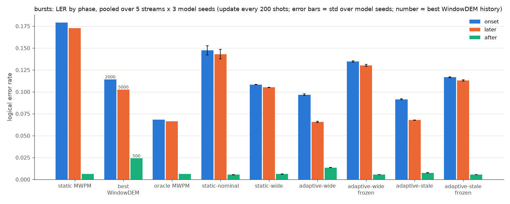
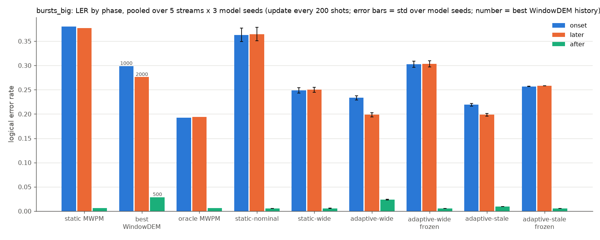
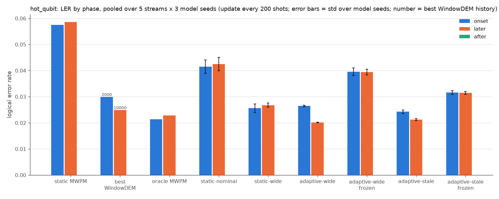
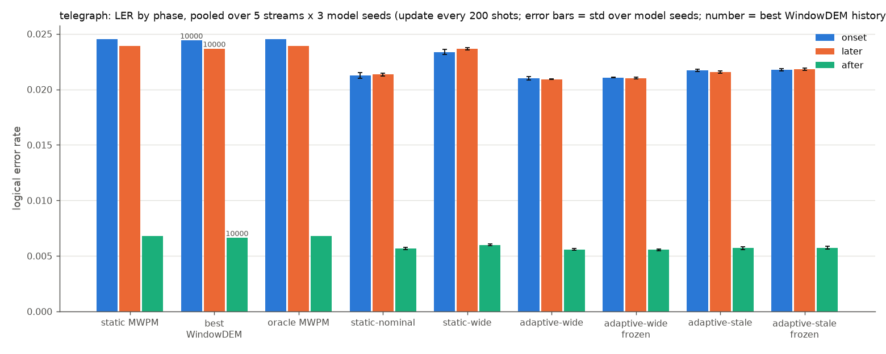

# d=3: frozen fingerprints, WindowDEM window sweep, pooled streams

Follows `02_d3_stale_fingerprint.md`. Tables are generated by `python report.py --data data/d3_wide --exp2` and written to `results/exp2/report2_tables.md`. Table cells that refer to "report 1" mean note 02.

## Summary

- (a) On localized drift, the adaptive models' advantage is adaptation, and more than all of it. On `bursts`, `bursts_big` and `hot_qubit`, the live fingerprint beats the same model with a frozen nominal fingerprint by a wide margin (bursts drift LER: adaptive-wide 0.0725 live vs 0.1311 frozen, p < 1e-300). Frozen, both adaptive models are worse than static-wide on drifted steps, so the "decoder part" of their gain is negative and adaptation makes up more than the whole gain. On `telegraph` (uniform scale changes), live and frozen tie: none of the gain there is adaptation.
- (b) The nominal-noise gap is static-wide's hedging cost. A static model trained only on nominal noise ties adaptive-wide on the nominal test set (0.00536 vs 0.00532, p = 0.4) and on scale x2 (p = 0.4). Static-wide is worse than both (0.00605). On nominal stream steps, static-wide is consistently worse than static-nominal (+0.0006 to +0.0007, every p < 1e-19). With a frozen nominal fingerprint, the adaptive models match the specialist on those steps.
- (c) A tuned WindowDEM is a better baseline than the 10000-shot one, but the adaptive models still beat its best setting in every phase of every regime. The best history depends on regime and phase: 2000 for bursts drift (0.1069 vs 0.1233 at 10000), 500 for after-burst steps, 10000 for `hot_qubit` and `telegraph`. Against the best window per phase (picked after the fact, which favours WindowDEM), adaptive-wide is lower on bursts drift by 0.034 and on bursts onset by 0.018 (p < 1e-40).
- Corrections to note 02. With 5 streams, adaptive-wide ties oracle MWPM on later burst steps (0.0656 vs 0.0663, p = 0.8), so "beats the oracle" from the single stream does not hold up. With 29 onsets instead of 7, adaptive-wide at update 200 is significantly better than static-wide at burst onset (0.0968 vs 0.1083, p = 5e-26); with 7 onsets this was a tie.
- Regressions that remain. The live fingerprint costs accuracy right after a burst ends and on nominal steps near bursts. On the after step, adaptive-wide is at 0.0136 vs 0.0061 for static-wide, and adaptive-stale is at 0.0076, still significantly worse than static-wide. Stale augmentation costs a little on steady drift (`hot_qubit` drift +0.0011, `telegraph` +0.0006, both p < 1e-11).

## Setup

| | |
|---|---|
| Code | rotated surface code memory-Z, d=3, 3 rounds, p=0.003, 24 detectors |
| Streams | `data/d3_r3_p0.003_s0`, manifest SHA-256 `698e5a7606150499…7491b948` after adding stream seeds 1–4 for `hot_qubit`, `bursts`, `bursts_big`, `telegraph`. The 11 files that already existed were checked byte-identical. Stream seed 0 is the original stream. 150 steps × 2000 shots per stream |
| Onsets pooled over 5 streams | bursts 29 (report 1: 7), bursts_big 29 (6), telegraph 21 (4), hot_qubit 5 (1; same schedule in every stream, fresh shots) |
| Models | static-nominal (new), static-wide, adaptive-wide, adaptive-stale; 3 model seeds each; same 3D CNN (hidden 48, 4 layers) |
| static-nominal training | `train.py --nominal-only --steps 60000 --seed s`: on the fly, every chunk NoiseState(), batch 512, AdamW lr 1e-3 OneCycle; same architecture and step count as the others. Logs: `results/exp2/train_static_d3_nominal_s*.log` |
| Test sets | `data/d3_wide` test sets (identical to D's), 200000 shots per state, per-shot error bits on GPU |
| Eval | update every 200 shots; WindowDEM histories 500, 1000, 2000, 5000, 10000 (min_shots = min(history, 1000)); frozen fingerprint = mean of D's nominal test-set fingerprint shots (2000 shots). 4 regimes × 5 streams × 3 model seeds = 60 runs |
| Device | neural decoders on GPU (`--device cuda`) for speed. Check against report 1's CPU runs on stream 0: MWPM and WindowDEM identical; neural decoders differ by at most 7 of 300000 shots per run (≈2e-5 LER, logits at the threshold). GPU runs are bit-reproducible |
| Versions | stim 1.16.0, pymatching 2.4.0, numpy 2.4.6, torch 2.15.0+cu132, Python 3.11.17, NVIDIA RTX 4050 Laptop GPU |

Reading the comparison cells.

- Example cell: `**-0.0115** p=5e-26 (3/3) tie`.
- The number is LER(a) − LER(b), averaged over model seeds. Negative means a is better.
- p is the largest exact two-sided McNemar p-value across the 3 model seeds. Each seed is tested on the same pooled shots for both decoders, so the test is paired.
- (k/3) is the number of seeds in which a had fewer errors.
- Bold means significant: every seed has p < 0.05 in the same direction.
- "tie" marks the 2-SE unpaired binomial rule from note 02, kept as a secondary column. The paired test is more sensitive, so a bold result can also carry "tie". Treat those as small but real.
- MWPM-vs-MWPM pairs are the same for every seed, so they are tested once (1/1).
- There are several hundred tests and no multiple-testing correction. Treat p between 0.001 and 0.05 with caution.

Decomposition. gain over static-wide = static-wide − live = (static-wide − frozen) + (frozen − live). The first term is the "decoder part": what the same network gets with a nominal fingerprint. The second is the "adaptation part": what the live fingerprint adds.

Phases are as in note 02, plus nominal (all nominal steps). In `bursts`, 4 of the 33 bursts start right after another one; by the onset definition those count as later. In `bursts_big`, 8 of 29 bursts are ones where even oracle MWPM is above LER 0.4, which dilutes every comparison there.

## Test sets (fixed noise)

| decoder | nominal | scale x2 | 2 hot qubits |
|---|---|---|---|
| static MWPM | 0.00648 | 0.02433 | 0.05803 |
| oracle MWPM | 0.00648 | 0.02433 | 0.02269 |
| static-nominal | 0.00536 ± 0.00009 | 0.02150 ± 0.00027 | 0.04195 ± 0.00267 |
| static-wide | 0.00605 ± 0.00003 | 0.02390 ± 0.00011 | 0.02661 ± 0.00078 |
| adaptive-wide | 0.00532 ± 0.00001 | 0.02127 ± 0.00013 | 0.01985 ± 0.00016 |
| adaptive-stale | 0.00554 ± 0.00003 | 0.02164 ± 0.00014 | 0.02106 ± 0.00049 |

| a vs b | nominal | scale x2 | 2 hot qubits |
|---|---|---|---|
| adaptive-wide vs static-nominal | -0.0000 p=0.4 (2/3) tie | -0.0002 p=0.4 (3/3) tie | **-0.0221** p<1e-300 (3/3) |
| adaptive-stale vs static-nominal | +0.0002 p=0.3 (0/3) tie | +0.0001 p=0.2 (1/3) tie | **-0.0209** p<1e-300 (3/3) |
| static-wide vs static-nominal | **+0.0007** p=1e-08 (0/3) | **+0.0024** p=2e-24 (0/3) | **-0.0153** p<1e-300 (3/3) |
| static-nominal vs static MWPM | **-0.0011** p=6e-19 (3/3) | **-0.0028** p=5e-29 (3/3) | **-0.0161** p=1e-253 (3/3) |
| adaptive-wide vs static-wide | **-0.0007** p=1e-11 (3/3) | **-0.0026** p=1e-33 (3/3) | **-0.0068** p=4e-119 (3/3) |

static-nominal is the best static model on nominal and scale x2 noise, as good as adaptive-wide there. It is poor on localized noise (2 hot qubits: 0.042, vs 0.027 for static-wide). The tables in the `train.py` logs use fresh samples, not the saved test sets, so their numbers differ slightly.

## Results per regime (pooled over 5 streams × 3 model seeds, update every 200 shots)

Each regime has the LER table (± = std over model seeds), paired comparisons, the decoder-vs-adaptation split, the WindowDEM history sweep and a phase bar chart in which WindowDEM is shown at its best history for each phase (the number above the bar).

### bursts

Pooled over 5 streams: drift 132 steps, onset 29 steps, later 103 steps, after 28 steps, nominal 618 steps.

| decoder | LER | LER (drift) | onset | later | after | nominal |
|---|---|---|---|---|---|---|
| static MWPM | 0.03610 | 0.17419 | 0.17921 | 0.17278 | 0.00648 | 0.00661 |
| WindowDEM-500 | 0.03568 | 0.12629 | 0.13533 | 0.12375 | 0.02423 | 0.01632 |
| WindowDEM-1000 | 0.02963 | 0.11598 | 0.12450 | 0.11358 | 0.02486 | 0.01119 |
| WindowDEM-2000 | 0.02646 | 0.10687 | 0.11428 | 0.10479 | 0.03650 | 0.00928 |
| WindowDEM-5000 | 0.02705 | 0.10812 | 0.12745 | 0.10268 | 0.03936 | 0.00973 |
| WindowDEM-10000 | 0.03137 | 0.12331 | 0.13714 | 0.11942 | 0.03716 | 0.01173 |
| oracle MWPM | 0.01718 | 0.06667 | 0.06812 | 0.06626 | 0.00648 | 0.00661 |
| static-nominal | 0.02993 ± 0.00097 | 0.14400 ± 0.00539 | 0.14733 ± 0.00512 | 0.14306 ± 0.00549 | 0.00549 ± 0.00012 | 0.00557 ± 0.00002 |
| static-wide | 0.02374 ± 0.00003 | 0.10579 ± 0.00013 | 0.10832 ± 0.00019 | 0.10507 ± 0.00018 | 0.00614 ± 0.00004 | 0.00622 ± 0.00001 |
| adaptive-wide | 0.01761 ± 0.00014 | 0.07246 ± 0.00062 | 0.09678 ± 0.00095 | 0.06561 ± 0.00061 | 0.01355 ± 0.00022 | 0.00590 ± 0.00004 |
| adaptive-wide frozen | 0.02764 ± 0.00021 | 0.13112 ± 0.00100 | 0.13465 ± 0.00089 | 0.13013 ± 0.00104 | 0.00561 ± 0.00003 | 0.00554 ± 0.00004 |
| adaptive-stale | 0.01760 ± 0.00003 | 0.07297 ± 0.00016 | 0.09156 ± 0.00041 | 0.06774 ± 0.00022 | 0.00756 ± 0.00013 | 0.00577 ± 0.00001 |
| adaptive-stale frozen | 0.02475 ± 0.00012 | 0.11393 ± 0.00067 | 0.11661 ± 0.00043 | 0.11317 ± 0.00078 | 0.00564 ± 0.00008 | 0.00570 ± 0.00001 |

#### Paired comparisons: bursts

| a vs b | drift | onset | later | after | nominal |
|---|---|---|---|---|---|
| adaptive-wide vs adaptive-wide frozen | **-0.0587** p<1e-300 (3/3) | **-0.0379** p<1e-300 (3/3) | **-0.0645** p<1e-300 (3/3) | **+0.0079** p=6e-86 (0/3) | **+0.0004** p=4e-60 (0/3) |
| adaptive-stale vs adaptive-stale frozen | **-0.0410** p<1e-300 (3/3) | **-0.0251** p=2e-213 (3/3) | **-0.0454** p<1e-300 (3/3) | **+0.0019** p=1e-12 (0/3) | **+0.0001** p=0.0003 (0/3) tie |
| adaptive-wide vs static-wide | **-0.0333** p<1e-300 (3/3) | **-0.0115** p=5e-26 (3/3) | **-0.0395** p<1e-300 (3/3) | **+0.0074** p=2e-70 (0/3) | **-0.0003** p=1e-09 (3/3) |
| adaptive-stale vs static-wide | **-0.0328** p<1e-300 (3/3) | **-0.0168** p=7e-87 (3/3) | **-0.0373** p<1e-300 (3/3) | **+0.0014** p=3e-07 (0/3) | **-0.0004** p=6e-33 (3/3) |
| adaptive-wide frozen vs static-wide | **+0.0253** p<1e-300 (0/3) | **+0.0263** p=6e-141 (0/3) | **+0.0251** p<1e-300 (0/3) | **-0.0005** p=0.02 (3/3) tie | **-0.0007** p=1e-53 (3/3) |
| adaptive-stale frozen vs static-wide | **+0.0081** p=6e-116 (0/3) | **+0.0083** p=5e-28 (0/3) | **+0.0081** p=1e-89 (0/3) | **-0.0005** p=0.02 (3/3) tie | **-0.0005** p=2e-53 (3/3) |
| adaptive-stale vs adaptive-wide | +0.0005 p=0.3 (1/3) tie | **-0.0052** p=2e-09 (3/3) | **+0.0021** p=2e-05 (0/3) | **-0.0060** p=1e-67 (3/3) | **-0.0001** p=0.02 (3/3) tie |
| adaptive-wide vs static-nominal | **-0.0715** p<1e-300 (3/3) | **-0.0505** p<1e-300 (3/3) | **-0.0775** p<1e-300 (3/3) | **+0.0081** p=1e-85 (0/3) | **+0.0003** p=5e-21 (0/3) |
| adaptive-stale vs static-nominal | **-0.0710** p<1e-300 (3/3) | **-0.0558** p<1e-300 (3/3) | **-0.0753** p<1e-300 (3/3) | **+0.0021** p=2e-12 (0/3) | **+0.0002** p=2e-07 (0/3) |
| static-wide vs static-nominal | **-0.0382** p<1e-300 (3/3) | **-0.0390** p=9e-206 (3/3) | **-0.0380** p<1e-300 (3/3) | **+0.0006** p=0.01 (0/3) tie | **+0.0007** p=2e-47 (0/3) |
| adaptive-wide vs best WindowDEM | **-0.0344** p<1e-300 (3/3) | **-0.0175** p=2e-42 (3/3) | **-0.0371** p<1e-300 (3/3) | **-0.0107** p=4e-62 (3/3) | **-0.0034** p<1e-300 (3/3) |
| adaptive-stale vs best WindowDEM | **-0.0339** p<1e-300 (3/3) | **-0.0227** p=3e-79 (3/3) | **-0.0349** p<1e-300 (3/3) | **-0.0167** p=2e-176 (3/3) | **-0.0035** p<1e-300 (3/3) |
| adaptive-wide vs oracle MWPM | **+0.0058** p=9e-36 (0/3) | **+0.0287** p=4e-137 (0/3) | -0.0006 p=0.8 (3/3) tie | **+0.0071** p=1e-56 (0/3) | **-0.0007** p=7e-40 (3/3) |
| adaptive-stale vs oracle MWPM | **+0.0063** p=8e-46 (0/3) | **+0.0234** p=3e-98 (0/3) | **+0.0015** p=0.008 (0/3) tie | **+0.0011** p=0.002 (0/3) | **-0.0008** p=3e-53 (3/3) |
| best WindowDEM vs static MWPM | **-0.0673** p<1e-300 (1/1) | **-0.0649** p<1e-300 (1/1) | **-0.0701** p<1e-300 (1/1) | **+0.0177** p=5e-215 (0/1) | **+0.0027** p<1e-300 (0/1) |

#### Decoder vs adaptation: bursts

| model | phase | static-wide | frozen | live | gain over static-wide | decoder part | adaptation part | live vs frozen (McNemar) |
|---|---|---|---|---|---|---|---|---|
| adaptive-wide | drift | 0.10579 | 0.13112 | 0.07246 | +0.03332 | -0.02534 | +0.05866 | **-0.0587** p<1e-300 (3/3) |
| adaptive-wide | onset | 0.10832 | 0.13465 | 0.09678 | +0.01154 | -0.02633 | +0.03787 | **-0.0379** p<1e-300 (3/3) |
| adaptive-wide | later | 0.10507 | 0.13013 | 0.06561 | +0.03946 | -0.02506 | +0.06452 | **-0.0645** p<1e-300 (3/3) |
| adaptive-wide | after | 0.00614 | 0.00561 | 0.01355 | -0.00742 | +0.00053 | -0.00795 | **+0.0079** p=6e-86 (0/3) |
| adaptive-wide | nominal | 0.00622 | 0.00554 | 0.00590 | +0.00032 | +0.00068 | -0.00036 | **+0.0004** p=4e-60 (0/3) |
| adaptive-stale | drift | 0.10579 | 0.11393 | 0.07297 | +0.03281 | -0.00814 | +0.04095 | **-0.0410** p<1e-300 (3/3) |
| adaptive-stale | onset | 0.10832 | 0.11661 | 0.09156 | +0.01676 | -0.00829 | +0.02505 | **-0.0251** p=2e-213 (3/3) |
| adaptive-stale | later | 0.10507 | 0.11317 | 0.06774 | +0.03733 | -0.00810 | +0.04543 | **-0.0454** p<1e-300 (3/3) |
| adaptive-stale | after | 0.00614 | 0.00564 | 0.00756 | -0.00142 | +0.00049 | -0.00192 | **+0.0019** p=1e-12 (0/3) |
| adaptive-stale | nominal | 0.00622 | 0.00570 | 0.00577 | +0.00044 | +0.00052 | -0.00007 | **+0.0001** p=0.0003 (0/3) tie |

#### WindowDEM history: bursts

| phase | w=500 | w=1000 | w=2000 | w=5000 | w=10000 | best |
|---|---|---|---|---|---|---|
| drift | 0.12629 | 0.11598 | 0.10687 | 0.10812 | 0.12331 | 2000 |
| onset | 0.13533 | 0.12450 | 0.11428 | 0.12745 | 0.13714 | 2000 |
| later | 0.12375 | 0.11358 | 0.10479 | 0.10268 | 0.11942 | 5000 |
| after | 0.02423 | 0.02486 | 0.03650 | 0.03936 | 0.03716 | 500 |
| nominal | 0.01632 | 0.01119 | 0.00928 | 0.00973 | 0.01173 | 2000 |



### bursts_big

Pooled over 5 streams: drift 116 steps, onset 29 steps, later 87 steps, after 29 steps, nominal 634 steps.

| decoder | LER | LER (drift) | onset | later | after | nominal |
|---|---|---|---|---|---|---|
| static MWPM | 0.06395 | 0.37778 | 0.38045 | 0.37690 | 0.00655 | 0.00653 |
| WindowDEM-500 | 0.05852 | 0.28885 | 0.30269 | 0.28424 | 0.02881 | 0.01638 |
| WindowDEM-1000 | 0.05462 | 0.29021 | 0.29888 | 0.28732 | 0.03414 | 0.01151 |
| WindowDEM-2000 | 0.05259 | 0.28482 | 0.31117 | 0.27604 | 0.05721 | 0.01010 |
| WindowDEM-5000 | 0.05470 | 0.28829 | 0.31840 | 0.27825 | 0.05660 | 0.01196 |
| WindowDEM-10000 | 0.06347 | 0.31874 | 0.31493 | 0.32001 | 0.05536 | 0.01676 |
| oracle MWPM | 0.03548 | 0.19375 | 0.19264 | 0.19411 | 0.00655 | 0.00653 |
| static-nominal | 0.06096 ± 0.00216 | 0.36411 ± 0.01379 | 0.36292 ± 0.01392 | 0.36451 ± 0.01375 | 0.00518 ± 0.00003 | 0.00549 ± 0.00003 |
| static-wide | 0.04379 ± 0.00084 | 0.24955 ± 0.00547 | 0.24857 ± 0.00565 | 0.24988 ± 0.00541 | 0.00590 ± 0.00010 | 0.00614 ± 0.00002 |
| adaptive-wide | 0.03736 ± 0.00065 | 0.20712 ± 0.00420 | 0.23326 ± 0.00432 | 0.19840 ± 0.00437 | 0.02359 ± 0.00076 | 0.00630 ± 0.00006 |
| adaptive-wide frozen | 0.05154 ± 0.00095 | 0.30341 ± 0.00628 | 0.30262 ± 0.00626 | 0.30367 ± 0.00630 | 0.00518 ± 0.00007 | 0.00546 ± 0.00004 |
| adaptive-stale | 0.03639 ± 0.00039 | 0.20366 ± 0.00261 | 0.21901 ± 0.00252 | 0.19854 ± 0.00268 | 0.00931 ± 0.00022 | 0.00579 ± 0.00004 |
| adaptive-stale frozen | 0.04462 ± 0.00004 | 0.25777 ± 0.00009 | 0.25691 ± 0.00060 | 0.25805 ± 0.00008 | 0.00540 ± 0.00009 | 0.00562 ± 0.00004 |

#### Paired comparisons: bursts_big

| a vs b | drift | onset | later | after | nominal |
|---|---|---|---|---|---|
| adaptive-wide vs adaptive-wide frozen | **-0.0963** p<1e-300 (3/3) | **-0.0694** p<1e-300 (3/3) | **-0.1053** p<1e-300 (3/3) | **+0.0184** p=7e-247 (0/3) | **+0.0008** p=2e-200 (0/3) |
| adaptive-stale vs adaptive-stale frozen | **-0.0541** p<1e-300 (3/3) | **-0.0379** p=1e-209 (3/3) | **-0.0595** p<1e-300 (3/3) | **+0.0039** p=2e-38 (0/3) | **+0.0002** p=4e-21 (0/3) tie |
| adaptive-wide vs static-wide | **-0.0424** p<1e-300 (3/3) | **-0.0153** p=3e-08 (3/3) | **-0.0515** p<1e-300 (3/3) | **+0.0177** p=2e-220 (0/3) | **+0.0002** p=0.01 (0/3) tie |
| adaptive-stale vs static-wide | **-0.0459** p<1e-300 (3/3) | **-0.0296** p=3e-82 (3/3) | **-0.0513** p<1e-300 (3/3) | **+0.0034** p=4e-26 (0/3) | **-0.0004** p=3e-17 (3/3) |
| adaptive-wide frozen vs static-wide | **+0.0539** p<1e-300 (0/3) | **+0.0540** p=2e-155 (0/3) | **+0.0538** p<1e-300 (0/3) | **-0.0007** p=0.0009 (3/3) tie | **-0.0007** p=2e-53 (3/3) |
| adaptive-stale frozen vs static-wide | **+0.0082** p=0.0009 (0/3) | +0.0083 p=0.08 (0/3) | **+0.0082** p=0.005 (0/3) | **-0.0005** p=0.04 (3/3) tie | **-0.0005** p=6e-50 (3/3) |
| adaptive-stale vs adaptive-wide | -0.0035 p=0.04 (2/3) | **-0.0143** p=7e-11 (3/3) | +0.0001 p=6e-05 (1/3) tie | **-0.0143** p=3e-176 (3/3) | **-0.0005** p=2e-28 (3/3) |
| adaptive-wide vs static-nominal | **-0.1570** p<1e-300 (3/3) | **-0.1297** p<1e-300 (3/3) | **-0.1661** p<1e-300 (3/3) | **+0.0184** p=3e-243 (0/3) | **+0.0008** p=2e-96 (0/3) |
| adaptive-stale vs static-nominal | **-0.1605** p<1e-300 (3/3) | **-0.1439** p<1e-300 (3/3) | **-0.1660** p<1e-300 (3/3) | **+0.0041** p=4e-36 (0/3) | **+0.0003** p=4e-12 (0/3) |
| static-wide vs static-nominal | **-0.1146** p<1e-300 (3/3) | **-0.1143** p<1e-300 (3/3) | **-0.1146** p<1e-300 (3/3) | **+0.0007** p=0.002 (0/3) tie | **+0.0006** p=5e-47 (0/3) |
| adaptive-wide vs best WindowDEM | **-0.0777** p<1e-300 (3/3) | **-0.0656** p=2e-208 (3/3) | **-0.0776** p<1e-300 (3/3) | **-0.0052** p=2e-10 (3/3) | **-0.0038** p<1e-300 (3/3) |
| adaptive-stale vs best WindowDEM | **-0.0812** p<1e-300 (3/3) | **-0.0799** p<1e-300 (3/3) | **-0.0775** p<1e-300 (3/3) | **-0.0195** p=9e-192 (3/3) | **-0.0043** p<1e-300 (3/3) |
| adaptive-wide vs oracle MWPM | **+0.0134** p=2e-57 (0/3) | **+0.0406** p=3e-135 (0/3) | +0.0043 p=0.4 (0/3) | **+0.0170** p=9e-180 (0/3) | **-0.0002** p=0.003 (3/3) |
| adaptive-stale vs oracle MWPM | **+0.0099** p=2e-34 (0/3) | **+0.0264** p=2e-65 (0/3) | **+0.0044** p=0.0004 (0/3) | **+0.0028** p=1e-12 (0/3) | **-0.0007** p=2e-38 (3/3) |
| best WindowDEM vs static MWPM | **-0.0930** p<1e-300 (1/1) | **-0.0816** p=3e-269 (1/1) | **-0.1009** p<1e-300 (1/1) | **+0.0223** p=1e-281 (0/1) | **+0.0036** p<1e-300 (0/1) |

#### Decoder vs adaptation: bursts_big

| model | phase | static-wide | frozen | live | gain over static-wide | decoder part | adaptation part | live vs frozen (McNemar) |
|---|---|---|---|---|---|---|---|---|
| adaptive-wide | drift | 0.24955 | 0.30341 | 0.20712 | +0.04244 | -0.05386 | +0.09629 | **-0.0963** p<1e-300 (3/3) |
| adaptive-wide | onset | 0.24857 | 0.30262 | 0.23326 | +0.01531 | -0.05405 | +0.06936 | **-0.0694** p<1e-300 (3/3) |
| adaptive-wide | later | 0.24988 | 0.30367 | 0.19840 | +0.05148 | -0.05380 | +0.10527 | **-0.1053** p<1e-300 (3/3) |
| adaptive-wide | after | 0.00590 | 0.00518 | 0.02359 | -0.01769 | +0.00071 | -0.01840 | **+0.0184** p=7e-247 (0/3) |
| adaptive-wide | nominal | 0.00614 | 0.00546 | 0.00630 | -0.00016 | +0.00069 | -0.00085 | **+0.0008** p=2e-200 (0/3) |
| adaptive-stale | drift | 0.24955 | 0.25777 | 0.20366 | +0.04590 | -0.00822 | +0.05411 | **-0.0541** p<1e-300 (3/3) |
| adaptive-stale | onset | 0.24857 | 0.25691 | 0.21901 | +0.02957 | -0.00834 | +0.03791 | **-0.0379** p=1e-209 (3/3) |
| adaptive-stale | later | 0.24988 | 0.25805 | 0.19854 | +0.05134 | -0.00817 | +0.05951 | **-0.0595** p<1e-300 (3/3) |
| adaptive-stale | after | 0.00590 | 0.00540 | 0.00931 | -0.00341 | +0.00050 | -0.00391 | **+0.0039** p=2e-38 (0/3) |
| adaptive-stale | nominal | 0.00614 | 0.00562 | 0.00579 | +0.00035 | +0.00052 | -0.00017 | **+0.0002** p=4e-21 (0/3) tie |

#### WindowDEM history: bursts_big

| phase | w=500 | w=1000 | w=2000 | w=5000 | w=10000 | best |
|---|---|---|---|---|---|---|
| drift | 0.28885 | 0.29021 | 0.28482 | 0.28829 | 0.31874 | 2000 |
| onset | 0.30269 | 0.29888 | 0.31117 | 0.31840 | 0.31493 | 1000 |
| later | 0.28424 | 0.28732 | 0.27604 | 0.27825 | 0.32001 | 2000 |
| after | 0.02881 | 0.03414 | 0.05721 | 0.05660 | 0.05536 | 500 |
| nominal | 0.01638 | 0.01151 | 0.01010 | 0.01196 | 0.01676 | 2000 |



### hot_qubit

Pooled over 5 streams: drift 500 steps, onset 5 steps, later 495 steps, after 0 steps, nominal 250 steps.

| decoder | LER | LER (drift) | onset | later | after | nominal |
|---|---|---|---|---|---|---|
| static MWPM | 0.04131 | 0.05863 | 0.05750 | 0.05864 | – | 0.00667 |
| WindowDEM-500 | 0.03412 | 0.04312 | 0.04730 | 0.04308 | – | 0.01612 |
| WindowDEM-1000 | 0.02843 | 0.03731 | 0.03690 | 0.03731 | – | 0.01068 |
| WindowDEM-2000 | 0.02417 | 0.03228 | 0.02990 | 0.03230 | – | 0.00797 |
| WindowDEM-5000 | 0.02047 | 0.02732 | 0.03210 | 0.02727 | – | 0.00678 |
| WindowDEM-10000 | 0.01887 | 0.02499 | 0.03690 | 0.02487 | – | 0.00662 |
| oracle MWPM | 0.01745 | 0.02285 | 0.02140 | 0.02286 | – | 0.00667 |
| static-nominal | 0.03018 ± 0.00168 | 0.04248 ± 0.00253 | 0.04147 ± 0.00257 | 0.04249 ± 0.00253 | – | 0.00556 ± 0.00002 |
| static-wide | 0.01992 ± 0.00054 | 0.02678 ± 0.00082 | 0.02560 ± 0.00167 | 0.02679 ± 0.00082 | – | 0.00620 ± 0.00004 |
| adaptive-wide | 0.01531 ± 0.00007 | 0.02020 ± 0.00011 | 0.02643 ± 0.00029 | 0.02013 ± 0.00010 | – | 0.00555 ± 0.00002 |
| adaptive-wide frozen | 0.02816 ± 0.00074 | 0.03949 ± 0.00110 | 0.03957 ± 0.00150 | 0.03948 ± 0.00110 | – | 0.00552 ± 0.00001 |
| adaptive-stale | 0.01608 ± 0.00026 | 0.02126 ± 0.00039 | 0.02423 ± 0.00067 | 0.02123 ± 0.00040 | – | 0.00572 ± 0.00002 |
| adaptive-stale frozen | 0.02288 ± 0.00038 | 0.03146 ± 0.00056 | 0.03160 ± 0.00075 | 0.03146 ± 0.00056 | – | 0.00573 ± 0.00003 |

#### Paired comparisons: hot_qubit

| a vs b | drift | onset | later | nominal |
|---|---|---|---|---|
| adaptive-wide vs adaptive-wide frozen | **-0.0193** p<1e-300 (3/3) | **-0.0131** p=1e-22 (3/3) | **-0.0194** p<1e-300 (3/3) | +0.0000 p=0.7 (0/3) tie |
| adaptive-stale vs adaptive-stale frozen | **-0.0102** p<1e-300 (3/3) | **-0.0074** p=1e-13 (3/3) | **-0.0102** p<1e-300 (3/3) | -0.0000 p=1 (2/3) tie |
| adaptive-wide vs static-wide | **-0.0066** p<1e-300 (3/3) | +0.0008 p=0.3 (1/3) tie | **-0.0067** p<1e-300 (3/3) | **-0.0007** p=4e-21 (3/3) |
| adaptive-stale vs static-wide | **-0.0055** p<1e-300 (3/3) | -0.0014 p=0.6 (3/3) tie | **-0.0056** p<1e-300 (3/3) | **-0.0005** p=3e-18 (3/3) |
| adaptive-wide frozen vs static-wide | **+0.0127** p<1e-300 (0/3) | **+0.0140** p=1e-16 (0/3) | **+0.0127** p<1e-300 (0/3) | **-0.0007** p=1e-24 (3/3) |
| adaptive-stale frozen vs static-wide | **+0.0047** p<1e-300 (0/3) | **+0.0060** p=9e-07 (0/3) | **+0.0047** p<1e-300 (0/3) | **-0.0005** p=1e-18 (3/3) |
| adaptive-stale vs adaptive-wide | **+0.0011** p=1e-13 (0/3) | -0.0022 p=0.09 (3/3) tie | **+0.0011** p=2e-14 (0/3) | **+0.0002** p=0.002 (0/3) tie |
| adaptive-wide vs static-nominal | **-0.0223** p<1e-300 (3/3) | **-0.0150** p=4e-21 (3/3) | **-0.0224** p<1e-300 (3/3) | -0.0000 p=0.9 (2/3) tie |
| adaptive-stale vs static-nominal | **-0.0212** p<1e-300 (3/3) | **-0.0172** p=7e-25 (3/3) | **-0.0213** p<1e-300 (3/3) | **+0.0002** p=0.009 (0/3) tie |
| static-wide vs static-nominal | **-0.0157** p<1e-300 (3/3) | **-0.0159** p=3e-19 (3/3) | **-0.0157** p<1e-300 (3/3) | **+0.0006** p=4e-20 (0/3) |
| adaptive-wide vs best WindowDEM | **-0.0048** p=3e-319 (3/3) | **-0.0035** p=0.04 (3/3) tie | **-0.0047** p=6e-310 (3/3) | **-0.0011** p=3e-47 (3/3) |
| adaptive-stale vs best WindowDEM | **-0.0037** p=5e-140 (3/3) | **-0.0057** p=0.0006 (3/3) | **-0.0036** p=1e-131 (3/3) | **-0.0009** p=5e-29 (3/3) |
| adaptive-wide vs oracle MWPM | **-0.0026** p=2e-108 (3/3) | **+0.0050** p=0.001 (0/3) | **-0.0027** p=1e-114 (3/3) | **-0.0011** p=5e-49 (3/3) |
| adaptive-stale vs oracle MWPM | **-0.0016** p=1e-20 (3/3) | +0.0028 p=0.1 (0/3) tie | **-0.0016** p=8e-22 (3/3) | **-0.0009** p=3e-30 (3/3) |
| best WindowDEM vs static MWPM | **-0.0336** p<1e-300 (1/1) | **-0.0276** p=8e-43 (1/1) | **-0.0338** p<1e-300 (1/1) | -0.0000 p=0.3 (1/1) tie |

#### Decoder vs adaptation: hot_qubit

| model | phase | static-wide | frozen | live | gain over static-wide | decoder part | adaptation part | live vs frozen (McNemar) |
|---|---|---|---|---|---|---|---|---|
| adaptive-wide | drift | 0.02678 | 0.03949 | 0.02020 | +0.00658 | -0.01271 | +0.01929 | **-0.0193** p<1e-300 (3/3) |
| adaptive-wide | onset | 0.02560 | 0.03957 | 0.02643 | -0.00083 | -0.01397 | +0.01313 | **-0.0131** p=1e-22 (3/3) |
| adaptive-wide | later | 0.02679 | 0.03948 | 0.02013 | +0.00666 | -0.01269 | +0.01935 | **-0.0194** p<1e-300 (3/3) |
| adaptive-wide | nominal | 0.00620 | 0.00552 | 0.00555 | +0.00066 | +0.00068 | -0.00002 | +0.0000 p=0.7 (0/3) tie |
| adaptive-stale | drift | 0.02678 | 0.03146 | 0.02126 | +0.00552 | -0.00468 | +0.01020 | **-0.0102** p<1e-300 (3/3) |
| adaptive-stale | onset | 0.02560 | 0.03160 | 0.02423 | +0.00137 | -0.00600 | +0.00737 | **-0.0074** p=1e-13 (3/3) |
| adaptive-stale | later | 0.02679 | 0.03146 | 0.02123 | +0.00556 | -0.00467 | +0.01023 | **-0.0102** p<1e-300 (3/3) |
| adaptive-stale | nominal | 0.00620 | 0.00573 | 0.00572 | +0.00048 | +0.00047 | +0.00001 | -0.0000 p=1 (2/3) tie |

#### WindowDEM history: hot_qubit

| phase | w=500 | w=1000 | w=2000 | w=5000 | w=10000 | best |
|---|---|---|---|---|---|---|
| drift | 0.04312 | 0.03731 | 0.03228 | 0.02732 | 0.02499 | 10000 |
| onset | 0.04730 | 0.03690 | 0.02990 | 0.03210 | 0.03690 | 2000 |
| later | 0.04308 | 0.03731 | 0.03230 | 0.02727 | 0.02487 | 10000 |
| after | – | – | – | – | – | – |
| nominal | 0.01612 | 0.01068 | 0.00797 | 0.00678 | 0.00662 | 10000 |



### telegraph

Pooled over 5 streams: drift 311 steps, onset 21 steps, later 290 steps, after 18 steps, nominal 439 steps.

| decoder | LER | LER (drift) | onset | later | after | nominal |
|---|---|---|---|---|---|---|
| static MWPM | 0.01368 | 0.02394 | 0.02455 | 0.02389 | 0.00681 | 0.00642 |
| WindowDEM-500 | 0.02469 | 0.03737 | 0.03983 | 0.03719 | 0.01597 | 0.01571 |
| WindowDEM-1000 | 0.01877 | 0.03044 | 0.03148 | 0.03036 | 0.01033 | 0.01051 |
| WindowDEM-2000 | 0.01542 | 0.02612 | 0.02757 | 0.02602 | 0.00825 | 0.00783 |
| WindowDEM-5000 | 0.01383 | 0.02411 | 0.02519 | 0.02403 | 0.00672 | 0.00654 |
| WindowDEM-10000 | 0.01357 | 0.02373 | 0.02443 | 0.02368 | 0.00664 | 0.00637 |
| oracle MWPM | 0.01369 | 0.02394 | 0.02455 | 0.02390 | 0.00681 | 0.00642 |
| static-nominal | 0.01206 ± 0.00005 | 0.02134 ± 0.00012 | 0.02126 ± 0.00027 | 0.02134 ± 0.00011 | 0.00567 ± 0.00011 | 0.00549 ± 0.00002 |
| static-wide | 0.01336 ± 0.00005 | 0.02365 ± 0.00011 | 0.02336 ± 0.00023 | 0.02367 ± 0.00011 | 0.00600 ± 0.00007 | 0.00607 ± 0.00001 |
| adaptive-wide | 0.01188 ± 0.00003 | 0.02093 ± 0.00003 | 0.02100 ± 0.00014 | 0.02093 ± 0.00004 | 0.00559 ± 0.00008 | 0.00547 ± 0.00002 |
| adaptive-wide frozen | 0.01191 ± 0.00005 | 0.02102 ± 0.00008 | 0.02107 ± 0.00002 | 0.02102 ± 0.00008 | 0.00555 ± 0.00009 | 0.00546 ± 0.00003 |
| adaptive-stale | 0.01224 ± 0.00003 | 0.02157 ± 0.00008 | 0.02171 ± 0.00010 | 0.02156 ± 0.00009 | 0.00571 ± 0.00013 | 0.00562 ± 0.00002 |
| adaptive-stale frozen | 0.01234 ± 0.00005 | 0.02182 ± 0.00011 | 0.02179 ± 0.00011 | 0.02182 ± 0.00011 | 0.00574 ± 0.00013 | 0.00562 ± 0.00001 |

#### Paired comparisons: telegraph

| a vs b | drift | onset | later | after | nominal |
|---|---|---|---|---|---|
| adaptive-wide vs adaptive-wide frozen | -0.0001 p=0.6 (3/3) tie | -0.0001 p=0.6 (2/3) tie | -0.0001 p=0.8 (3/3) tie | +0.0000 p=1 (0/3) tie | +0.0000 p=0.9 (1/3) tie |
| adaptive-stale vs adaptive-stale frozen | **-0.0002** p=0.001 (3/3) tie | -0.0001 p=1 (2/3) tie | **-0.0003** p=0.0009 (3/3) tie | -0.0000 p=1 (3/3) tie | +0.0000 p=1 (1/3) tie |
| adaptive-wide vs static-wide | **-0.0027** p=6e-107 (3/3) | **-0.0024** p=2e-06 (3/3) | **-0.0027** p=1e-100 (3/3) | -0.0004 p=0.3 (3/3) tie | **-0.0006** p=4e-32 (3/3) |
| adaptive-stale vs static-wide | **-0.0021** p=8e-80 (3/3) | **-0.0016** p=0.0001 (3/3) tie | **-0.0021** p=9e-77 (3/3) | -0.0003 p=0.8 (3/3) tie | **-0.0004** p=1e-29 (3/3) |
| adaptive-wide frozen vs static-wide | **-0.0026** p=2e-104 (3/3) | **-0.0023** p=5e-06 (3/3) | **-0.0027** p=1e-98 (3/3) | -0.0005 p=0.2 (3/3) tie | **-0.0006** p=8e-33 (3/3) |
| adaptive-stale frozen vs static-wide | **-0.0018** p=7e-72 (3/3) | **-0.0016** p=0.0003 (3/3) tie | **-0.0019** p=4e-69 (3/3) | -0.0003 p=0.9 (3/3) tie | **-0.0005** p=1e-31 (3/3) |
| adaptive-stale vs adaptive-wide | **+0.0006** p=4e-12 (0/3) | +0.0007 p=0.1 (0/3) tie | **+0.0006** p=2e-11 (0/3) | +0.0001 p=0.9 (0/3) tie | **+0.0002** p=0.002 (0/3) tie |
| adaptive-wide vs static-nominal | **-0.0004** p=8e-05 (3/3) tie | -0.0003 p=0.9 (3/3) tie | **-0.0004** p=5e-05 (3/3) tie | -0.0001 p=0.9 (3/3) tie | -0.0000 p=0.8 (3/3) tie |
| adaptive-stale vs static-nominal | +0.0002 p=0.8 (0/3) tie | +0.0005 p=0.6 (0/3) tie | +0.0002 p=0.9 (0/3) tie | +0.0000 p=1 (0/3) tie | **+0.0001** p=0.02 (0/3) tie |
| static-wide vs static-nominal | **+0.0023** p=4e-75 (0/3) | **+0.0021** p=5e-05 (0/3) | **+0.0023** p=3e-71 (0/3) | +0.0003 p=0.6 (0/3) tie | **+0.0006** p=3e-29 (0/3) |
| adaptive-wide vs best WindowDEM | **-0.0028** p=1e-112 (3/3) | **-0.0034** p=1e-11 (3/3) | **-0.0028** p=2e-101 (3/3) | **-0.0010** p=0.001 (3/3) tie | **-0.0009** p=3e-56 (3/3) |
| adaptive-stale vs best WindowDEM | **-0.0022** p=2e-56 (3/3) | **-0.0027** p=7e-07 (3/3) | **-0.0021** p=2e-50 (3/3) | **-0.0009** p=0.01 (3/3) tie | **-0.0007** p=4e-35 (3/3) |
| adaptive-wide vs oracle MWPM | **-0.0030** p=1e-121 (3/3) | **-0.0035** p=5e-12 (3/3) | **-0.0030** p=2e-110 (3/3) | **-0.0012** p=0.0001 (3/3) | **-0.0010** p=7e-60 (3/3) |
| adaptive-stale vs oracle MWPM | **-0.0024** p=5e-63 (3/3) | **-0.0028** p=6e-07 (3/3) | **-0.0023** p=6e-57 (3/3) | **-0.0011** p=0.004 (3/3) tie | **-0.0008** p=2e-37 (3/3) |
| best WindowDEM vs static MWPM | **-0.0002** p=0.001 (1/1) tie | -0.0001 p=0.7 (1/1) tie | **-0.0002** p=0.001 (1/1) tie | -0.0002 p=0.4 (1/1) tie | -0.0000 p=0.1 (1/1) tie |

#### Decoder vs adaptation: telegraph

| model | phase | static-wide | frozen | live | gain over static-wide | decoder part | adaptation part | live vs frozen (McNemar) |
|---|---|---|---|---|---|---|---|---|
| adaptive-wide | drift | 0.02365 | 0.02102 | 0.02093 | +0.00272 | +0.00263 | +0.00009 | -0.0001 p=0.6 (3/3) tie |
| adaptive-wide | onset | 0.02336 | 0.02107 | 0.02100 | +0.00236 | +0.00229 | +0.00007 | -0.0001 p=0.6 (2/3) tie |
| adaptive-wide | later | 0.02367 | 0.02102 | 0.02093 | +0.00275 | +0.00266 | +0.00009 | -0.0001 p=0.8 (3/3) tie |
| adaptive-wide | after | 0.00600 | 0.00555 | 0.00559 | +0.00041 | +0.00045 | -0.00005 | +0.0000 p=1 (0/3) tie |
| adaptive-wide | nominal | 0.00607 | 0.00546 | 0.00547 | +0.00060 | +0.00061 | -0.00001 | +0.0000 p=0.9 (1/3) tie |
| adaptive-stale | drift | 0.02365 | 0.02182 | 0.02157 | +0.00208 | +0.00183 | +0.00025 | **-0.0002** p=0.001 (3/3) tie |
| adaptive-stale | onset | 0.02336 | 0.02179 | 0.02171 | +0.00164 | +0.00157 | +0.00007 | -0.0001 p=1 (2/3) tie |
| adaptive-stale | later | 0.02367 | 0.02182 | 0.02156 | +0.00211 | +0.00185 | +0.00026 | **-0.0003** p=0.0009 (3/3) tie |
| adaptive-stale | after | 0.00600 | 0.00574 | 0.00571 | +0.00029 | +0.00026 | +0.00003 | -0.0000 p=1 (3/3) tie |
| adaptive-stale | nominal | 0.00607 | 0.00562 | 0.00562 | +0.00045 | +0.00045 | -0.00000 | +0.0000 p=1 (1/3) tie |

#### WindowDEM history: telegraph

| phase | w=500 | w=1000 | w=2000 | w=5000 | w=10000 | best |
|---|---|---|---|---|---|---|
| drift | 0.03737 | 0.03044 | 0.02612 | 0.02411 | 0.02373 | 10000 |
| onset | 0.03983 | 0.03148 | 0.02757 | 0.02519 | 0.02443 | 10000 |
| later | 0.03719 | 0.03036 | 0.02602 | 0.02403 | 0.02368 | 10000 |
| after | 0.01597 | 0.01033 | 0.00825 | 0.00672 | 0.00664 | 10000 |
| nominal | 0.01571 | 0.01051 | 0.00783 | 0.00654 | 0.00637 | 10000 |



## Questions

### a) Live vs frozen fingerprint: how much of the adaptive advantage is adaptation?

Drift LER (all off-nominal steps), pooled:

| regime | model | static-wide | frozen | live | live − frozen | McNemar p (max over seeds) | decoder part | adaptation part |
|---|---|---|---|---|---|---|---|---|
| bursts | adaptive-wide | 0.1058 | 0.1311 | 0.0725 | −0.0587 | < 1e-300 (3/3) | −0.0253 | +0.0587 |
| bursts | adaptive-stale | 0.1058 | 0.1139 | 0.0730 | −0.0410 | < 1e-300 (3/3) | −0.0081 | +0.0410 |
| bursts_big | adaptive-wide | 0.2496 | 0.3034 | 0.2071 | −0.0963 | < 1e-300 (3/3) | −0.0539 | +0.0963 |
| bursts_big | adaptive-stale | 0.2496 | 0.2578 | 0.2037 | −0.0541 | < 1e-300 (3/3) | −0.0082 | +0.0541 |
| hot_qubit | adaptive-wide | 0.0268 | 0.0395 | 0.0202 | −0.0193 | < 1e-300 (3/3) | −0.0127 | +0.0193 |
| hot_qubit | adaptive-stale | 0.0268 | 0.0315 | 0.0213 | −0.0102 | < 1e-300 (3/3) | −0.0047 | +0.0102 |
| telegraph | adaptive-wide | 0.0237 | 0.0210 | 0.0209 | −0.0001 | 0.6, tie | +0.0026 | +0.0001 |
| telegraph | adaptive-stale | 0.0237 | 0.0218 | 0.0216 | −0.0002 | 0.001 (3/3), 2-SE tie | +0.0018 | +0.0003 |

- Localized drift (bursts, bursts_big, hot_qubit)
  - The live fingerprint is essential. The same network with a nominal fingerprint is worse than static-wide on drifted steps. It has learned to rely on the fingerprint instead of hedging, so all of its advantage, and more, comes from adaptation.
  - Onset and later both show this. At burst onset, live beats frozen by 0.038 (adaptive-wide, p < 1e-300) and 0.025 (adaptive-stale, p = 2e-213). The fingerprint helps even though it is partly stale at onset.
  - Stale augmentation shrinks the frozen penalty (bursts drift frozen: 0.1139 vs 0.1311). The augmented model leans on the fingerprint less, so it degrades less when the fingerprint is wrong.
- Uniform scale drift (telegraph)
  - Live and frozen tie (adaptive-wide: p ≥ 0.6 in every phase).
  - The ~0.0027 gain over static-wide is entirely "decoder part". It equals what static-nominal gets (next question). Global scale changes do not need adaptation, consistent with MWPM, WindowDEM and oracle all tying on them.
- Where the live fingerprint loses
  - First nominal step after drift: on bursts, adaptive-wide is at 0.0136 live vs 0.0056 frozen (+0.0079, p = 6e-86); adaptive-stale at 0.0076 vs 0.0056 (+0.0019, p = 1e-12). bursts_big is similar.
  - All nominal steps: on bursts, adaptive-wide is +0.0004 (p = 4e-60); on bursts_big, +0.0008. These are the costs of a fingerprint that still remembers the burst.
  - Steady streams: on `hot_qubit` and `telegraph` nominal steps, live and frozen tie.

### b) Adaptive vs static-nominal: is the nominal gap a hedging cost?

Yes. On nominal noise, a specialist static model is as good as the adaptive model, and the wide static model is worse than both:

| comparison | nominal test set | scale x2 test set |
|---|---|---|
| adaptive-wide vs static-nominal | −0.0000 (0.00532 vs 0.00536), p = 0.4, tie | −0.0002, p = 0.4, tie |
| adaptive-stale vs static-nominal | +0.0002, p = 0.3, tie | +0.0001, p = 0.2, tie |
| static-wide vs static-nominal | **+0.0007** (0.00605 vs 0.00536), p = 1e-08 | **+0.0024**, p = 2e-24 |

On nominal stream steps (pooled):

| regime | static-nominal | static-wide | adaptive-wide | adaptive-wide frozen | adaptive-stale | adaptive-wide vs static-nominal | static-wide vs static-nominal |
|---|---|---|---|---|---|---|---|
| bursts | 0.00557 | 0.00622 | 0.00590 | 0.00554 | 0.00577 | **+0.0003**, p = 5e-21 | **+0.0007**, p = 2e-47 |
| bursts_big | 0.00549 | 0.00614 | 0.00630 | 0.00546 | 0.00579 | **+0.0008**, p = 2e-96 | **+0.0006**, p = 5e-47 |
| hot_qubit | 0.00556 | 0.00620 | 0.00555 | 0.00552 | 0.00572 | −0.0000, p = 0.9, tie | **+0.0006**, p = 4e-20 |
| telegraph | 0.00549 | 0.00607 | 0.00547 | 0.00546 | 0.00562 | −0.0000, p = 0.8, tie | **+0.0006**, p = 3e-29 |

- Static-wide pays about 13% on nominal noise (0.00605 vs 0.00536) for being robust to drift it cannot see. The adaptive model avoids that cost because its fingerprint tells it the noise is nominal; the frozen variants show the same thing.
- The live adaptive model loses it again on nominal steps near bursts (bursts, bursts_big), where its fingerprint is still recovering.
- static-nominal is not a usable drift decoder. It is the worst neural model on every drifted phase: bursts drift 0.144 vs 0.106 for static-wide, and 2 hot qubits 0.042.
- Training data differ. static-nominal was trained on fresh samples (about 31M distinct shots). The wide models reused a fixed set of 30000 chunks twice. Some of the gap could come from data reuse, not hedging. Training static-nominal on a fixed nominal dataset would settle it (see `04_d5_initial.md`).

### c) Best WindowDEM history, and the adaptive models against it

| regime | drift | onset | later | after | nominal |
|---|---|---|---|---|---|
| bursts | 2000 (0.1069; 10000: 0.1233) | 2000 (0.1143) | 5000 (0.1027) | 500 (0.0242) | 2000 (0.0093) |
| bursts_big | 2000 (0.2848; 10000: 0.3187) | 1000 (0.2989) | 2000 (0.2760) | 500 (0.0288) | 2000 (0.0101) |
| hot_qubit | 10000 (0.0250) | 2000 (0.0299) | 10000 (0.0249) | – | 10000 (0.0066) |
| telegraph | 10000 (0.0237) | 10000 (0.0244) | 10000 (0.0237) | 10000 (0.0066) | 10000 (0.0064) |

- No single history is best everywhere. Short windows help onset and the after step. Long windows help steady drift and nominal steps.
- The 10000-shot default was the worst or near-worst choice on bursts and bursts_big, so note 02 understated the classical baseline there. The tuned window is much better than static MWPM during drift (bursts drift 0.107 vs 0.174). It is still worse than static MWPM on nominal steps (bursts: 0.0093 vs 0.0066) and after bursts (0.0242 vs 0.0065), because the estimator is noisy.

Adaptive models vs the best history for each phase (paired):

| regime | model | drift | onset | later | after | nominal |
|---|---|---|---|---|---|---|
| bursts | adaptive-wide | **−0.0344**, p < 1e-300 | **−0.0175**, p = 2e-42 | **−0.0371**, p < 1e-300 | **−0.0107**, p = 4e-62 | **−0.0034**, p < 1e-300 |
| bursts | adaptive-stale | **−0.0339**, p < 1e-300 | **−0.0227**, p = 3e-79 | **−0.0349**, p < 1e-300 | **−0.0167**, p = 2e-176 | **−0.0035**, p < 1e-300 |
| bursts_big | adaptive-wide | **−0.0777**, p < 1e-300 | **−0.0656**, p = 2e-208 | **−0.0776**, p < 1e-300 | **−0.0052**, p = 2e-10 | **−0.0038**, p < 1e-300 |
| bursts_big | adaptive-stale | **−0.0812**, p < 1e-300 | **−0.0799**, p < 1e-300 | **−0.0775**, p < 1e-300 | **−0.0195**, p = 9e-192 | **−0.0043**, p < 1e-300 |
| hot_qubit | adaptive-wide | **−0.0048**, p = 3e-319 | **−0.0035**, p = 0.04 (2-SE tie) | **−0.0047**, p = 6e-310 | – | **−0.0011**, p = 3e-47 |
| hot_qubit | adaptive-stale | **−0.0037**, p = 5e-140 | **−0.0057**, p = 6e-4 | **−0.0036**, p = 1e-131 | – | **−0.0009**, p = 5e-29 |
| telegraph | adaptive-wide | **−0.0028**, p = 1e-112 | **−0.0034**, p = 1e-11 | **−0.0028**, p = 2e-101 | **−0.0010**, p = 0.001 (2-SE tie) | **−0.0009**, p = 3e-56 |
| telegraph | adaptive-stale | **−0.0022**, p = 2e-56 | **−0.0027**, p = 7e-7 | **−0.0021**, p = 2e-50 | **−0.0009**, p = 0.01 (2-SE tie) | **−0.0007**, p = 4e-35 |

- The adaptive models beat the best window everywhere.
- The weakest margin is `hot_qubit` onset (5 onset steps, p = 0.04). Read it as "at least as good".
- On `telegraph` the margin is decoder quality, not adaptation (see a).

## Corrections to note 02

| claim in report 1 (stream 0 only) | with 5 streams |
|---|---|
| adaptive-wide beats oracle MWPM on later burst steps (0.0527 vs 0.0581) | **tie**: 0.0656 vs 0.0663, p = 0.8 |
| at update 200, adaptive-wide ties static-wide at burst onset (0.0868 vs 0.0899) | adaptive-wide **better**: 0.0968 vs 0.1083, p = 5e-26 |
| adaptive-stale ties oracle on later burst steps | stale **slightly worse**: +0.0015, p = 0.008 (3/3), 2-SE tie |
| WindowDEM (10000 shots) is the classical sliding-window baseline | the 10000-shot window is not the best on bursts; tuned windows are clearly better (see c), but still lose to the adaptive models |
| stale beats static-wide at onset with update 200 | confirmed: 0.0916 vs 0.1083, p = 7e-87 |
| stale costs ~5% on steady localized drift | confirmed: hot_qubit drift +0.0011, p = 1e-13 |

## Conclusions

- The fingerprint does real work, and the network depends on it. On localized drift, almost all of the adaptive models' advantage disappears without a correct fingerprint, and then some. This is evidence of adaptation, not just a better decoder. It also means the adaptive models are only as good as their fingerprint: when it is wrong, they are worse than a hedging static model. Stale augmentation reduces that dependence (smaller frozen penalty) at a small steady-state cost.
- On global scale drift there is nothing to adapt to. Every telegraph advantage of the adaptive models is matched by a static model trained on nominal noise. Telegraph and wander should not be used as evidence for adaptation.
- The fingerprint's second benefit is avoiding the hedging cost. Static-wide gives up about 13% on nominal noise to stay robust. The adaptive model gets the specialist's nominal performance and the wide model's robustness. A frozen nominal fingerprint would give that too.
- The classical baseline is now fair, and still loses. Even with the history picked after the fact for each regime and phase, WindowDEM is far behind the adaptive models on localized drift. It is behind static MWPM on nominal steps.
- The remaining weak spot is the transition out of drift. After a burst, a live fingerprint that remembers the burst costs 0.002-0.008 LER on the next step, and some on nominal steps nearby. Stale augmentation helps but does not remove it.

## Open items

1. Fix the after-drift and near-burst nominal cost. Feed two fingerprints (a 200-shot and a 2000-shot window), or a short-window change signal, or fall back to the nominal fingerprint when the recent window looks nominal. The frozen results put the gain at about 0.0004-0.0008 LER on nominal steps near bursts and up to 0.008 on after steps.
2. Control for data reuse: train static-nominal (and a static-wide repeat) on fixed datasets with the same reuse as the wide models.
3. Retune the stale augmentation: bias the "other chunk" toward nominal noise and sweep `--stale-prob` (0.1 / 0.2). The aim is to keep the onset and after gains while shrinking the steady-state cost.
4. Give WindowDEM an online-tunable form, such as an exponentially weighted estimator, or two windows with a switch, and compare at matched update cost.
5. Use a pre-registered set of comparisons with a multiple-testing correction (for example Holm). Keep McNemar as the primary test.
6. Move `bursts_big` to d=5, or drop saturated clusters. 8 of its 29 bursts are unrecoverable at d=3.
7. Repeat at d=5, where the hedging cost and the value of the fingerprint may scale differently.

## Plots

Phase bar charts (onset, later, after), one per regime, embedded above:

- `bursts`: [results/exp2/report2_bursts_phases.png](../results/exp2/report2_bursts_phases.png)
- `bursts_big`: [results/exp2/report2_bursts_big_phases.png](../results/exp2/report2_bursts_big_phases.png)
- `hot_qubit`: [results/exp2/report2_hot_qubit_phases.png](../results/exp2/report2_hot_qubit_phases.png)
- `telegraph`: [results/exp2/report2_telegraph_phases.png](../results/exp2/report2_telegraph_phases.png)

Each eval run also writes its own per-step plot, `results/exp2/<regime>_d3_r3_u200_st<stream>_s<seed>.png`.

## Reproduce

```
python train.py --nominal-only --steps 60000 --seed 0 --out decoder_static_d3_nominal_s0.pt   # also seeds 1, 2
python make_dataset.py --streams-only --name d3_r3_p0.003_s0 --stream-seeds 1,2,3,4 --regimes hot_qubit,bursts,bursts_big,telegraph
for r in bursts bursts_big hot_qubit telegraph; do for st in 0 1 2 3 4; do for s in 0 1 2; do
  python eval.py --data data/d3_r3_p0.003_s0 --regime $r --stream-seed $st --update-every 200 --tag s$s \
    --device cuda --frozen-fingerprint --window-sizes 500,1000,2000,5000,10000 \
    --checkpoint decoder_static_d3_wide_s$s.pt --checkpoint decoder_static_d3_nominal_s$s.pt \
    --checkpoint decoder_adaptive_d3_wide_s$s.pt --checkpoint decoder_adaptive_d3_stale_s$s.pt --out results/exp2
done; done; done
python report.py --data data/d3_wide --exp2
```
