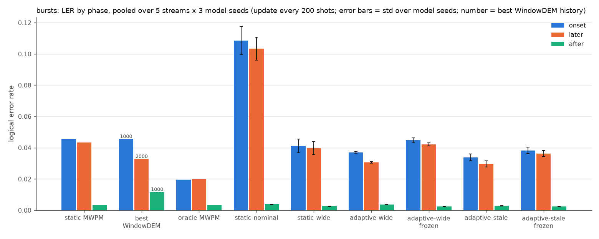
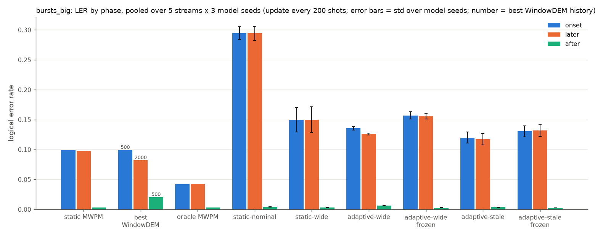
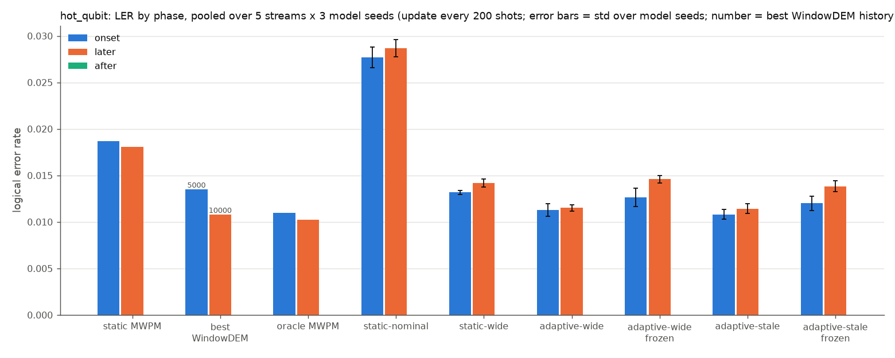
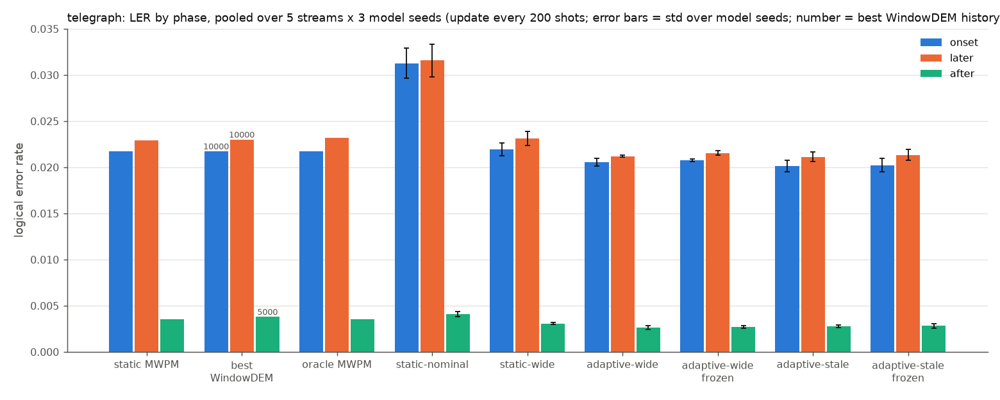

# d=5: initial results, data-reuse control, decode latency

Follows `03_d3_controls.md`. Tables are generated by `python report.py --exp2 --distance 5 --seeds 0,1,2` (`results/exp3/d5/report3_tables.md`) and `python report.py --exp3 --seeds 0,1,2` (`results/exp3/report3_extra.md`). Table cells that refer to "report 2" mean note 03.

## Summary

- Data reuse explains none of the d=3 nominal gap. static-nominal trained on a fixed nominal dataset (same size and reuse as the wide models) ties the on-the-fly one on the nominal test set (+0.0001, p = 0.9) and on nominal stream steps (pooled over 4 regimes: −0.0000, p = 0.5). static-wide is still worse than it (+0.0006, p = 7e-08). The hedging-cost reading of note 03 stands at d=3.
- At d=5 the adaptive models still use their fingerprint, but much less. Live beats frozen on localized drift in every regime and every seed, p < 1e-260. The effect is about 5× smaller than at d=3 (bursts drift −0.0107 vs −0.0587).
- The d=5 static-nominal model is broken, so claim 2 fails at d=5. Trained on the fixed nominal dataset, it is worse than static MWPM on nominal noise (0.00400 vs 0.00329, 3/3 seeds) and worse than static-wide (0.00281). Static-wide pays almost no hedging cost at d=5: 0.00281 vs 0.00260 for adaptive-wide, p = 0.05.
- The classical baselines win back two regimes at d=5. On `bursts_big` drift, static MWPM (0.098) and the best WindowDEM (0.090) beat every neural model (adaptive-wide 0.128, static-wide 0.150, adaptive-stale 0.118). On steady `hot_qubit` drift, WindowDEM-10000 is slightly better than adaptive-wide (+0.0007, p = 2e-05). Adaptive-wide is now behind oracle MWPM on later steps of every localized regime.
- Telegraph is unchanged: live and frozen still tie, within 0.0003.
- Reproducibility across machines is exact. The `bursts` / stream 0 / seed 0 eval from note 03 reproduces bit for bit on the L4, neural decoders included (0 of 300000 shots differ for all 13 decoders).
- Latency (cloud VM, not a real-time claim). MWPM is the fastest decoder at both distances. At d=5 with batch 4096, MWPM takes 1.85 µs/shot on CPU. The neural decoders take 10-11 µs/shot on the L4 and 290 µs/shot on CPU. WindowDEM's reweighting costs 2.4-8.6 ms per update at d=5, which amortises to 12-43 µs/shot when updating every 200 shots. That is more than the decode itself.

## Headline claims: d=3 vs d=5

| # | claim (report 2, d=3) | d=3 | d=5 | verdict at d=5 |
|---|---|---|---|---|
| 1 | Live beats frozen on localized drift (bursts, bursts_big, hot_qubit), and frozen is worse than static-wide | live − frozen drift: −0.0587 / −0.0963 / −0.0193, all p < 1e-300 (3/3); frozen − static-wide: +0.025 / +0.054 / +0.013 (3/3) | live − frozen: **−0.0107 / −0.0277 / −0.0031**, p ≤ 2e-263 (3/3); frozen − static-wide: +0.0026 (1/3 seeds) / +0.0062 (1/3) / +0.0004 p = 0.0007 (3/3) | **holds** (live vs frozen); about 5× smaller. "Frozen is worse than static-wide" **weakens**: not consistent across seeds on bursts and bursts_big |
| 2 | Adaptive-wide ties static-nominal on nominal noise; static-wide's gap is hedging cost | adaptive − static-nominal: −0.0000 p = 0.4, tie; static-wide − static-nominal +0.0007 p = 1e-08 | adaptive − static-nominal: **−0.0014** p = 5e-24 (3/3); static-wide − static-nominal **−0.0012** p = 6e-16; adaptive − static-wide −0.0002 p = 0.05, tie | **fails**: the specialist is worse than MWPM at d=5, and static-wide pays no significant hedging cost |
| 3 | Adaptive-wide beats the best WindowDEM in every phase of every regime | 19 better, 0 tie, 0 worse | 12 better, 2 tie, **5 worse** (bursts_big drift/onset/later +0.036 to +0.044; hot_qubit drift/later +0.0007) | **fails** on bursts_big and hot_qubit drift; holds on bursts and telegraph |
| 4 | Adaptive-wide matches or beats oracle MWPM on later drift steps | bursts tie (p = 0.8), bursts_big +0.0043 p = 0.4, hot_qubit −0.0027, telegraph −0.0030 | bursts **+0.0109**, bursts_big **+0.0831**, hot_qubit **+0.0013** (all p ≤ 2e-21, 0/3); telegraph −0.0020 | **fails** on all three localized regimes. Telegraph still "beats oracle", but that is decoder quality (oracle = MWPM there), not adaptation |
| 5 | Live and frozen tie on telegraph (no adaptation gain on uniform drift) | every phase p ≥ 0.6 | drift −0.0003 p = 0.002 (3/3, 2-SE tie); nominal +0.0001 p = 3e-07 (2-SE tie); other phases p ≥ 0.8 | **holds**: tiny effects in both directions, inside 2 SE |

The cell-by-cell comparison is in `results/exp3/report3_extra.md`, section "Headline claims". p between 0.001 and 0.05 is weak evidence (no multiple-testing correction). The claim-1 hot_qubit frozen cell (p = 0.0007) is just below that band, the claim-2 adaptive vs static-wide tie (p = 0.05) is at its edge, and the claim-5 telegraph drift cell (p = 0.002) is inside it.

## Setup

| | |
|---|---|
| Code | rotated surface code memory-Z, **d=5, 5 rounds**, p=0.003, 120 detectors |
| Data | `data/d5_wide`: same generator and noise ranges as `d3_wide`, seed 0, 30000 train chunks × 512 shots, 1000 val chunks, test sets 200000 shots per state, streams 150 steps × 2000 shots for `hot_qubit`, `bursts`, `bursts_big`, `telegraph` with stream seeds 0–4 (plus `static`, `wander` at seed 0). **510 MB** on disk. `data/d5_nominal`: same, but every train/val chunk is nominal noise (`make_dataset.py --nominal-only --window 0`); test sets and streams are byte-identical to `d5_wide`'s. **86 MB** |
| Models | static-wide, static-nominal (fixed `d5_nominal` dataset), adaptive-wide, adaptive-stale (`--stale-prob 0.3`); seeds 0, 1, 2; 3D CNN hidden 48, 4 layers (≈195k params), `train.py --data … --epochs 2 --val-every 5000` (60000 steps), batch 512, AdamW lr 1e-3 OneCycle, **fp32 for every model** |
| Eval | as report 2: update every 200 shots, live and frozen fingerprints, WindowDEM histories 500/1000/2000/5000/10000, `--device cuda`. 4 regimes × 5 streams × 3 model seeds = 60 runs (`results/exp3/d5/`) |
| Onsets pooled over 5 streams | same schedules as d=3: bursts 29, bursts_big 29, telegraph 21, hot_qubit 5 |
| Machines | seed 0 and the pilot: the laptop (RTX 4050 Laptop GPU). Seeds 1–2, all d=5 evals, latency: GCP g2-standard-8 VM, **NVIDIA L4 (24 GB)**, Intel Xeon @ 2.20 GHz (Cascade Lake, family 6 model 85 stepping 7), 4 cores / 8 threads, 31 GB RAM, 97 GB disk (64 GB free) |
| Versions (VM) | stim 1.16.0, pymatching 2.4.0, numpy 2.4.6, torch 2.15.0+cu132 (CUDA 13.2, driver 580.178), **Python 3.11.18** (report 2: 3.11.17; all other versions identical). The reproducibility check below shows the patch-level Python difference changes nothing |

Comparison cells are read as in note 03: `diff p=… (k/3)`, where diff = LER(a) − LER(b) averaged over model seeds (negative = a better), p is the largest exact two-sided McNemar p over seeds, k is the number of seeds in which a had fewer errors, bold means every seed has p < 0.05 in the same direction, and "tie" is the 2-SE unpaired rule. MWPM and WindowDEM pairs are deterministic and tested once (1/1). There is no multiple-testing correction.

### Environment checks

- Data integrity. Every file listed in every manifest matches its SHA-256: `d3_r3_p0.003_s0` (27 files), `d3_wide` (10), `d3_nominal` (11), `d5_wide` (27), `d5_nominal` (11). There are no unlisted files. The `d3_r3_p0.003_s0` manifest hashes to `698e5a76…7491b948`, as recorded in note 03.
- Reproducibility. The note 03 eval for bursts, stream seed 0, model seed 0, update 200, `--device cuda`, all four d=3 models with frozen fingerprints and WindowDEM 500-10000, was rerun on the VM (output in `results/exp3/repro/`). Per-shot error bits were compared with `results/exp2/bursts_d3_r3_u200_st0_s0_errors.npz`:

| decoder | errors (report 2, laptop) | errors (VM, L4) | shots differing |
|---|---|---|---|
| static MWPM | 10460 | 10460 | 0 / 300000 |
| WindowDEM-500 … 10000 | 9533, 7827, 6802, 7231, 8560 | identical | 0 each |
| oracle MWPM | 4948 | 4948 | 0 |
| static-wide s0 | 6488 | 6488 | 0 |
| static-nominal s0 | 8304 | 8304 | 0 |
| adaptive-wide s0 (live / frozen) | 4838 / 7586 | identical | 0 / 0 |
| adaptive-stale s0 (live / frozen) | 4860 / 6781 | identical | 0 / 0 |

  MWPM and WindowDEM are identical, as they must be. The neural decoders are also bit-identical: the L4 and the laptop GPU give the same sign for every logit on these 300000 shots. Different GPUs are not guaranteed to do this, but the number of shots that could differ was already small (at most 7 between CPU and GPU in note 03). Results are in `results/exp3/repro/repro_compare.json`.

### Pilot and training cost

Pilot: 2000 steps (3% of a full run), one seed, `data/d5_wide` (`results/exp3/pilot/`):

| config | params | s/step (laptop, incl. val every 250 steps, 2 pilots side by side) | val loss @ 2000 | nominal LER @ 2000 (MWPM 0.00329) |
|---|---|---|---|---|
| static, hidden 48, 4 layers | 194k | 0.37 | 0.239 | 0.0361 |
| adaptive, hidden 48, 4 layers | 196k | 0.42 | 0.247 | 0.0401 |
| static, hidden 64, 6 layers | 563k | 0.66 | 0.268 | 0.0487 |
| adaptive, hidden 64, 6 layers | 565k | 0.68 | 0.379 | 0.1415 |

- The pilot did not show whether either config reaches MWPM. At 2000 steps neither is close (0.036 vs 0.0033). But h48/l4 was ahead of h64/l6 at equal steps and 1.6-1.8× cheaper per step, so h48/l4 was kept for all d=5 models.
- The full runs confirm this on nominal noise. At 60000 steps, static-wide, adaptive-wide and adaptive-stale all beat MWPM on the nominal test set (0.00281 / 0.00260 / 0.00268 vs 0.00329, 3/3 seeds). Capacity may still matter for drift (see limitations).
- Mixed precision. The four seed-0 models were trained in fp32 at batch 512. Using bf16 or a larger batch for seeds 1-2 would break "same settings for every d=5 model", so neither was used or benchmarked.
- Throughput on the L4, measured with the real 4-model mix, timing steps 250 to 1000 of each job:

| concurrent jobs | s/step per job | aggregate steps/s | GPU util | GPU mem |
|---|---|---|---|---|
| 1 | 0.016 | 62.5 | ~71% | 1.2 GB |
| 2 | 0.032 | 62.5 | ~48% | 2.4 GB |
| 4 | 0.045–0.067 | **68** | ~59% | 3.6 GB |
| 6 | 0.089–0.107 | 62.7 | – | – |

  The L4 is close to saturated by one job, so concurrency gains only ~9%. Four jobs were run at a time. One epoch (30000 steps) takes ~8 min for a job alone, or ~33-36 min per job with 4 in parallel. The laptop needed ~85 min per job with 4 in parallel.
- Estimated vs actual time for the 8 runs of seeds 1-2: 2.2 h estimated, 2.36 h actual (07:25-09:47 UTC). The seed-1 evals (2 at a time, CPU-heavy MWPM and WindowDEM) overlapped seed-2 training. That slowed training by ~15-20% and saved ~35 min of evals afterwards.

## Results at d=5 (pooled over 5 streams × 3 model seeds, update every 200 shots)

Same layout as note 03: for each regime, the LER table (± = std over model seeds), paired comparisons, the decoder-vs-adaptation split, the WindowDEM sweep and a phase bar chart. "static-nominal" here is the fixed-dataset model `decoder_static_d5_nominal_fixed_s*`. There is no on-the-fly d=5 specialist.

### Test sets

| decoder | nominal | scale x2 | 2 hot qubits |
|---|---|---|---|
| static MWPM | 0.00329 | 0.02265 | 0.01890 |
| oracle MWPM | 0.00329 | 0.02298 | 0.01081 |
| static-nominal | 0.00400 ± 0.00027 | 0.03191 ± 0.00191 | 0.02914 ± 0.00101 |
| static-wide | 0.00281 ± 0.00004 | 0.02319 ± 0.00062 | 0.01468 ± 0.00052 |
| adaptive-wide | 0.00260 ± 0.00006 | 0.02120 ± 0.00007 | 0.01183 ± 0.00018 |
| adaptive-stale | 0.00268 ± 0.00009 | 0.02123 ± 0.00061 | 0.01187 ± 0.00057 |

| a vs b | nominal | scale x2 | 2 hot qubits |
|---|---|---|---|
| adaptive-wide vs static-nominal | **-0.0014** p=5e-24 (3/3) | **-0.0107** p=8e-154 (3/3) | **-0.0173** p<1e-300 (3/3) |
| adaptive-stale vs static-nominal | **-0.0013** p=4e-20 (3/3) | **-0.0107** p=3e-173 (3/3) | **-0.0173** p<1e-300 (3/3) |
| static-wide vs static-nominal | **-0.0012** p=6e-16 (3/3) | **-0.0087** p=5e-74 (3/3) | **-0.0145** p<1e-300 (3/3) |
| static-nominal vs static MWPM | **+0.0007** p=9e-05 (0/3) | **+0.0093** p=1e-90 (0/3) | **+0.0102** p=2e-147 (0/3) |
| adaptive-wide vs static-wide | -0.0002 p=0.05 (3/3) tie | **-0.0020** p=7e-09 (3/3) | **-0.0029** p=3e-26 (3/3) |

### bursts

Pooled over 5 streams: drift 132 steps, onset 29 steps, later 103 steps, after 28 steps, nominal 618 steps.

| decoder | LER | LER (drift) | onset | later | after | nominal |
|---|---|---|---|---|---|---|
| static MWPM | 0.01042 | 0.04390 | 0.04548 | 0.04346 | 0.00327 | 0.00326 |
| WindowDEM-500 | 0.01665 | 0.05235 | 0.05428 | 0.05181 | 0.01268 | 0.00903 |
| WindowDEM-1000 | 0.01215 | 0.04129 | 0.04547 | 0.04012 | 0.01161 | 0.00592 |
| WindowDEM-2000 | 0.01007 | 0.03564 | 0.04605 | 0.03270 | 0.01439 | 0.00461 |
| WindowDEM-5000 | 0.01017 | 0.03647 | 0.04802 | 0.03322 | 0.01352 | 0.00456 |
| WindowDEM-10000 | 0.01200 | 0.04362 | 0.04572 | 0.04303 | 0.01364 | 0.00525 |
| oracle MWPM | 0.00616 | 0.01972 | 0.01953 | 0.01978 | 0.00327 | 0.00326 |
| static-nominal | 0.02157 ± 0.00148 | 0.10446 ± 0.00773 | 0.10854 ± 0.00911 | 0.10332 ± 0.00736 | 0.00379 ± 0.00007 | 0.00386 ± 0.00020 |
| static-wide | 0.00935 ± 0.00081 | 0.04008 ± 0.00430 | 0.04114 ± 0.00445 | 0.03978 ± 0.00427 | 0.00258 ± 0.00011 | 0.00279 ± 0.00006 |
| adaptive-wide | 0.00789 ± 0.00007 | 0.03201 ± 0.00051 | 0.03690 ± 0.00052 | 0.03063 ± 0.00051 | 0.00360 ± 0.00008 | 0.00273 ± 0.00005 |
| adaptive-wide frozen | 0.00966 ± 0.00023 | 0.04273 ± 0.00110 | 0.04470 ± 0.00156 | 0.04217 ± 0.00102 | 0.00240 ± 0.00004 | 0.00259 ± 0.00005 |
| adaptive-stale | 0.00758 ± 0.00039 | 0.03051 ± 0.00202 | 0.03374 ± 0.00224 | 0.02960 ± 0.00196 | 0.00287 ± 0.00012 | 0.00268 ± 0.00006 |
| adaptive-stale frozen | 0.00858 ± 0.00038 | 0.03666 ± 0.00205 | 0.03829 ± 0.00211 | 0.03620 ± 0.00204 | 0.00236 ± 0.00006 | 0.00258 ± 0.00005 |

#### Paired comparisons: bursts

| a vs b | drift | onset | later | after | nominal |
|---|---|---|---|---|---|
| adaptive-wide vs adaptive-wide frozen | **-0.0107** p=2e-263 (3/3) | **-0.0078** p=2e-45 (3/3) | **-0.0115** p=4e-213 (3/3) | **+0.0012** p=3e-09 (0/3) | **+0.0001** p=8e-13 (0/3) |
| adaptive-stale vs adaptive-stale frozen | **-0.0061** p=9e-124 (3/3) | **-0.0046** p=2e-24 (3/3) | **-0.0066** p=4e-99 (3/3) | **+0.0005** p=0.001 (0/3) tie | **+0.0001** p=3e-11 (0/3) tie |
| adaptive-wide vs static-wide | **-0.0081** p=5e-49 (3/3) | -0.0042 p=0.3 (3/3) | **-0.0092** p=9e-58 (3/3) | **+0.0010** p=8e-05 (0/3) | -0.0001 p=1 (2/3) tie |
| adaptive-stale vs static-wide | **-0.0096** p=2e-47 (3/3) | **-0.0074** p=0.0002 (3/3) | **-0.0102** p=6e-47 (3/3) | +0.0003 p=0.6 (0/3) tie | -0.0001 p=0.5 (3/3) tie |
| adaptive-wide frozen vs static-wide | +0.0026 p=0.005 (1/3) | +0.0036 p=0.8 (1/3) | +0.0024 p=0.003 (1/3) | -0.0002 p=0.8 (3/3) tie | **-0.0002** p=4e-07 (3/3) |
| adaptive-stale frozen vs static-wide | -0.0034 p=0.0003 (2/3) | -0.0029 p=0.03 (2/3) | -0.0036 p=0.003 (2/3) | -0.0002 p=0.6 (3/3) tie | **-0.0002** p=6e-05 (3/3) |
| adaptive-stale vs adaptive-wide | -0.0015 p=3e-06 (2/3) | -0.0032 p=1 (2/3) | -0.0010 p=7e-08 (2/3) tie | **-0.0007** p=0.002 (3/3) | -0.0001 p=0.4 (2/3) tie |
| adaptive-wide vs static-nominal | **-0.0725** p<1e-300 (3/3) | **-0.0716** p<1e-300 (3/3) | **-0.0727** p<1e-300 (3/3) | -0.0002 p=0.8 (3/3) tie | **-0.0011** p=1e-83 (3/3) |
| adaptive-stale vs static-nominal | **-0.0740** p<1e-300 (3/3) | **-0.0748** p<1e-300 (3/3) | **-0.0737** p<1e-300 (3/3) | **-0.0009** p=0.0003 (3/3) | **-0.0012** p=1e-94 (3/3) |
| static-wide vs static-nominal | **-0.0644** p<1e-300 (3/3) | **-0.0674** p<1e-300 (3/3) | **-0.0635** p<1e-300 (3/3) | **-0.0012** p=6e-07 (3/3) | **-0.0011** p=4e-84 (3/3) |
| adaptive-wide vs best WindowDEM | **-0.0036** p=5e-16 (3/3) | **-0.0086** p=1e-16 (3/3) | **-0.0021** p=9e-05 (3/3) | **-0.0080** p=1e-78 (3/3) | **-0.0018** p=4e-222 (3/3) |
| adaptive-stale vs best WindowDEM | **-0.0051** p=1e-11 (3/3) | **-0.0117** p=1e-21 (3/3) | -0.0031 p=0.06 (3/3) | **-0.0087** p=3e-96 (3/3) | **-0.0019** p=1e-234 (3/3) |
| adaptive-wide vs oracle MWPM | **+0.0123** p=2e-266 (0/3) | **+0.0174** p=3e-108 (0/3) | **+0.0109** p=1e-166 (0/3) | +0.0003 p=0.3 (0/3) tie | **-0.0005** p=1e-25 (3/3) |
| adaptive-stale vs oracle MWPM | **+0.0108** p=4e-191 (0/3) | **+0.0142** p=2e-72 (0/3) | **+0.0098** p=3e-123 (0/3) | -0.0004 p=0.2 (3/3) tie | **-0.0006** p=1e-30 (3/3) |
| best WindowDEM vs static MWPM | **-0.0083** p=1e-86 (1/1) | -0.0000 p=1 (1/1) tie | **-0.0108** p=7e-117 (1/1) | **+0.0083** p=2e-97 (0/1) | **+0.0013** p=1e-211 (0/1) |

#### Decoder vs adaptation: bursts

| model | phase | static-wide | frozen | live | gain over static-wide | decoder part | adaptation part | live vs frozen (McNemar) |
|---|---|---|---|---|---|---|---|---|
| adaptive-wide | drift | 0.04008 | 0.04273 | 0.03201 | +0.00807 | -0.00264 | +0.01072 | **-0.0107** p=2e-263 (3/3) |
| adaptive-wide | onset | 0.04114 | 0.04470 | 0.03690 | +0.00424 | -0.00355 | +0.00779 | **-0.0078** p=2e-45 (3/3) |
| adaptive-wide | later | 0.03978 | 0.04217 | 0.03063 | +0.00915 | -0.00239 | +0.01154 | **-0.0115** p=4e-213 (3/3) |
| adaptive-wide | after | 0.00258 | 0.00240 | 0.00360 | -0.00102 | +0.00018 | -0.00120 | **+0.0012** p=3e-09 (0/3) |
| adaptive-wide | nominal | 0.00279 | 0.00259 | 0.00273 | +0.00005 | +0.00019 | -0.00014 | **+0.0001** p=8e-13 (0/3) |
| adaptive-stale | drift | 0.04008 | 0.03666 | 0.03051 | +0.00957 | +0.00342 | +0.00615 | **-0.0061** p=9e-124 (3/3) |
| adaptive-stale | onset | 0.04114 | 0.03829 | 0.03374 | +0.00740 | +0.00285 | +0.00455 | **-0.0046** p=2e-24 (3/3) |
| adaptive-stale | later | 0.03978 | 0.03620 | 0.02960 | +0.01018 | +0.00358 | +0.00660 | **-0.0066** p=4e-99 (3/3) |
| adaptive-stale | after | 0.00258 | 0.00236 | 0.00287 | -0.00029 | +0.00023 | -0.00051 | **+0.0005** p=0.001 (0/3) tie |
| adaptive-stale | nominal | 0.00279 | 0.00258 | 0.00268 | +0.00010 | +0.00020 | -0.00010 | **+0.0001** p=3e-11 (0/3) tie |

#### WindowDEM history: bursts

| phase | w=500 | w=1000 | w=2000 | w=5000 | w=10000 | best |
|---|---|---|---|---|---|---|
| drift | 0.05235 | 0.04129 | 0.03564 | 0.03647 | 0.04362 | 2000 |
| onset | 0.05428 | 0.04547 | 0.04605 | 0.04802 | 0.04572 | 1000 |
| later | 0.05181 | 0.04012 | 0.03270 | 0.03322 | 0.04303 | 2000 |
| after | 0.01268 | 0.01161 | 0.01439 | 0.01352 | 0.01364 | 1000 |
| nominal | 0.00903 | 0.00592 | 0.00461 | 0.00456 | 0.00525 | 5000 |



### bursts_big

Pooled over 5 streams: drift 116 steps, onset 29 steps, later 87 steps, after 29 steps, nominal 634 steps.

| decoder | LER | LER (drift) | onset | later | after | nominal |
|---|---|---|---|---|---|---|
| static MWPM | 0.01801 | 0.09795 | 0.09933 | 0.09749 | 0.00343 | 0.00338 |
| WindowDEM-500 | 0.02300 | 0.09654 | 0.09924 | 0.09564 | 0.02060 | 0.00955 |
| WindowDEM-1000 | 0.01939 | 0.09030 | 0.10014 | 0.08702 | 0.02326 | 0.00642 |
| WindowDEM-2000 | 0.01862 | 0.08965 | 0.11202 | 0.08219 | 0.03479 | 0.00562 |
| WindowDEM-5000 | 0.02046 | 0.09649 | 0.11488 | 0.09036 | 0.03629 | 0.00655 |
| WindowDEM-10000 | 0.02474 | 0.11223 | 0.11462 | 0.11144 | 0.03279 | 0.00873 |
| oracle MWPM | 0.00945 | 0.04263 | 0.04219 | 0.04278 | 0.00343 | 0.00338 |
| static-nominal | 0.04879 ± 0.00187 | 0.29441 ± 0.01148 | 0.29464 ± 0.01071 | 0.29433 ± 0.01175 | 0.00401 ± 0.00016 | 0.00385 ± 0.00017 |
| static-wide | 0.02557 ± 0.00334 | 0.14982 ± 0.02111 | 0.14970 ± 0.02055 | 0.14985 ± 0.02130 | 0.00284 ± 0.00005 | 0.00284 ± 0.00009 |
| adaptive-wide | 0.02226 ± 0.00021 | 0.12831 ± 0.00169 | 0.13567 ± 0.00285 | 0.12586 ± 0.00138 | 0.00613 ± 0.00014 | 0.00286 ± 0.00007 |
| adaptive-wide frozen | 0.02634 ± 0.00078 | 0.15597 ± 0.00520 | 0.15693 ± 0.00603 | 0.15565 ± 0.00496 | 0.00274 ± 0.00013 | 0.00262 ± 0.00006 |
| adaptive-stale | 0.02053 ± 0.00150 | 0.11787 ± 0.00944 | 0.11988 ± 0.00922 | 0.11720 ± 0.00952 | 0.00356 ± 0.00014 | 0.00272 ± 0.00007 |
| adaptive-stale frozen | 0.02251 ± 0.00153 | 0.13133 ± 0.00964 | 0.13033 ± 0.00932 | 0.13167 ± 0.00974 | 0.00278 ± 0.00003 | 0.00260 ± 0.00006 |

#### Paired comparisons: bursts_big

| a vs b | drift | onset | later | after | nominal |
|---|---|---|---|---|---|
| adaptive-wide vs adaptive-wide frozen | **-0.0277** p<1e-300 (3/3) | **-0.0213** p=2e-77 (3/3) | **-0.0298** p=6e-301 (3/3) | **+0.0034** p=1e-34 (0/3) | **+0.0002** p=3e-41 (0/3) |
| adaptive-stale vs adaptive-stale frozen | **-0.0135** p=3e-140 (3/3) | **-0.0104** p=8e-34 (3/3) | **-0.0145** p=3e-109 (3/3) | **+0.0008** p=0.0002 (0/3) | **+0.0001** p=2e-14 (0/3) tie |
| adaptive-wide vs static-wide | **-0.0215** p=2e-19 (3/3) | -0.0140 p=0.2 (2/3) | **-0.0240** p=2e-28 (3/3) | **+0.0033** p=5e-25 (0/3) | +0.0000 p=0.5 (2/3) tie |
| adaptive-stale vs static-wide | **-0.0319** p=1e-39 (3/3) | **-0.0298** p=2e-08 (3/3) | **-0.0326** p=4e-33 (3/3) | **+0.0007** p=0.03 (0/3) | -0.0001 p=1 (2/3) tie |
| adaptive-wide frozen vs static-wide | +0.0062 p=4e-71 (1/3) | +0.0072 p=3e-20 (1/3) | +0.0058 p=2e-52 (1/3) | -0.0001 p=0.8 (2/3) tie | **-0.0002** p=6e-05 (3/3) |
| adaptive-stale frozen vs static-wide | -0.0185 p=2e-08 (2/3) | -0.0194 p=0.08 (2/3) | -0.0182 p=3e-08 (2/3) | -0.0001 p=1 (3/3) tie | **-0.0002** p=0.003 (3/3) |
| adaptive-stale vs adaptive-wide | -0.0104 p=0.006 (2/3) | **-0.0158** p=0.01 (3/3) | -0.0087 p=3e-06 (2/3) | **-0.0026** p=3e-19 (3/3) | -0.0001 p=0.4 (3/3) |
| adaptive-wide vs static-nominal | **-0.1661** p<1e-300 (3/3) | **-0.1590** p<1e-300 (3/3) | **-0.1685** p<1e-300 (3/3) | **+0.0021** p=5e-08 (0/3) | **-0.0010** p=4e-66 (3/3) |
| adaptive-stale vs static-nominal | **-0.1765** p<1e-300 (3/3) | **-0.1748** p<1e-300 (3/3) | **-0.1771** p<1e-300 (3/3) | -0.0004 p=0.1 (3/3) tie | **-0.0011** p=4e-91 (3/3) |
| static-wide vs static-nominal | **-0.1446** p<1e-300 (3/3) | **-0.1449** p<1e-300 (3/3) | **-0.1445** p<1e-300 (3/3) | **-0.0012** p=2e-05 (3/3) | **-0.0010** p=6e-72 (3/3) |
| adaptive-wide vs best WindowDEM | **+0.0387** p<1e-300 (0/3) | **+0.0364** p=8e-93 (0/3) | **+0.0437** p<1e-300 (0/3) | **-0.0145** p=2e-136 (3/3) | **-0.0028** p<1e-300 (3/3) |
| adaptive-stale vs best WindowDEM | **+0.0282** p=1e-177 (0/3) | **+0.0206** p=3e-19 (0/3) | **+0.0350** p=3e-236 (0/3) | **-0.0170** p=8e-211 (3/3) | **-0.0029** p<1e-300 (3/3) |
| adaptive-wide vs oracle MWPM | **+0.0857** p<1e-300 (0/3) | **+0.0935** p<1e-300 (0/3) | **+0.0831** p<1e-300 (0/3) | **+0.0027** p=5e-16 (0/3) | **-0.0005** p=9e-22 (3/3) |
| adaptive-stale vs oracle MWPM | **+0.0752** p<1e-300 (0/3) | **+0.0777** p<1e-300 (0/3) | **+0.0744** p<1e-300 (0/3) | +0.0001 p=0.9 (1/3) tie | **-0.0007** p=3e-38 (3/3) |
| best WindowDEM vs static MWPM | **-0.0083** p=2e-31 (1/1) | -0.0001 p=1 (1/1) tie | **-0.0153** p=3e-81 (1/1) | **+0.0172** p=1e-227 (0/1) | **+0.0022** p<1e-300 (0/1) |

#### Decoder vs adaptation: bursts_big

| model | phase | static-wide | frozen | live | gain over static-wide | decoder part | adaptation part | live vs frozen (McNemar) |
|---|---|---|---|---|---|---|---|---|
| adaptive-wide | drift | 0.14982 | 0.15597 | 0.12831 | +0.02150 | -0.00615 | +0.02766 | **-0.0277** p<1e-300 (3/3) |
| adaptive-wide | onset | 0.14970 | 0.15693 | 0.13567 | +0.01403 | -0.00722 | +0.02125 | **-0.0213** p=2e-77 (3/3) |
| adaptive-wide | later | 0.14985 | 0.15565 | 0.12586 | +0.02400 | -0.00579 | +0.02979 | **-0.0298** p=6e-301 (3/3) |
| adaptive-wide | after | 0.00284 | 0.00274 | 0.00613 | -0.00328 | +0.00011 | -0.00339 | **+0.0034** p=1e-34 (0/3) |
| adaptive-wide | nominal | 0.00284 | 0.00262 | 0.00286 | -0.00002 | +0.00022 | -0.00024 | **+0.0002** p=3e-41 (0/3) |
| adaptive-stale | drift | 0.14982 | 0.13133 | 0.11787 | +0.03194 | +0.01848 | +0.01346 | **-0.0135** p=3e-140 (3/3) |
| adaptive-stale | onset | 0.14970 | 0.13033 | 0.11988 | +0.02982 | +0.01937 | +0.01045 | **-0.0104** p=8e-34 (3/3) |
| adaptive-stale | later | 0.14985 | 0.13167 | 0.11720 | +0.03265 | +0.01818 | +0.01447 | **-0.0145** p=3e-109 (3/3) |
| adaptive-stale | after | 0.00284 | 0.00278 | 0.00356 | -0.00072 | +0.00007 | -0.00079 | **+0.0008** p=0.0002 (0/3) |
| adaptive-stale | nominal | 0.00284 | 0.00260 | 0.00272 | +0.00012 | +0.00024 | -0.00011 | **+0.0001** p=2e-14 (0/3) tie |

#### WindowDEM history: bursts_big

| phase | w=500 | w=1000 | w=2000 | w=5000 | w=10000 | best |
|---|---|---|---|---|---|---|
| drift | 0.09654 | 0.09030 | 0.08965 | 0.09649 | 0.11223 | 2000 |
| onset | 0.09924 | 0.10014 | 0.11202 | 0.11488 | 0.11462 | 500 |
| later | 0.09564 | 0.08702 | 0.08219 | 0.09036 | 0.11144 | 2000 |
| after | 0.02060 | 0.02326 | 0.03479 | 0.03629 | 0.03279 | 500 |
| nominal | 0.00955 | 0.00642 | 0.00562 | 0.00655 | 0.00873 | 2000 |



### hot_qubit

Pooled over 5 streams: drift 500 steps, onset 5 steps, later 495 steps, after 0 steps, nominal 250 steps.

| decoder | LER | LER (drift) | onset | later | after | nominal |
|---|---|---|---|---|---|---|
| static MWPM | 0.01316 | 0.01805 | 0.01870 | 0.01804 | – | 0.00339 |
| WindowDEM-500 | 0.02187 | 0.02843 | 0.02700 | 0.02845 | – | 0.00874 |
| WindowDEM-1000 | 0.01587 | 0.02100 | 0.01870 | 0.02103 | – | 0.00561 |
| WindowDEM-2000 | 0.01191 | 0.01580 | 0.01480 | 0.01581 | – | 0.00412 |
| WindowDEM-5000 | 0.00923 | 0.01211 | 0.01350 | 0.01210 | – | 0.00346 |
| WindowDEM-10000 | 0.00832 | 0.01083 | 0.01520 | 0.01079 | – | 0.00330 |
| oracle MWPM | 0.00797 | 0.01026 | 0.01100 | 0.01025 | – | 0.00339 |
| static-nominal | 0.02037 ± 0.00069 | 0.02867 ± 0.00094 | 0.02770 ± 0.00110 | 0.02868 ± 0.00094 | – | 0.00377 ± 0.00020 |
| static-wide | 0.01037 ± 0.00029 | 0.01417 ± 0.00041 | 0.01317 ± 0.00021 | 0.01418 ± 0.00042 | – | 0.00277 ± 0.00007 |
| adaptive-wide | 0.00860 ± 0.00024 | 0.01151 ± 0.00033 | 0.01127 ± 0.00067 | 0.01151 ± 0.00033 | – | 0.00280 ± 0.00014 |
| adaptive-wide frozen | 0.01058 ± 0.00031 | 0.01458 ± 0.00041 | 0.01263 ± 0.00098 | 0.01460 ± 0.00041 | – | 0.00258 ± 0.00011 |
| adaptive-stale | 0.00854 ± 0.00036 | 0.01143 ± 0.00052 | 0.01080 ± 0.00052 | 0.01144 ± 0.00052 | – | 0.00276 ± 0.00005 |
| adaptive-stale frozen | 0.01007 ± 0.00042 | 0.01382 ± 0.00060 | 0.01200 ± 0.00079 | 0.01384 ± 0.00060 | – | 0.00257 ± 0.00005 |

#### Paired comparisons: hot_qubit

| a vs b | drift | onset | later | nominal |
|---|---|---|---|---|
| adaptive-wide vs adaptive-wide frozen | **-0.0031** p=2e-291 (3/3) | -0.0014 p=0.1 (3/3) tie | **-0.0031** p=6e-291 (3/3) | **+0.0002** p=2e-11 (0/3) |
| adaptive-stale vs adaptive-stale frozen | **-0.0024** p=4e-234 (3/3) | **-0.0012** p=0.04 (3/3) tie | **-0.0024** p=1e-232 (3/3) | **+0.0002** p=3e-13 (0/3) tie |
| adaptive-wide vs static-wide | **-0.0027** p=2e-136 (3/3) | -0.0019 p=0.2 (3/3) tie | **-0.0027** p=2e-136 (3/3) | +0.0000 p=1 (1/3) tie |
| adaptive-stale vs static-wide | **-0.0027** p=4e-89 (3/3) | **-0.0024** p=0.04 (3/3) tie | **-0.0027** p=4e-88 (3/3) | -0.0000 p=0.8 (1/3) tie |
| adaptive-wide frozen vs static-wide | **+0.0004** p=0.0007 (0/3) | -0.0005 p=0.9 (2/3) tie | **+0.0004** p=0.0005 (0/3) | -0.0002 p=0.09 (3/3) tie |
| adaptive-stale frozen vs static-wide | -0.0003 p=0.007 (2/3) | -0.0012 p=0.7 (3/3) tie | -0.0003 p=0.01 (2/3) | -0.0002 p=0.2 (3/3) tie |
| adaptive-stale vs adaptive-wide | -0.0001 p=0.9 (1/3) tie | -0.0005 p=1 (2/3) tie | -0.0001 p=0.9 (1/3) tie | -0.0000 p=0.08 (2/3) tie |
| adaptive-wide vs static-nominal | **-0.0172** p<1e-300 (3/3) | **-0.0164** p=8e-25 (3/3) | **-0.0172** p<1e-300 (3/3) | **-0.0010** p=7e-20 (3/3) |
| adaptive-stale vs static-nominal | **-0.0172** p<1e-300 (3/3) | **-0.0169** p=6e-28 (3/3) | **-0.0172** p<1e-300 (3/3) | **-0.0010** p=2e-27 (3/3) |
| static-wide vs static-nominal | **-0.0145** p<1e-300 (3/3) | **-0.0145** p=6e-20 (3/3) | **-0.0145** p<1e-300 (3/3) | **-0.0010** p=4e-29 (3/3) |
| adaptive-wide vs best WindowDEM | **+0.0007** p=2e-05 (0/3) | -0.0022 p=0.1 (3/3) tie | **+0.0007** p=4e-06 (0/3) | **-0.0005** p=1e-06 (3/3) |
| adaptive-stale vs best WindowDEM | +0.0006 p=0.2 (0/3) | -0.0027 p=0.08 (3/3) tie | +0.0006 p=0.1 (0/3) | **-0.0005** p=2e-10 (3/3) |
| adaptive-wide vs oracle MWPM | **+0.0012** p=1e-21 (0/3) | +0.0003 p=0.7 (1/3) tie | **+0.0013** p=2e-21 (0/3) | **-0.0006** p=1e-09 (3/3) |
| adaptive-stale vs oracle MWPM | **+0.0012** p=9e-11 (0/3) | -0.0002 p=0.8 (2/3) tie | **+0.0012** p=5e-11 (0/3) | **-0.0006** p=4e-14 (3/3) |
| best WindowDEM vs static MWPM | **-0.0072** p<1e-300 (1/1) | **-0.0052** p=9e-09 (1/1) | **-0.0073** p<1e-300 (1/1) | **-0.0001** p=0.02 (1/1) tie |

#### Decoder vs adaptation: hot_qubit

| model | phase | static-wide | frozen | live | gain over static-wide | decoder part | adaptation part | live vs frozen (McNemar) |
|---|---|---|---|---|---|---|---|---|
| adaptive-wide | drift | 0.01417 | 0.01458 | 0.01151 | +0.00266 | -0.00041 | +0.00307 | **-0.0031** p=2e-291 (3/3) |
| adaptive-wide | onset | 0.01317 | 0.01263 | 0.01127 | +0.00190 | +0.00053 | +0.00137 | -0.0014 p=0.1 (3/3) tie |
| adaptive-wide | later | 0.01418 | 0.01460 | 0.01151 | +0.00267 | -0.00042 | +0.00309 | **-0.0031** p=6e-291 (3/3) |
| adaptive-wide | nominal | 0.00277 | 0.00258 | 0.00280 | -0.00003 | +0.00019 | -0.00022 | **+0.0002** p=2e-11 (0/3) |
| adaptive-stale | drift | 0.01417 | 0.01382 | 0.01143 | +0.00274 | +0.00034 | +0.00239 | **-0.0024** p=4e-234 (3/3) |
| adaptive-stale | onset | 0.01317 | 0.01200 | 0.01080 | +0.00237 | +0.00117 | +0.00120 | **-0.0012** p=0.04 (3/3) tie |
| adaptive-stale | later | 0.01418 | 0.01384 | 0.01144 | +0.00274 | +0.00034 | +0.00241 | **-0.0024** p=1e-232 (3/3) |
| adaptive-stale | nominal | 0.00277 | 0.00257 | 0.00276 | +0.00000 | +0.00020 | -0.00020 | **+0.0002** p=3e-13 (0/3) tie |

#### WindowDEM history: hot_qubit

| phase | w=500 | w=1000 | w=2000 | w=5000 | w=10000 | best |
|---|---|---|---|---|---|---|
| drift | 0.02843 | 0.02100 | 0.01580 | 0.01211 | 0.01083 | 10000 |
| onset | 0.02700 | 0.01870 | 0.01480 | 0.01350 | 0.01520 | 5000 |
| later | 0.02845 | 0.02103 | 0.01581 | 0.01210 | 0.01079 | 10000 |
| after | – | – | – | – | – | – |
| nominal | 0.00874 | 0.00561 | 0.00412 | 0.00346 | 0.00330 | 10000 |



### telegraph

Pooled over 5 streams: drift 311 steps, onset 21 steps, later 290 steps, after 18 steps, nominal 439 steps.

| decoder | LER | LER (drift) | onset | later | after | nominal |
|---|---|---|---|---|---|---|
| static MWPM | 0.01140 | 0.02285 | 0.02174 | 0.02293 | 0.00353 | 0.00329 |
| WindowDEM-500 | 0.02150 | 0.03930 | 0.03862 | 0.03935 | 0.00925 | 0.00889 |
| WindowDEM-1000 | 0.01590 | 0.03027 | 0.03021 | 0.03028 | 0.00575 | 0.00572 |
| WindowDEM-2000 | 0.01322 | 0.02592 | 0.02590 | 0.02592 | 0.00464 | 0.00423 |
| WindowDEM-5000 | 0.01184 | 0.02359 | 0.02314 | 0.02363 | 0.00381 | 0.00352 |
| WindowDEM-10000 | 0.01146 | 0.02292 | 0.02174 | 0.02301 | 0.00392 | 0.00334 |
| oracle MWPM | 0.01149 | 0.02307 | 0.02171 | 0.02317 | 0.00353 | 0.00329 |
| static-nominal | 0.01535 ± 0.00082 | 0.03155 ± 0.00178 | 0.03126 ± 0.00163 | 0.03157 ± 0.00179 | 0.00409 ± 0.00027 | 0.00387 ± 0.00015 |
| static-wide | 0.01122 ± 0.00034 | 0.02302 ± 0.00076 | 0.02195 ± 0.00070 | 0.02309 ± 0.00076 | 0.00307 ± 0.00008 | 0.00286 ± 0.00005 |
| adaptive-wide | 0.01040 ± 0.00007 | 0.02116 ± 0.00010 | 0.02056 ± 0.00039 | 0.02120 ± 0.00011 | 0.00264 ± 0.00019 | 0.00278 ± 0.00005 |
| adaptive-wide frozen | 0.01047 ± 0.00013 | 0.02149 ± 0.00023 | 0.02075 ± 0.00014 | 0.02155 ± 0.00025 | 0.00270 ± 0.00013 | 0.00266 ± 0.00006 |
| adaptive-stale | 0.01034 ± 0.00027 | 0.02106 ± 0.00052 | 0.02015 ± 0.00063 | 0.02112 ± 0.00052 | 0.00277 ± 0.00016 | 0.00276 ± 0.00009 |
| adaptive-stale frozen | 0.01037 ± 0.00031 | 0.02127 ± 0.00062 | 0.02022 ± 0.00073 | 0.02135 ± 0.00061 | 0.00281 ± 0.00027 | 0.00265 ± 0.00010 |

#### Paired comparisons: telegraph

| a vs b | drift | onset | later | after | nominal |
|---|---|---|---|---|---|
| adaptive-wide vs adaptive-wide frozen | **-0.0003** p=0.002 (3/3) tie | -0.0002 p=0.8 (2/3) tie | **-0.0003** p=0.003 (3/3) tie | -0.0001 p=1 (2/3) tie | **+0.0001** p=3e-07 (0/3) tie |
| adaptive-stale vs adaptive-stale frozen | **-0.0002** p=0.04 (3/3) tie | -0.0001 p=0.7 (2/3) tie | **-0.0002** p=0.03 (3/3) tie | -0.0000 p=1 (1/3) tie | **+0.0001** p=2e-06 (0/3) tie |
| adaptive-wide vs static-wide | **-0.0019** p=8e-21 (3/3) | -0.0014 p=0.4 (3/3) tie | **-0.0019** p=8e-20 (3/3) | -0.0004 p=0.3 (3/3) tie | -0.0001 p=0.2 (3/3) tie |
| adaptive-stale vs static-wide | **-0.0020** p=3e-15 (3/3) | -0.0018 p=0.3 (3/3) tie | **-0.0020** p=3e-15 (3/3) | -0.0003 p=0.6 (3/3) tie | -0.0001 p=0.6 (3/3) tie |
| adaptive-wide frozen vs static-wide | **-0.0015** p=2e-14 (3/3) | -0.0012 p=0.3 (3/3) tie | **-0.0015** p=6e-14 (3/3) | -0.0004 p=0.2 (3/3) tie | **-0.0002** p=3e-05 (3/3) |
| adaptive-stale frozen vs static-wide | **-0.0017** p=1e-08 (3/3) | -0.0017 p=0.4 (3/3) tie | **-0.0017** p=1e-08 (3/3) | -0.0003 p=0.9 (2/3) tie | **-0.0002** p=0.03 (3/3) |
| adaptive-stale vs adaptive-wide | -0.0001 p=0.9 (1/3) tie | -0.0004 p=0.9 (3/3) tie | -0.0001 p=0.7 (1/3) tie | +0.0001 p=0.6 (1/3) tie | -0.0000 p=0.5 (1/3) tie |
| adaptive-wide vs static-nominal | **-0.0104** p<1e-300 (3/3) | **-0.0107** p=2e-38 (3/3) | **-0.0104** p<1e-300 (3/3) | **-0.0015** p=7e-05 (3/3) | **-0.0011** p=2e-64 (3/3) |
| adaptive-stale vs static-nominal | **-0.0105** p<1e-300 (3/3) | **-0.0111** p=3e-41 (3/3) | **-0.0104** p<1e-300 (3/3) | **-0.0013** p=0.0005 (3/3) | **-0.0011** p=7e-62 (3/3) |
| static-wide vs static-nominal | **-0.0085** p=2e-230 (3/3) | **-0.0093** p=1e-22 (3/3) | **-0.0085** p=7e-210 (3/3) | **-0.0010** p=0.007 (3/3) | **-0.0010** p=2e-57 (3/3) |
| adaptive-wide vs best WindowDEM | **-0.0018** p=2e-21 (3/3) | -0.0012 p=0.3 (3/3) tie | **-0.0018** p=2e-20 (3/3) | **-0.0012** p=0.0007 (3/3) | **-0.0006** p=4e-20 (3/3) |
| adaptive-stale vs best WindowDEM | **-0.0019** p=2e-14 (3/3) | -0.0016 p=0.2 (3/3) tie | **-0.0019** p=4e-14 (3/3) | **-0.0010** p=0.002 (3/3) | **-0.0006** p=1e-19 (3/3) |
| adaptive-wide vs oracle MWPM | **-0.0019** p=4e-25 (3/3) | -0.0012 p=0.3 (3/3) tie | **-0.0020** p=4e-24 (3/3) | **-0.0009** p=0.01 (3/3) | **-0.0005** p=6e-17 (3/3) |
| adaptive-stale vs oracle MWPM | **-0.0020** p=2e-17 (3/3) | -0.0016 p=0.2 (3/3) tie | **-0.0020** p=2e-17 (3/3) | **-0.0008** p=0.02 (3/3) tie | **-0.0005** p=2e-16 (3/3) |
| best WindowDEM vs static MWPM | +0.0001 p=0.4 (0/1) tie | +0.0000 p=1 (0/1) tie | +0.0001 p=0.4 (0/1) tie | +0.0003 p=0.1 (0/1) tie | +0.0000 p=0.1 (0/1) tie |

#### Decoder vs adaptation: telegraph

| model | phase | static-wide | frozen | live | gain over static-wide | decoder part | adaptation part | live vs frozen (McNemar) |
|---|---|---|---|---|---|---|---|---|
| adaptive-wide | drift | 0.02302 | 0.02149 | 0.02116 | +0.00186 | +0.00153 | +0.00034 | **-0.0003** p=0.002 (3/3) tie |
| adaptive-wide | onset | 0.02195 | 0.02075 | 0.02056 | +0.00140 | +0.00121 | +0.00019 | -0.0002 p=0.8 (2/3) tie |
| adaptive-wide | later | 0.02309 | 0.02155 | 0.02120 | +0.00189 | +0.00155 | +0.00035 | **-0.0003** p=0.003 (3/3) tie |
| adaptive-wide | after | 0.00307 | 0.00270 | 0.00264 | +0.00044 | +0.00037 | +0.00006 | -0.0001 p=1 (2/3) tie |
| adaptive-wide | nominal | 0.00286 | 0.00266 | 0.00278 | +0.00008 | +0.00020 | -0.00012 | **+0.0001** p=3e-07 (0/3) tie |
| adaptive-stale | drift | 0.02302 | 0.02127 | 0.02106 | +0.00196 | +0.00175 | +0.00021 | **-0.0002** p=0.04 (3/3) tie |
| adaptive-stale | onset | 0.02195 | 0.02022 | 0.02015 | +0.00180 | +0.00173 | +0.00007 | -0.0001 p=0.7 (2/3) tie |
| adaptive-stale | later | 0.02309 | 0.02135 | 0.02112 | +0.00197 | +0.00175 | +0.00022 | **-0.0002** p=0.03 (3/3) tie |
| adaptive-stale | after | 0.00307 | 0.00281 | 0.00277 | +0.00031 | +0.00026 | +0.00005 | -0.0000 p=1 (1/3) tie |
| adaptive-stale | nominal | 0.00286 | 0.00265 | 0.00276 | +0.00011 | +0.00021 | -0.00010 | **+0.0001** p=2e-06 (0/3) tie |

#### WindowDEM history: telegraph

| phase | w=500 | w=1000 | w=2000 | w=5000 | w=10000 | best |
|---|---|---|---|---|---|---|
| drift | 0.03930 | 0.03027 | 0.02592 | 0.02359 | 0.02292 | 10000 |
| onset | 0.03862 | 0.03021 | 0.02590 | 0.02314 | 0.02174 | 10000 |
| later | 0.03935 | 0.03028 | 0.02592 | 0.02363 | 0.02301 | 10000 |
| after | 0.00925 | 0.00575 | 0.00464 | 0.00381 | 0.00392 | 5000 |
| nominal | 0.00889 | 0.00572 | 0.00423 | 0.00352 | 0.00334 | 10000 |



## What changes from d=3 to d=5

- The fingerprint still does real work, but less of it.
  - Live vs frozen on localized drift is significant in every regime and seed. The gain is smaller in absolute terms (bursts drift −0.0107 vs −0.0587 at d=3) and relative to the frozen LER (25% vs 45% on bursts drift).
  - Without the fingerprint, the d=5 adaptive models are roughly as good as static-wide (frozen − static-wide is mixed across seeds). At d=3 they were far worse. So the d=5 networks rely on the fingerprint less, or need it less.
- The specialist control did not work at d=5.
  - static-nominal is worse than MWPM on nominal noise in all three seeds (0.00387 / 0.00431 / 0.00381). Its train loss is a little below its val loss (seed 0: 0.0091 vs 0.0108).
  - A plausible but unverified cause: at d=5, p=0.003, only ~0.3% of nominal shots are logical errors and most syndromes are sparse, so the fixed 15M-shot nominal set gives a weak, overfittable signal. The wide set contains harder noise and more informative errors.
  - The hedging-cost question therefore cannot be answered with this specialist at d=5. What the data show: static-wide is only 8% worse than adaptive-wide on the nominal test set (p = 0.05, tie). A frozen nominal fingerprint gives the best nominal-step LER of any decoder (bursts nominal: adaptive-wide frozen 0.00259 vs static-wide 0.00279, p = 4e-07).
- The neural decoders fall behind oracle MWPM on localized drift.
  - At d=3, adaptive-wide tied or beat oracle on later steps. At d=5 it is behind on bursts (+0.011), bursts_big (+0.083) and hot_qubit (+0.0013).
  - On `bursts_big` every neural model is worse than static MWPM during drift (MWPM 0.098; neural 0.118-0.150), and static-wide has a large seed spread there (±0.021).
  - One reading: at d=5 the big clusters are a small, hard part of the training distribution (the noise ranges are the same as at d=3), and a 195k-parameter CNN does not learn to decode them as well as matching on a correct-ish graph does.
- WindowDEM is relatively stronger at d=5.
  - On bursts_big drift the best history (2000) is at 0.090 vs 0.128 for adaptive-wide. On hot_qubit, WindowDEM-10000 comes within 0.0006 of oracle.
  - It still loses badly on nominal and after-burst steps (estimator noise), as at d=3.
- Unchanged: telegraph. Live and frozen tie. The ~0.0019 gain of adaptive-wide over static-wide is decoder quality: its frozen variant gets 0.0015 of it.
- The after-drift regression is the same as at d=3. On bursts_big the after step is 0.0061 for adaptive-wide vs 0.0028 for static-wide (p = 5e-25). Stale augmentation shrinks it to 0.0036: +0.0007 vs static-wide, p = 0.03, which is weak evidence of a remaining cost.

## Data-reuse control (d=3)

`decoder_static_d3_nominal_fixed_s{0,1,2}.pt`: `train.py --data data/d3_nominal --epochs 2` (60000 steps, fp32, batch 512, h48/l4). `data/d3_nominal` is a nominal-only dataset of the same size as `data/d3_wide` (30000 × 512 train shots, each reused twice). Its test sets and streams are byte-identical to `d3_wide`'s. Evals: the same 4 regimes × 5 streams × 3 seeds as note 03, update 200, `--device cuda` (`results/exp3/d3/`).

Test sets (200000 shots per state):

| decoder | nominal | scale x2 | 2 hot qubits |
|---|---|---|---|
| static MWPM | 0.00648 | 0.02433 | 0.05803 |
| static-nominal (fresh, report 2) | 0.00536 ± 0.00009 | 0.02150 ± 0.00027 | 0.04195 ± 0.00267 |
| static-nominal (fixed) | 0.00544 ± 0.00002 | 0.02151 ± 0.00010 | 0.03990 ± 0.00210 |
| static-wide | 0.00605 ± 0.00003 | 0.02390 ± 0.00011 | 0.02661 ± 0.00078 |
| adaptive-wide | 0.00532 ± 0.00001 | 0.02127 ± 0.00013 | 0.01985 ± 0.00016 |

| a vs b | nominal | scale x2 | 2 hot qubits |
|---|---|---|---|
| static-nominal (fixed) vs static-nominal (fresh) | +0.0001 p=0.9 (1/3) tie | +0.0000 p=0.5 (1/3) tie | **-0.0020** p=6e-08 (3/3) |
| adaptive-wide vs static-nominal (fixed) | -0.0001 p=0.2 (3/3) tie | -0.0002 p=0.2 (3/3) tie | **-0.0200** p<1e-300 (3/3) |
| static-wide vs static-nominal (fixed) | **+0.0006** p=7e-08 (0/3) | **+0.0024** p=1e-25 (0/3) | **-0.0133** p=1e-305 (3/3) |

Nominal stream steps (pooled over 5 streams):

| regime | steps | static-nominal (fresh) | static-nominal (fixed) | static-wide | adaptive-wide | fixed vs fresh | static-wide vs fixed | adaptive-wide vs fixed |
|---|---|---|---|---|---|---|---|---|
| bursts | 618 | 0.00557 | 0.00558 | 0.00622 | 0.00590 | +0.0000 p=1 tie | **+0.0006** p=4e-48 | **+0.0003** p=5e-20 |
| bursts_big | 634 | 0.00549 | 0.00547 | 0.00614 | 0.00630 | -0.0000 p=0.7 tie | **+0.0007** p=8e-52 | **+0.0008** p=2e-98 |
| hot_qubit | 250 | 0.00556 | 0.00555 | 0.00620 | 0.00555 | -0.0000 p=0.9 tie | **+0.0007** p=2e-22 | +0.0000 p=0.7 tie |
| telegraph | 439 | 0.00549 | 0.00550 | 0.00607 | 0.00547 | +0.0000 p=1 tie | **+0.0006** p=3e-29 | -0.0000 p=0.7 tie |
| all 4 regimes | 1941 | 0.00552 | 0.00552 | 0.00616 | 0.00589 | -0.0000 p=0.5 tie | **+0.0006** p=2e-148 | **+0.0004** p=3e-74 |

Answer: no. Data reuse explains none of the nominal gap at d=3.

- Fixed and fresh specialists are interchangeable on nominal noise (the test set and every regime's nominal steps tie, p ≥ 0.5).
- static-wide's +0.0006 cost against the specialist is unchanged when both are trained with the same reuse.
- The only fixed-vs-fresh difference is off-distribution: the fixed model is slightly better on 2 hot qubits (−0.0020, p = 6e-08), which does not bear on the nominal question.
- The adaptive-wide cost on nominal steps near bursts remains (+0.0003 / +0.0008 vs the specialist). It is the live-fingerprint cost from note 03, not a reuse effect.
- At d=5 this control was not repeated: no on-the-fly d=5 specialist was trained. Reuse therefore cannot be ruled out as the cause of the d=5 specialist's failure.

## Decode latency

Cloud VM, not a real-time hardware claim. GCP g2-standard-8: Intel Xeon @ 2.20 GHz (Cascade Lake, family 6 model 85, 4 cores / 8 threads, torch using 4 threads), NVIDIA L4, torch 2.15.0+cu132, PyMatching 2.4.0. Nothing else was running.

Method: `latency.py` decodes nominal test-set shots in repeated calls (1000 calls at batch 1, 300 at 64, 100 at 4096, after 10 warm-up calls) and times each call with a wall clock.

- Neural times are end to end: numpy grid layout, host to device copy, forward pass, copy back. Adaptive models also recompute the fingerprint (mean over their 2000-shot buffer) on every call.
- The architecture is the same for every neural model. static-wide stands for static-nominal, and adaptive-wide for adaptive-stale.
- Units: per shot = call / batch; per round = per shot / rounds (3 or 5).

Per-shot latency, mean (p99), µs:

| d | decoder | device | batch 1 | batch 64 | batch 4096 |
|---|---|---|---|---|---|
| 3 | MWPM | CPU | 4.45 (8.69) | 0.34 (0.52) | 0.24 (0.26) |
| 3 | WindowDEM decode (w=2000) | CPU | 4.39 (8.39) | 0.37 (0.60) | 0.27 (0.29) |
| 3 | static NN | CPU | 1026 (1221) | 64.7 (74.0) | 85.2 (87.9) |
| 3 | static NN | L4 | 789 (950) | 12.6 (14.7) | 2.99 (3.08) |
| 3 | adaptive NN | CPU | 1257 (1500) | 68.7 (95.6) | 84.7 (87.3) |
| 3 | adaptive NN | L4 | 976 (1041) | 16.8 (20.5) | 3.15 (3.26) |
| 5 | MWPM | CPU | 6.27 (15.2) | 2.09 (2.71) | 1.85 (1.92) |
| 5 | WindowDEM decode (w=2000) | CPU | 6.65 (17.5) | 2.57 (3.35) | 2.31 (2.38) |
| 5 | static NN | CPU | 1823 (1932) | 177.8 (218.5) | 292.9 (296.0) |
| 5 | static NN | L4 | 777 (872) | 12.6 (13.3) | 10.2 (10.6) |
| 5 | adaptive NN | CPU | 2203 (2630) | 185.8 (193.8) | 290.2 (292.7) |
| 5 | adaptive NN | L4 | 1225 (1336) | 20.1 (21.3) | 10.8 (11.0) |

WindowDEM reweighting (estimate from the history and build a new Matching), once per update:

| d | history | per update, mean (p99), ms | amortised per shot at update every 200, µs |
|---|---|---|---|
| 3 | 500 / 2000 / 10000 | 0.56 (0.57) / 0.72 (0.79) / 1.60 (1.67) | 2.8 / 3.6 / 8.0 |
| 5 | 500 / 2000 / 10000 | 2.37 (2.41) / 3.34 (3.38) / 8.58 (8.68) | 11.9 / 16.7 / 42.9 |

Per-round numbers, every history and every batch size are in `results/exp3/report3_extra.md` and `results/exp3/latency_d{3,5}.json`.

- MWPM is the fastest decoder in every configuration measured. At d=5, batch 4096, it is 5.5× faster per shot than the neural models on the L4.
- WindowDEM's decode costs about the same as MWPM's. Its reweighting dominates at d=5: 12-43 µs per shot amortised at update every 200, which is 6-23× the decode.
- Neural at batch 1 is ~0.8-2.2 ms per shot, which is Python, kernel-launch and transfer overhead. At batch 64 the L4 is ~13-20 µs per shot.
- The adaptive fingerprint costs real time at small batch: ~0.2-0.45 ms per call (batch 1, L4).
- On CPU, neural batch 4096 is slower per shot than batch 64 at both distances (likely cache and memory bandwidth).
- None of this is a real-time statement. Surface-code hardware needs ~1 µs per round. These numbers are Python-level, on shared cloud hardware, without optimisation.

## Limitations

- The d=5 static-nominal control failed. It is worse than MWPM, so claim 2 at d=5 compares against a weak specialist. Whether the cause is data reuse, the sparse nominal signal or undertraining is not tested.
- One architecture and training budget at d=5 (h48/l4, 60000 steps, fp32), chosen from a 2000-step pilot that did not show whether a larger network would do better. The d=5 drift failures (bursts_big, oracle gap) may be capacity- or data-limited rather than intrinsic.
- The noise ranges are the same as at d=3. Burst and cluster sizes were not rescaled for the larger lattice, so `bursts_big` at d=5 is a different difficulty point than at d=3. Absolute LERs across distances are not comparable; compare signs and relative sizes.
- Mixed hardware. Seed 0 was trained on the laptop, seeds 1-2 on the L4, with the same code, settings and data. The reproducibility check shows the two GPUs give bit-identical inference. Training nondeterminism means the seeds' differences include hardware as well as seed. The seed spread (for example static-wide on bursts_big ±0.021) is large compared with some effects.
- Three model seeds and five streams. The hot_qubit onset has 5 onset steps in total, so its onset cells have little power.
- Several hundred uncorrected tests. p between 0.001 and 0.05 is weak evidence. Best-WindowDEM-per-phase is picked after the fact, which favours WindowDEM.
- Latency is a Python benchmark on a shared cloud VM.

## Open items

1. Fix or replace the d=5 specialist. Train one on-the-fly d=5 static-nominal seed (~16 min on the L4 alone) to separate reuse from the sparse-signal explanation. Then try a curriculum: start on wide noise, fine-tune on nominal.
2. Capacity and data at d=5. Rerun the pilot to 10000+ steps for h48/l4 vs h64/l6. Add more big-cluster chunks to the d=5 training set and check whether bursts_big drift gets below static MWPM.
3. Rescale the drift regimes with distance (cluster size and burst footprint as a fraction of the lattice), so d=3 and d=5 are compared at the same difficulty.
4. Hybrid decoding. At d=5, WindowDEM-2000 is the best decoder on bursts_big drift, and the neural models win on nominal steps and after bursts. A switch, or a neural model that outputs edge weights for MWPM, could get both.
5. Fix the after-drift regression (see note 03, open item 1): two fingerprint windows or a nominal fallback. It is still present at d=5.
6. Pre-register the headline comparisons with a Holm correction.

## Reproduce

```
# d=3 reuse control
python make_dataset.py --nominal-only --name d3_nominal --window 0
python train.py --data data/d3_nominal --epochs 2 --seed s --out decoder_static_d3_nominal_fixed_s$s.pt   # s = 0, 1, 2
# d=5
python make_dataset.py --distance 5 --rounds 5 --name d5_wide
python make_dataset.py --streams-only --name d5_wide --stream-seeds 1,2,3,4 --regimes hot_qubit,bursts,bursts_big,telegraph
python make_dataset.py --distance 5 --rounds 5 --nominal-only --name d5_nominal --window 0
JOBS=4 scripts/train_d5.sh 0 1 2      # resumable; skips saved checkpoints
for s in 0 1 2; do JOBS=4 scripts/eval_d5.sh $s; done   # resumable; skips runs whose JSON exists
# latency
python latency.py --data data/d5_wide --checkpoint decoder_static_d5_wide_s0.pt --checkpoint decoder_adaptive_d5_wide_s0.pt \
    --windows 500,1000,2000,5000,10000 --out results/exp3/latency_d5.json   # and the same with d3
# tables
python report.py --exp2 --distance 5 --seeds 0,1,2
python report.py --exp3 --seeds 0,1,2
```
