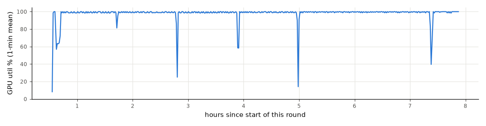
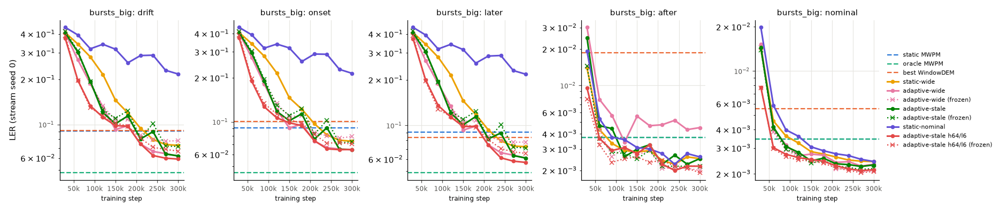
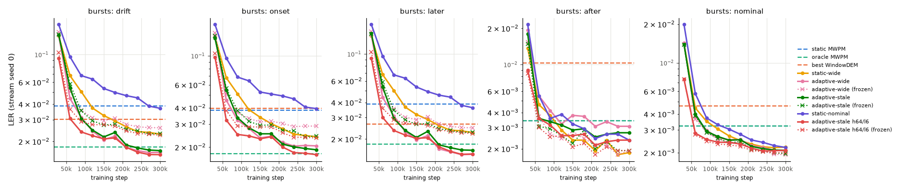
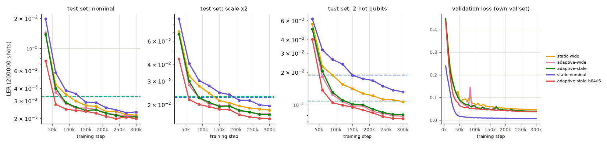
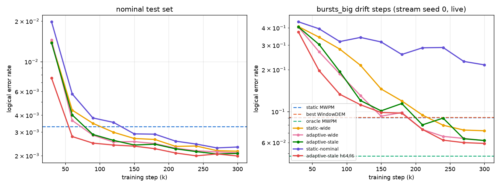

# d=5: long training and learning curves

Follows `04_d5_initial.md`. Everything here is d=5, 5 rounds, p=0.003, run on a GCP g2-standard-8 VM (NVIDIA L4 24 GB, 4 cores / 8 threads, 31 GB RAM). Tables are generated by `python analysis/learning_curves.py` and written to `results/exp4/report4_tables.md`. Table cells that refer to "report 3" mean note 04 (the 60k-step models).

## Summary

The d=5 failures in note 04 came from too little training. The same h48/l4 networks, trained 5× longer (300k steps instead of 60k) on 5× more data, fix most of them. Final checkpoints only:

1. static-nominal now beats MWPM on nominal noise: 0.00232 vs 0.00329 (p = 8e-18), against 0.00400 in note 04. It is still not the best decoder on nominal noise. static-wide (0.00216, p = 0.04, weak) and adaptive-wide (0.00210, p = 0.003) are better.
2. Every wide-trained model beats static MWPM and the best WindowDEM on bursts_big drift. adaptive-wide 0.0516, adaptive-stale 0.0514, static-wide 0.0629 and h64/l6 0.0484, against static MWPM 0.0980 and WindowDEM-2000 0.0896 (all p < 1e-300). In note 04 every neural model lost here.
3. The gap to oracle MWPM on later burst steps mostly closes. On bursts, adaptive-wide now beats oracle on later steps (−0.0029, p = 3e-25); in note 04 it was +0.0102 behind (seed 0). On bursts_big the gap shrinks from +0.0817 to +0.0071 but does not close (p = 2e-47). On hot_qubit later steps adaptive beats oracle (−0.0028).
4. Live minus frozen stays about the same in absolute terms (bursts_big drift −0.0238 → −0.0213, bursts −0.0103 → −0.0097, hot_qubit −0.0032 → −0.0033). Both live and frozen LERs fall a lot, so the relative adaptation gain grows: frozen/live on bursts_big drift goes from 1.19 to 1.41. On telegraph, live and frozen still tie.
5. h64/l6 beats h48/l4 at the same number of steps, but only a little: adaptive-stale on bursts_big drift 0.0484 vs 0.0514 (−0.0031, p = 8e-14) and nominal 0.00199 vs 0.00208 (p = 0.1, not significant). It cost 2.2× the GPU time (2 h 22 min vs 65 min), so at equal compute it is not a clear win. One seed only.

Training is not finished. Between 240k and 300k steps all five models improved on bursts_big drift (stream seed 0) by more than 2 SE. None improved on the nominal test set by more than 2 SE. The stopping rule therefore chose "still falling", and seeds 1 and 2 were trained (see `06_d5_three_seeds.md`).

Unchanged problems:

- adaptive-wide's after-burst regression remains. On bursts_big "after" steps it is worse than static MWPM (+0.0024, p = 1e-13). adaptive-stale and h64/l6 do not have this problem.
- Static MWPM still has the smallest decode latency (note 04; not re-measured).

## Training setup and decisions

| decision | choice | why |
|---|---|---|
| Data path | Packed training chunks loaded onto the GPU once. Unpacking, fingerprint and grid layout run there with torch ops. Fingerprints are computed once per chunk; packed windows are kept only for `--stale-prob` | Removes all per-step CPU work. Inputs checked bit-identical to the CPU path |
| Pinned memory / non-blocking copies | not needed | Nothing is copied host→device per step any more. The per-step `loss.item()` sync was replaced by a buffer read every 250 steps (same running-mean values) |
| channels_last_3d + cudnn.benchmark | **on** | +4% alone (64.8 → 67.3 steps/s). The losses differ from the old path by float noise only (below) |
| torch.compile | **on** | +6–8% more on top (→ 71.4–72.9 steps/s); val loss after 500 steps within noise (0.4617 vs 0.4614) |
| fp32, batch 512 | kept | Comparability with report 3. As in report 3, PyTorch's default TF32 for cuDNN convolutions is left on |
| Concurrent jobs | **1** | 2–4 jobs give *less* total throughput (65 steps/s vs 71), with or without CUDA MPS. One job already saturates the L4 |
| Start training on early chunks while generating | not done | Each epoch's order is a permutation over all 150000 chunks, so starting early would change the results. Generation took ~25 min while Part A benchmarks used the GPU, so nothing was lost |
| Data size | `d5_wide_x5`, `d5_nominal_x5`: 150000 train chunks each, so `--epochs 2` = 300000 steps with the same 2-pass reuse as report 3 | "LR schedule stretched to 300000 steps": OneCycle over 300000 steps |
| Evals for learning curves | Only the neural decoders run, on the GPU, one eval at a time (~45 s each), with ≤ 2 CPU threads. Static MWPM, WindowDEM and oracle per-shot errors are reused from report 3's eval files | The baselines are deterministic. `curve_eval.py` reproduces report 3's per-shot errors exactly (0 of 300000 bursts_big shots differ for adaptive-wide s0 live and frozen, and for static-wide s0). It saves ~95% of the CPU work, and nothing on the CPU competed with training |
| Curve eval set | 3 test sets (200000 shots each) + bursts_big and bursts stream seed 0, live and frozen, update every 200 shots. All 5 WindowDEM histories are kept (they came for free) | planned |
| Full eval of final checkpoints | 4 regimes × 5 stream seeds, live and frozen, WindowDEM 500–10000 (reused), update 200 | planned |
| Stopping rule | For each model compare step 240k vs 300k on the nominal test set and on bursts_big drift (stream 0), unpaired 2-SE rule. STILL FALLING if more than half the models improve on either | planned rule |
| "h64/l6 clearly won" | more than 1 percentage point better than h48/l4 adaptive-stale on bursts_big drift (stream 0) at 300k | needed a threshold; it was 0.0590 vs 0.0620 (0.3 points), so h48/l4 seeds were queued |
| Seed order under the cap | all seeds of one model before the next: adaptive-wide s1, s2, then static-nominal s1, s2, then adaptive-stale, static-wide | So that the cap leaves complete 3-seed sets for the models behind questions 1–4 rather than seed 1 of everything |
| Cap | **A job starts only if it is expected to finish before 12 h** (h48/l4 ≈ 1.25 h) | Cost rule. The literal rule (stop *queuing* at 12 h) would let one more job run past the cap and yield a partial seed set |
| GPU-util rule | the queue starts the next job if the mean utilisation over 10 min drops below 70% with work queued | It never fired: utilisation stayed ≥ 85% in 97% of minutes |

Every run is resumable: `train.py --resume` continues from the latest `_step<k>.pt`, which stores optimiser, scheduler, RNG and epoch-order state.

## GPU efficiency

### Profile of the CPU-data path

One d=5 job, steps 100-600, alone on the L4:

| part of a step | adaptive | static |
|---|---|---|
| unpack bits (numpy) | 0.14 ms (1%) | 0.14 ms (1%) |
| `build_input` (grid layout + fingerprint, CPU) | 0.74 ms (5%) | 0.26 ms (2%) |
| host → device copy | 0.37 ms (2%) | 0.24 ms (2%) |
| GPU forward + backward + AdamW | **13.9 ms (92%)** | **14.0 ms (96%)** |

The old path was already GPU-bound. The step is dominated by the 3D convolutions: batch 512 × 48 channels × 216 voxels, about 130 GFLOP per step.

### Before and after

Single job, steps 500-2000, d5_wide, alone on the GPU:

| path | adaptive steps/s | static steps/s |
|---|---|---|
| old (CPU data, report 3) | 57.7 | 60.0 |
| new (GPU data + channels_last + compile) | **71.4** | **71.4** |

In the full 300k-step runs (including validation every 5000 steps): 77-78 steps/s for static and adaptive-stale (3830-3890 s), 72 steps/s for adaptive-wide (its time includes a 2-min pause for the benchmark above and the first curve evals), and 35 steps/s for h64/l6. Note 04 trained 4 jobs at once at 68 steps/s in total.

GPU-only step time under the options (synthetic input):

| | default | cudnn.benchmark | + channels_last | benchmark + compile | + both |
|---|---|---|---|---|---|
| h48/l4 ms/step | 13.78 | 13.83 | 12.37 | 12.95 | **11.49** |
| h64/l6 ms/step | 29.80 | 29.96 | 27.29 | 28.77 | **26.23** |

### Same maths

adaptive-stale (exercises fingerprints and stale windows), `--steps 500`, d5_wide:

| path | loss @250 | val @250 | loss @500 | val @500 |
|---|---|---|---|---|
| old | 0.4804 | 0.4770 | 0.4337 | 0.4614 |
| old, rerun | 0.4804 | 0.4770 | 0.4337 | 0.4614 |
| new, channels_last off | 0.4804 | 0.4770 | 0.4337 | 0.4614 |
| new, channels_last on | 0.4803 | 0.4771 | 0.4341 | 0.4619 |
| new, channels_last on + compile | 0.4803 | 0.4773 | 0.4340 | 0.4617 |

The GPU inputs (events grid, fingerprint, stale fingerprints, labels) are bit-identical to `build_input`'s on 27 val chunks × 5 fingerprint variants. With the old memory layout the new path reproduces the old losses to 4 decimals. channels_last and compile change the convolution algorithms, which gives differences of at most 0.0005 in loss after 500 steps (float noise; training is chaotic). The long runs are therefore not bit-reproductions of what the old path would give, but they are the same computation.

### Concurrency

Aggregate steps/s for N concurrent jobs (real model mix, new path with compile):

| N | 1 | 2 | 3 | 4 |
|---|---|---|---|---|
| plain | **71.4** | 65.2 | 64.9 | 65.4 |
| CUDA MPS | 71.4 | 65.9 | 57.2 | 59.6 |
| GPU util (nvidia-smi) | 79% | 90–92% | 94–95% | 96–97% |

Utilisation rises with N but throughput falls: the GPU switches between processes and does no more useful work. One job was used. Parts of this sweep overlapped the end of dataset generation; a clean single-job rerun gives the same 71.4.

### Utilisation over the run



GPU utilisation, 437 one-minute means from 0.55 h to 7.87 h: overall mean 98%, 97% of minutes ≥ 85%, 2% of minutes < 70%. Hourly: 0–1 h: 89%; 1–2 h: 99%; 2–3 h: 98%; 3–4 h: 98%; 4–5 h: 98%; 5–6 h: 99%; 6–7 h: 100%; 7–8 h: 98%

nvidia-smi "utilisation" is the fraction of time any kernel runs, not how full the SMs are.

### Data

| dataset | train chunks | on disk | generation |
|---|---|---|---|
| `data/d5_wide_x5` | 150000 × (512 + 2000 window) shots | **2.3 GB** | 262 s sampling with 6 workers + ~10 min single-threaded compression, ~25 min with streams |
| `data/d5_nominal_x5` | 150000 × 512 shots (no window) | **393 MB** | 20 s sampling, ~4 min total |

`make_dataset.py --workers N` draws every chunk's NoiseState and Stim seed first, in the original order from the original RNG, then samples in a process pool. It gives the same chunks as `--workers 1` (checked on 300 chunks, both modes). Checks against the originals are in `results/exp4/check_x5.json`:

- All 3 test sets and all 20 eval streams (4 regimes × stream seeds 0-4, plus `static`) are byte-identical to `d5_wide`'s (same SHA-256).
- The first 30000 train chunks and all 1000 val chunks have identical shots (det, obs, window, hot qubits, hot_p) to `d5_wide`'s. Likewise `d5_nominal_x5` vs `d5_nominal`.
- The only difference is the float64 `scale` label of 4-5% of chunks (and 7 steps of the unused `wander` stream), which differs in the last bit (relative 2.2e-16). This comes from `exp`/`log` rounding on the laptop CPU vs the VM. Training never reads `scale`, and the sampled shots are the same.
- `d5_nominal_x5` also has the extra stream seeds 1-4 (identical to `d5_wide`'s), which `d5_nominal` lacked.

## Learning curves (seed 0)

Five models, seed 0, 300000 steps each (2 epochs over 150000 chunks), AdamW lr 1e-3 OneCycle over 300000 steps, batch 512, fp32. Checkpoints every 30000 steps (`decoder_<model>_d5_long_s0_step<k>.pt`), each scored with `curve_eval.py`. Horizontal lines are static MWPM, the best WindowDEM (picked per phase after the fact, among histories 500-10000) and oracle MWPM on the same shots. Solid = live fingerprint, dotted × = frozen at the nominal fingerprint. All curves are for stream seed 0 only (one stream per regime), so single points are noisy. The final-checkpoint tables below use all 5 streams.









`results/exp4/summary_curves.png`, drawn by `analysis/plot_summary_curves.py`. Left: nominal test set (200k shots). Right: bursts_big drift steps, stream seed 0, live fingerprint. Dashed lines: static MWPM, best WindowDEM (window 1000 on this stream) and oracle MWPM. On the nominal test set, static MWPM = oracle = 0.00329, so there is no WindowDEM line. Full per-phase curve tables are in `results/exp4/report4_tables.md`.

Nominal test LER (static MWPM = oracle MWPM = 0.00329):

| model | 30k | 60k | 90k | 120k | 150k | 180k | 210k | 240k | 270k | 300k |
|---|---|---|---|---|---|---|---|---|---|---|
| static-wide | 0.01398 | 0.00436 | 0.00348 | 0.00298 | 0.00268 | 0.00264 | 0.00234 | 0.00236 | 0.00218 | 0.00216 |
| adaptive-wide | 0.01446 | 0.00365 | 0.00284 | 0.00253 | 0.00254 | 0.00246 | 0.00228 | 0.00217 | 0.00214 | 0.00210 |
| adaptive-stale | 0.01380 | 0.00402 | 0.00287 | 0.00260 | 0.00240 | 0.00244 | 0.00225 | 0.00215 | 0.00206 | 0.00208 |
| static-nominal | 0.01976 | 0.00575 | 0.00381 | 0.00353 | 0.00291 | 0.00289 | 0.00257 | 0.00244 | 0.00229 | 0.00232 |
| adaptive-stale h64/l6 | 0.00754 | 0.00278 | 0.00248 | 0.00240 | 0.00235 | 0.00226 | 0.00210 | 0.00199 | 0.00206 | 0.00199 |

bursts_big drift LER (stream seed 0, live fingerprint; static MWPM 0.0904, best WindowDEM (1000) 0.0912, oracle MWPM 0.0480):

| model | 30k | 60k | 90k | 120k | 150k | 180k | 210k | 240k | 270k | 300k |
|---|---|---|---|---|---|---|---|---|---|---|
| static-wide | 0.4081 | 0.3425 | 0.2814 | 0.2152 | 0.1455 | 0.1193 | 0.0944 | 0.0798 | 0.0737 | 0.0728 |
| adaptive-wide | 0.4051 | 0.2692 | 0.1869 | 0.1305 | 0.0927 | 0.0984 | 0.0744 | 0.0663 | 0.0641 | 0.0618 |
| adaptive-wide (frozen) | 0.4179 | 0.2969 | 0.1892 | 0.1324 | 0.1071 | 0.1083 | 0.0845 | 0.0797 | 0.0775 | 0.0782 |
| adaptive-stale | 0.4059 | 0.3036 | 0.1938 | 0.1201 | 0.1013 | 0.1143 | 0.0803 | 0.0897 | 0.0638 | 0.0620 |
| adaptive-stale (frozen) | 0.4166 | 0.3087 | 0.1938 | 0.1256 | 0.1099 | 0.1239 | 0.0814 | 0.1015 | 0.0719 | 0.0716 |
| static-nominal | 0.4420 | 0.3938 | 0.3187 | 0.3413 | 0.3168 | 0.2574 | 0.2874 | 0.2889 | 0.2294 | 0.2167 |
| adaptive-stale h64/l6 | 0.3733 | 0.1970 | 0.1332 | 0.1120 | 0.0985 | 0.0975 | 0.0745 | 0.0623 | 0.0598 | 0.0590 |
| adaptive-stale h64/l6 (frozen) | 0.3901 | 0.1958 | 0.1292 | 0.1145 | 0.1026 | 0.0976 | 0.0813 | 0.0706 | 0.0684 | 0.0667 |

From 240k to 300k steps, all 5 models still improved on bursts_big drift by more than 2 SE. None improved on the nominal test set by more than 2 SE (2-SE rule). The curves are flat on nominal and still falling on large-burst drift.


What the curves show:

- Nominal noise. Every model crosses static MWPM between 60k and 150k steps (h64/l6 by 60k, adaptive-wide and adaptive-stale by 90k, static-wide by 120k, static-nominal last at 150k). From 210k on they are all within 0.0002-0.0003 of each other, and the last 60k steps change none of them by more than 2 SE. The model trained on nominal data only is the slowest to learn nominal noise: its val loss is low (0.007, few errors to learn from), and its nominal test LER at every checkpoint is above static-wide's. Nominal chunks carry very few logical errors per batch (≈ 0.3% of 512 shots), so they teach less per step than wide chunks.
- bursts_big drift keeps falling to the end for every wide model (for example adaptive-wide 0.066 → 0.062 from 240k to 300k on stream 0). The wide models first get below static MWPM and the best WindowDEM at 210k (adaptive-wide, adaptive-stale, h64/l6) or 240k (static-wide) steps, far beyond the 60k budget of note 04.
- adaptive-wide is ahead of static-wide on bursts_big drift at every checkpoint. The gap shrinks from 0.073 at 60k to 0.011 at 300k (stream 0). On the 5-stream final eval it is 0.0516 vs 0.0629.
- The h64/l6 model learns faster per step (nominal 0.00278 at 60k vs 0.00402 for h48 adaptive-stale) and ends a little ahead.
- Validation loss falls steadily after the OneCycle learning-rate peak (~90k, where it briefly spikes) for all models. Its last-60k drop is small (for example adaptive-wide 0.0415 → 0.0393).

## Final checkpoints (seed 0, 5 streams pooled)

"300k" is the long model, "report 3 (60k)" is the same architecture and seed trained for 60k steps on the 1× dataset. Adaptive models use the live fingerprint unless marked (frozen). The best WindowDEM is chosen per phase after the fact, which favours WindowDEM. hot_qubit has no "after" phase (–). All comparisons use the step-300000 checkpoints; no checkpoint was picked on eval streams. In comparison cells, diff = LER(a) − LER(b) (negative = a better), p is the exact two-sided McNemar p on the pooled shots, (k/n) is the number of seeds where a had fewer errors, bold means every seed has p < 0.05 in the same direction, and "tie" is the 2-SE rule. p between 0.001 and 0.05 is weak evidence, and there is no multiple-testing correction. Full tables are in `results/exp4/report4_tables.md`.

### bursts

| decoder | drift | onset | later | after | nominal |
|---|---|---|---|---|---|
| static MWPM | 0.0439 | 0.0455 | 0.0435 | 0.0033 | 0.0033 |
| oracle MWPM | 0.0197 | 0.0195 | 0.0198 | 0.0033 | 0.0033 |
| WindowDEM-500 | 0.0523 | 0.0543 | 0.0518 | 0.0127 | 0.0090 |
| WindowDEM-1000 | 0.0413 | 0.0455 | 0.0401 | 0.0116 | 0.0059 |
| WindowDEM-2000 | 0.0356 | 0.0461 | 0.0327 | 0.0144 | 0.0046 |
| WindowDEM-5000 | 0.0365 | 0.0480 | 0.0332 | 0.0135 | 0.0046 |
| WindowDEM-10000 | 0.0436 | 0.0457 | 0.0430 | 0.0136 | 0.0053 |
| static-wide, 300k | 0.0241 | 0.0249 | 0.0239 | 0.0020 | 0.0022 |
| adaptive-wide, 300k | 0.0178 | 0.0214 | 0.0168 | 0.0033 | 0.0022 |
| adaptive-wide (frozen), 300k | 0.0276 | 0.0292 | 0.0271 | 0.0019 | 0.0020 |
| adaptive-stale, 300k | 0.0180 | 0.0202 | 0.0174 | 0.0027 | 0.0022 |
| adaptive-stale (frozen), 300k | 0.0244 | 0.0253 | 0.0241 | 0.0021 | 0.0021 |
| static-nominal, 300k | 0.0420 | 0.0435 | 0.0416 | 0.0021 | 0.0022 |
| adaptive-stale h64/l6, 300k | 0.0168 | 0.0192 | 0.0161 | 0.0023 | 0.0020 |
| adaptive-stale h64/l6 (frozen), 300k | 0.0232 | 0.0242 | 0.0230 | 0.0020 | 0.0020 |
| static-wide, report 3 (60k) | 0.0378 | 0.0390 | 0.0374 | 0.0027 | 0.0028 |
| adaptive-wide, report 3 (60k) | 0.0314 | 0.0363 | 0.0300 | 0.0037 | 0.0028 |
| adaptive-wide (frozen), report 3 (60k) | 0.0417 | 0.0430 | 0.0414 | 0.0024 | 0.0026 |
| adaptive-stale, report 3 (60k) | 0.0328 | 0.0363 | 0.0319 | 0.0029 | 0.0027 |
| adaptive-stale (frozen), report 3 (60k) | 0.0390 | 0.0407 | 0.0385 | 0.0024 | 0.0026 |
| static-nominal, report 3 (60k) | 0.1046 | 0.1099 | 0.1031 | 0.0038 | 0.0037 |

### bursts_big

| decoder | drift | onset | later | after | nominal |
|---|---|---|---|---|---|
| static MWPM | 0.0980 | 0.0993 | 0.0975 | 0.0034 | 0.0034 |
| oracle MWPM | 0.0426 | 0.0422 | 0.0428 | 0.0034 | 0.0034 |
| WindowDEM-500 | 0.0965 | 0.0992 | 0.0956 | 0.0206 | 0.0095 |
| WindowDEM-1000 | 0.0903 | 0.1001 | 0.0870 | 0.0233 | 0.0064 |
| WindowDEM-2000 | 0.0896 | 0.1120 | 0.0822 | 0.0348 | 0.0056 |
| WindowDEM-5000 | 0.0965 | 0.1149 | 0.0904 | 0.0363 | 0.0065 |
| WindowDEM-10000 | 0.1122 | 0.1146 | 0.1114 | 0.0328 | 0.0087 |
| static-wide, 300k | 0.0629 | 0.0629 | 0.0630 | 0.0024 | 0.0023 |
| adaptive-wide, 300k | 0.0516 | 0.0570 | 0.0499 | 0.0058 | 0.0023 |
| adaptive-wide (frozen), 300k | 0.0729 | 0.0737 | 0.0727 | 0.0019 | 0.0021 |
| adaptive-stale, 300k | 0.0514 | 0.0547 | 0.0503 | 0.0029 | 0.0022 |
| adaptive-stale (frozen), 300k | 0.0639 | 0.0651 | 0.0634 | 0.0021 | 0.0021 |
| static-nominal, 300k | 0.1596 | 0.1597 | 0.1596 | 0.0024 | 0.0023 |
| adaptive-stale h64/l6, 300k | 0.0484 | 0.0515 | 0.0473 | 0.0024 | 0.0021 |
| adaptive-stale h64/l6 (frozen), 300k | 0.0608 | 0.0610 | 0.0607 | 0.0018 | 0.0020 |
| static-wide, report 3 (60k) | 0.1383 | 0.1385 | 0.1383 | 0.0028 | 0.0028 |
| adaptive-wide, report 3 (60k) | 0.1269 | 0.1340 | 0.1245 | 0.0063 | 0.0029 |
| adaptive-wide (frozen), report 3 (60k) | 0.1507 | 0.1513 | 0.1504 | 0.0029 | 0.0026 |
| adaptive-stale, report 3 (60k) | 0.1287 | 0.1305 | 0.1282 | 0.0037 | 0.0028 |
| adaptive-stale (frozen), report 3 (60k) | 0.1425 | 0.1411 | 0.1429 | 0.0028 | 0.0027 |
| static-nominal, report 3 (60k) | 0.2968 | 0.2961 | 0.2971 | 0.0041 | 0.0037 |

### hot_qubit

| decoder | drift | onset | later | after | nominal |
|---|---|---|---|---|---|
| static MWPM | 0.0181 | 0.0187 | 0.0180 | – | 0.0034 |
| oracle MWPM | 0.0103 | 0.0110 | 0.0103 | – | 0.0034 |
| WindowDEM-500 | 0.0284 | 0.0270 | 0.0284 | – | 0.0087 |
| WindowDEM-1000 | 0.0210 | 0.0187 | 0.0210 | – | 0.0056 |
| WindowDEM-2000 | 0.0158 | 0.0148 | 0.0158 | – | 0.0041 |
| WindowDEM-5000 | 0.0121 | 0.0135 | 0.0121 | – | 0.0035 |
| WindowDEM-10000 | 0.0108 | 0.0152 | 0.0108 | – | 0.0033 |
| static-wide, 300k | 0.0101 | 0.0094 | 0.0102 | – | 0.0022 |
| adaptive-wide, 300k | 0.0074 | 0.0080 | 0.0074 | – | 0.0021 |
| adaptive-wide (frozen), 300k | 0.0107 | 0.0095 | 0.0107 | – | 0.0019 |
| adaptive-stale, 300k | 0.0075 | 0.0076 | 0.0075 | – | 0.0022 |
| adaptive-stale (frozen), 300k | 0.0101 | 0.0093 | 0.0101 | – | 0.0020 |
| static-nominal, 300k | 0.0130 | 0.0116 | 0.0130 | – | 0.0022 |
| adaptive-stale h64/l6, 300k | 0.0070 | 0.0072 | 0.0070 | – | 0.0020 |
| adaptive-stale h64/l6 (frozen), 300k | 0.0096 | 0.0081 | 0.0096 | – | 0.0019 |
| static-wide, report 3 (60k) | 0.0140 | 0.0134 | 0.0140 | – | 0.0027 |
| adaptive-wide, report 3 (60k) | 0.0113 | 0.0117 | 0.0113 | – | 0.0029 |
| adaptive-wide (frozen), report 3 (60k) | 0.0145 | 0.0132 | 0.0146 | – | 0.0026 |
| adaptive-stale, report 3 (60k) | 0.0120 | 0.0114 | 0.0120 | – | 0.0028 |
| adaptive-stale (frozen), report 3 (60k) | 0.0145 | 0.0129 | 0.0145 | – | 0.0026 |
| static-nominal, report 3 (60k) | 0.0279 | 0.0277 | 0.0279 | – | 0.0036 |

### telegraph

| decoder | drift | onset | later | after | nominal |
|---|---|---|---|---|---|
| static MWPM | 0.0228 | 0.0217 | 0.0229 | 0.0035 | 0.0033 |
| oracle MWPM | 0.0231 | 0.0217 | 0.0232 | 0.0035 | 0.0033 |
| WindowDEM-500 | 0.0393 | 0.0386 | 0.0393 | 0.0092 | 0.0089 |
| WindowDEM-1000 | 0.0303 | 0.0302 | 0.0303 | 0.0057 | 0.0057 |
| WindowDEM-2000 | 0.0259 | 0.0259 | 0.0259 | 0.0046 | 0.0042 |
| WindowDEM-5000 | 0.0236 | 0.0231 | 0.0236 | 0.0038 | 0.0035 |
| WindowDEM-10000 | 0.0229 | 0.0217 | 0.0230 | 0.0039 | 0.0033 |
| static-wide, 300k | 0.0184 | 0.0176 | 0.0185 | 0.0023 | 0.0023 |
| adaptive-wide, 300k | 0.0168 | 0.0160 | 0.0168 | 0.0021 | 0.0022 |
| adaptive-wide (frozen), 300k | 0.0170 | 0.0164 | 0.0170 | 0.0021 | 0.0021 |
| adaptive-stale, 300k | 0.0170 | 0.0164 | 0.0171 | 0.0023 | 0.0022 |
| adaptive-stale (frozen), 300k | 0.0172 | 0.0165 | 0.0172 | 0.0023 | 0.0021 |
| static-nominal, 300k | 0.0195 | 0.0190 | 0.0195 | 0.0023 | 0.0023 |
| adaptive-stale h64/l6, 300k | 0.0160 | 0.0150 | 0.0160 | 0.0019 | 0.0021 |
| adaptive-stale h64/l6 (frozen), 300k | 0.0161 | 0.0153 | 0.0162 | 0.0019 | 0.0020 |
| static-wide, report 3 (60k) | 0.0228 | 0.0215 | 0.0228 | 0.0030 | 0.0029 |
| adaptive-wide, report 3 (60k) | 0.0211 | 0.0210 | 0.0212 | 0.0027 | 0.0028 |
| adaptive-wide (frozen), report 3 (60k) | 0.0214 | 0.0209 | 0.0215 | 0.0027 | 0.0026 |
| adaptive-stale, report 3 (60k) | 0.0216 | 0.0209 | 0.0216 | 0.0029 | 0.0028 |
| adaptive-stale (frozen), report 3 (60k) | 0.0219 | 0.0210 | 0.0220 | 0.0031 | 0.0028 |
| static-nominal, report 3 (60k) | 0.0312 | 0.0310 | 0.0312 | 0.0039 | 0.0038 |

### Answers to the five questions (seed 0 only)

Q1. Does static-nominal beat MWPM on nominal noise? Yes. On the nominal test set it scores 0.00232 vs 0.00329 for MWPM (−0.00097, p = 8e-18). In note 04, after 60k steps, it was worse than MWPM (0.00400). It is still not the best model on nominal noise: the wide-trained models are as good or better (static-wide 0.00216, adaptive-wide 0.00210, a tie with static-wide by the 2-SE rule; adaptive-wide better by −0.00022, p = 0.003). On the nominal steps of the streams, all neural models are about 0.0022 vs 0.0033 for MWPM.

Q2. Does any neural decoder beat static MWPM and the best WindowDEM on bursts_big drift? Yes, every wide-trained model does. Pooled over 5 streams, drift-step LER is: h64/l6 0.0484, adaptive-stale 0.0514, adaptive-wide 0.0516, static-wide 0.0629. Static MWPM is 0.0980 and the best WindowDEM is 0.0896 (window 2000, picked after the fact). All p < 1e-300. In note 04 every one of these models was worse than static MWPM (0.127-0.138). Static-nominal still fails (0.1596), as expected for a model that never saw drift. Oracle MWPM (0.0426) still beats every model.

Q3. Does the adaptive model close the gap to the oracle on later burst steps? Mostly. On `bursts` it now beats the oracle on later steps (adaptive-wide −0.0029, adaptive-stale −0.0024 vs oracle). It also beats the oracle on `hot_qubit` (−0.0028). On `bursts_big` a gap remains, but it shrank about 10×: adaptive-wide went from +0.0817 above the oracle in note 04 to +0.0071 (adaptive-stale +0.0854 → +0.0075, h64/l6 +0.0046). The gap is still significant (p ≈ 1e-47). The bursts_big curve was still falling at 300k, so more training would probably shrink it further.

Q4. Does the live vs frozen gap grow, shrink or stay the same with training? About the same, slightly smaller. Live minus frozen on drift steps, note 04 → 300k:

| model | bursts | bursts_big | hot_qubit |
|---|---|---|---|
| adaptive-wide | −0.0103 → −0.0097 | −0.0238 → −0.0213 | −0.0032 → −0.0033 |
| adaptive-stale | −0.0062 → −0.0063 | −0.0137 → −0.0124 | −0.0025 → −0.0026 |

On telegraph both are ties. The live fingerprint is still worth about 1-2 points of LER on large bursts, so longer training did not make the fingerprint redundant. The cost also stayed: in the "after" phase on bursts_big, live adaptive-wide is worse than frozen (+0.0039) and worse than static MWPM (+0.0024). The fingerprint lags behind the end of the burst.

Q5. Does h64/l6 beat h48/l4 at the same training budget (300k steps)? Yes, but only a little. Comparing adaptive-stale h64/l6 with h48/l4: bursts_big drift −0.0031 (p = 8e-14), bursts drift −0.0012 (p = 1e-11), scale x2 test −0.0012 (p = 4e-11). Nominal is a tie (−0.00009, p = 0.1). This is far below the preset "clearly won" bar of 1 point on bursts_big drift, and h64/l6 costs 2.2× the GPU time (8540 s vs 3890 s). Per step it learns faster early on (30k-90k), but most of that lead is gone by 300k.

## Stopping rule

`results/exp4/partC_decision.json` records the comparison of step 240k with step 300k:

| model | nominal 240k → 300k | improves > 2 SE? | bursts_big drift (st0) 240k → 300k | improves > 2 SE? |
|---|---|---|---|---|
| static-wide | 0.00236 → 0.00216 | no | 0.0798 → 0.0728 | **yes** |
| adaptive-wide | 0.00218 → 0.00210 | no | 0.0663 → 0.0618 | **yes** |
| adaptive-stale | 0.00215 → 0.00208 | no | 0.0898 → 0.0620 | **yes** |
| static-nominal | 0.00244 → 0.00232 | no | 0.2889 → 0.2167 | **yes** |
| adaptive-stale h64/l6 | 0.00200 → 0.00199 | no | 0.0623 → 0.0590 | **yes** |

Decision: still falling (5/5 models, all on bursts_big drift). h64/l6 did not clearly win (0.3 points on bursts_big drift, threshold 1 point), so seeds 1 and 2 of the h48/l4 long models were trained, followed by the full eval of every finished checkpoint.

The rule has a caveat. bursts_big drift on a single stream is noisy between checkpoints (adaptive-stale went 0.114 → 0.080 → 0.090 → 0.064 → 0.062 from 180k to 300k). The trend over 150k-300k is clearly downward for every wide model, so a smoother rule would give the same decision. The nominal test set is flat at the 2-SE level.

## Conclusions

Longer training mostly fixed the d=5 failures. The remaining gaps are small (seed 0 only). Note 04 had three d=5 failures, and 5× more training (300k steps on the 5× dataset) changed all three.

1. static-nominal was worse than MWPM on nominal noise. It now beats MWPM by about 30%, so this failure was undertraining.
2. Every neural model lost to static MWPM on bursts_big drift. Every wide-trained model now beats both static MWPM and the best WindowDEM by 3-5 points of LER. That was also undertraining.
3. Adaptive models trailed the oracle on later localized drift. They now match or beat it on bursts and hot_qubit. On bursts_big the gap shrank from about 8 points to about 0.7 points but is still there. The drift curves were still falling at 300k, so this part is partly fixed and probably needs more training rather than a new design.

Two things are not fixed: adaptive-wide is slightly worse than MWPM just after bursts_big ends (stale fingerprint), and nothing reaches the oracle on bursts_big. Every number here comes from one model seed. Seeds 1 and 2 are evaluated in `06_d5_three_seeds.md`.

## Limitations

- Mostly one seed. The learning curves, h64/l6, static-wide and adaptive-stale results are seed 0 only. Note 04 showed a seed spread of ±0.02 on bursts_big for static-wide, so single-seed differences of a few tenths of a percent between models are not reliable even when the McNemar p is tiny (McNemar tests the shots, not the training seed).
- Long vs 60k changes two things at once: 5× more steps and 5× more distinct data (with the same 2-pass reuse). The curves show what happens with more steps at this data size. They do not separate steps from data; a 300k-step run on the old 30k-chunk data would.
- Learning curves use one stream per regime (stream seed 0) and only bursts and bursts_big. Their single points have SE ≈ 0.001-0.002 on drift phases.
- The stopping rule compared only two checkpoints on one stream.
- Training is not converged. 300k steps is still on a falling curve for drift, so every "neural vs X" gap here is a snapshot at this budget.
- The new GPU path is not bit-identical to the CPU-data path (channels_last and compile: float-noise differences, checked over 500 steps). Seed 0 of note 04 was trained on the laptop GPU anyway.
- The full-eval baselines are reused from note 04's eval files, not recomputed. This is exact: the decoders are deterministic, the neural decoders were verified bit for bit, and note 04 verified MWPM and WindowDEM across machines.
- h64/l6 is compared at equal steps, not equal compute.
- The best WindowDEM per phase is picked after the fact, which favours WindowDEM. It still loses everywhere except where noted.
- Multiple testing is uncorrected, as in notes 03 and 04.

## Open items

1. Keep training. Continue the long models (resume from `_step300000.pt` with a new, longer schedule, or train 600k-step runs) until bursts_big drift flattens. Then choose the architecture at a matched compute budget, not matched steps.
2. Separate steps from data: one 300k-step run on the old `d5_wide` (30k chunks, 10 passes). If it matches the `_x5` run, data was never the bottleneck.
3. Fix the after-burst regression of adaptive-wide (still +0.0024 vs static MWPM on bursts_big after-steps). adaptive-stale does not have it, so stale-fingerprint training is the cheap fix; make it the default adaptive recipe.
4. Nominal specialist: train on a mix of mostly nominal and some wide chunks, or fine-tune static-wide on nominal. Pure nominal data gives few errors per batch, and here it never beat static-wide.
5. bursts_big vs oracle is the one gap left (+0.007 on later steps). Hybrid decoding (a neural model reads the fingerprint and outputs MWPM edge weights) is the natural way to get oracle-like behaviour on localized noise with MWPM's latency. It is not implemented.
6. Rescale drift regimes with distance and re-measure latency for the long models (same architecture, so the latency numbers of note 04 apply to the h48/l4 models; h64/l6 is ~2.3× more compute per shot).

## Reproduce

```
python make_dataset.py --distance 5 --rounds 5 --name d5_wide_x5 --train-chunks 150000 --workers 6
python make_dataset.py --streams-only --name d5_wide_x5 --stream-seeds 1,2,3,4 --regimes hot_qubit,bursts,bursts_big,telegraph
python make_dataset.py --distance 5 --rounds 5 --nominal-only --window 0 --name d5_nominal_x5 --train-chunks 150000 --workers 6
python make_dataset.py --streams-only --name d5_nominal_x5 --stream-seeds 1,2,3,4 --regimes hot_qubit,bursts,bursts_big,telegraph
# or: scripts/make_data_d5_x5.sh

# one training job, for example
python train.py --data data/d5_wide_x5 --adaptive --epochs 2 --val-every 5000 --save-every 30000 \
    --device cuda --compile --resume --seed 0 --out decoder_adaptive_wide_d5_long_s0.pt
python curve_eval.py --checkpoint decoder_adaptive_wide_d5_long_s0_step30000.pt --out results/exp4/curves
python curve_eval.py --checkpoint decoder_adaptive_wide_d5_long_s0.pt --streams bursts,bursts_big,hot_qubit,telegraph \
    --stream-seed 0 --out results/exp4/full/st0          # stream seeds 0-4

# tables and figures
python analysis/learning_curves.py
python analysis/plot_summary_curves.py
```
