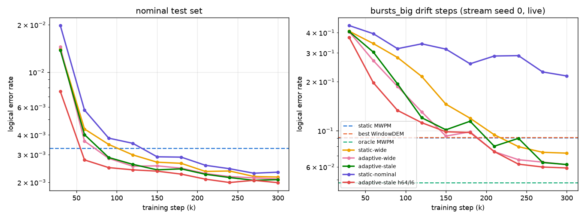

# d=5 round 4 summary (existing results only, seed 0)

Everything here comes from results that already existed: `results/exp4/curves/` (learning curves), `results/exp4/full/st0–st4` (final 300k checkpoints, 5 stream seeds) and the report-3 baselines and per-shot errors. No new training or evals were run. The plot was drawn from the existing curve JSONs by `results/exp4/summary_plot.py`. Tables are from `results/exp4/report4_tables.md`, generated before any seed-1/2 model existed, so they are pure seed 0.

All model results are **one model seed (seed 0)**. Seeds 1/2 of adaptive-wide and static-nominal are trained but not evaluated on streams. Paired p-values are exact McNemar on shared shots. They show the effect is real for *this* model, not that it would hold across seeds.

## 1. Learning curves (seed 0, 30k … 300k steps)

`results/exp4/summary_curves.png`. Left: nominal test set (200k shots). Right: bursts_big drift steps, stream seed 0, live fingerprint. Dashed lines: static MWPM, best WindowDEM (window 1000 on this stream) and oracle MWPM. On the nominal test set, static MWPM = oracle = 0.00329, so there is no WindowDEM line.

**Nominal test LER** (static MWPM = oracle MWPM = 0.00329)

| model | 30k | 60k | 90k | 120k | 150k | 180k | 210k | 240k | 270k | 300k |
|---|---|---|---|---|---|---|---|---|---|---|
| static-wide | 0.01398 | 0.00436 | 0.00348 | 0.00298 | 0.00268 | 0.00264 | 0.00234 | 0.00236 | 0.00218 | 0.00216 |
| adaptive-wide | 0.01446 | 0.00365 | 0.00284 | 0.00253 | 0.00254 | 0.00246 | 0.00228 | 0.00217 | 0.00214 | 0.00210 |
| adaptive-stale | 0.01380 | 0.00402 | 0.00287 | 0.00260 | 0.00240 | 0.00244 | 0.00225 | 0.00215 | 0.00206 | 0.00208 |
| static-nominal | 0.01976 | 0.00575 | 0.00381 | 0.00353 | 0.00291 | 0.00289 | 0.00257 | 0.00244 | 0.00229 | 0.00232 |
| adaptive-stale h64/l6 | 0.00754 | 0.00278 | 0.00248 | 0.00240 | 0.00235 | 0.00226 | 0.00210 | 0.00199 | 0.00206 | 0.00199 |

**bursts_big drift LER** (stream seed 0, live fingerprint; static MWPM 0.0904, best WindowDEM (1000) 0.0912, oracle MWPM 0.0480)

| model | 30k | 60k | 90k | 120k | 150k | 180k | 210k | 240k | 270k | 300k |
|---|---|---|---|---|---|---|---|---|---|---|
| static-wide | 0.4081 | 0.3425 | 0.2814 | 0.2152 | 0.1455 | 0.1193 | 0.0944 | 0.0798 | 0.0737 | 0.0728 |
| adaptive-wide | 0.4051 | 0.2692 | 0.1869 | 0.1305 | 0.0927 | 0.0984 | 0.0744 | 0.0663 | 0.0641 | 0.0618 |
| adaptive-wide (frozen) | 0.4179 | 0.2969 | 0.1892 | 0.1324 | 0.1071 | 0.1083 | 0.0845 | 0.0797 | 0.0775 | 0.0782 |
| adaptive-stale | 0.4059 | 0.3036 | 0.1938 | 0.1201 | 0.1013 | 0.1143 | 0.0803 | 0.0897 | 0.0638 | 0.0620 |
| adaptive-stale (frozen) | 0.4166 | 0.3087 | 0.1938 | 0.1256 | 0.1099 | 0.1239 | 0.0814 | 0.1015 | 0.0719 | 0.0716 |
| static-nominal | 0.4420 | 0.3938 | 0.3187 | 0.3413 | 0.3168 | 0.2574 | 0.2874 | 0.2889 | 0.2294 | 0.2167 |
| adaptive-stale h64/l6 | 0.3733 | 0.1970 | 0.1332 | 0.1120 | 0.0985 | 0.0975 | 0.0745 | 0.0623 | 0.0598 | 0.0590 |
| adaptive-stale h64/l6 (frozen) | 0.3901 | 0.1958 | 0.1292 | 0.1145 | 0.1026 | 0.0976 | 0.0813 | 0.0706 | 0.0684 | 0.0667 |

From 240k to 300k steps, all 5 models still improved on bursts_big drift by more than 2 SE. None improved on the nominal test set by more than 2 SE (2-SE rule). The curves are flat on nominal but **still falling on large-burst drift**.

Older plots with more panels: `report4_curve_tests.png`, `report4_curve_bursts_big.png`, `report4_curve_bursts.png`.

## 2. Final seed-0 results (300k steps), pooled over 5 streams, vs report 3 (60k steps, seed 0)

"300k" = this round's long model, "report 3 (60k)" = the same architecture and seed trained for 60k steps on the 1× dataset. Adaptive models use the live fingerprint unless marked (frozen). The best WindowDEM is chosen per phase after the fact, which flatters WindowDEM. hot_qubit has no "after" phase (–).

#### bursts

| decoder | drift | onset | later | after | nominal |
|---|---|---|---|---|---|
| static MWPM | 0.0439 | 0.0455 | 0.0435 | 0.0033 | 0.0033 |
| oracle MWPM | 0.0197 | 0.0195 | 0.0198 | 0.0033 | 0.0033 |
| WindowDEM-500 | 0.0523 | 0.0543 | 0.0518 | 0.0127 | 0.0090 |
| WindowDEM-1000 | 0.0413 | 0.0455 | 0.0401 | 0.0116 | 0.0059 |
| WindowDEM-2000 | 0.0356 | 0.0461 | 0.0327 | 0.0144 | 0.0046 |
| WindowDEM-5000 | 0.0365 | 0.0480 | 0.0332 | 0.0135 | 0.0046 |
| WindowDEM-10000 | 0.0436 | 0.0457 | 0.0430 | 0.0136 | 0.0053 |
| static-wide, 300k | 0.0241 | 0.0249 | 0.0239 | 0.0020 | 0.0022 |
| adaptive-wide, 300k | 0.0178 | 0.0214 | 0.0168 | 0.0033 | 0.0022 |
| adaptive-wide (frozen), 300k | 0.0276 | 0.0292 | 0.0271 | 0.0019 | 0.0020 |
| adaptive-stale, 300k | 0.0180 | 0.0202 | 0.0174 | 0.0027 | 0.0022 |
| adaptive-stale (frozen), 300k | 0.0244 | 0.0253 | 0.0241 | 0.0021 | 0.0021 |
| static-nominal, 300k | 0.0420 | 0.0435 | 0.0416 | 0.0021 | 0.0022 |
| adaptive-stale h64/l6, 300k | 0.0168 | 0.0192 | 0.0161 | 0.0023 | 0.0020 |
| adaptive-stale h64/l6 (frozen), 300k | 0.0232 | 0.0242 | 0.0230 | 0.0020 | 0.0020 |
| static-wide, report 3 (60k) | 0.0378 | 0.0390 | 0.0374 | 0.0027 | 0.0028 |
| adaptive-wide, report 3 (60k) | 0.0314 | 0.0363 | 0.0300 | 0.0037 | 0.0028 |
| adaptive-wide (frozen), report 3 (60k) | 0.0417 | 0.0430 | 0.0414 | 0.0024 | 0.0026 |
| adaptive-stale, report 3 (60k) | 0.0328 | 0.0363 | 0.0319 | 0.0029 | 0.0027 |
| adaptive-stale (frozen), report 3 (60k) | 0.0390 | 0.0407 | 0.0385 | 0.0024 | 0.0026 |
| static-nominal, report 3 (60k) | 0.1046 | 0.1099 | 0.1031 | 0.0038 | 0.0037 |

#### bursts_big

| decoder | drift | onset | later | after | nominal |
|---|---|---|---|---|---|
| static MWPM | 0.0980 | 0.0993 | 0.0975 | 0.0034 | 0.0034 |
| oracle MWPM | 0.0426 | 0.0422 | 0.0428 | 0.0034 | 0.0034 |
| WindowDEM-500 | 0.0965 | 0.0992 | 0.0956 | 0.0206 | 0.0095 |
| WindowDEM-1000 | 0.0903 | 0.1001 | 0.0870 | 0.0233 | 0.0064 |
| WindowDEM-2000 | 0.0896 | 0.1120 | 0.0822 | 0.0348 | 0.0056 |
| WindowDEM-5000 | 0.0965 | 0.1149 | 0.0904 | 0.0363 | 0.0065 |
| WindowDEM-10000 | 0.1122 | 0.1146 | 0.1114 | 0.0328 | 0.0087 |
| static-wide, 300k | 0.0629 | 0.0629 | 0.0630 | 0.0024 | 0.0023 |
| adaptive-wide, 300k | 0.0516 | 0.0570 | 0.0499 | 0.0058 | 0.0023 |
| adaptive-wide (frozen), 300k | 0.0729 | 0.0737 | 0.0727 | 0.0019 | 0.0021 |
| adaptive-stale, 300k | 0.0514 | 0.0547 | 0.0503 | 0.0029 | 0.0022 |
| adaptive-stale (frozen), 300k | 0.0639 | 0.0651 | 0.0634 | 0.0021 | 0.0021 |
| static-nominal, 300k | 0.1596 | 0.1597 | 0.1596 | 0.0024 | 0.0023 |
| adaptive-stale h64/l6, 300k | 0.0484 | 0.0515 | 0.0473 | 0.0024 | 0.0021 |
| adaptive-stale h64/l6 (frozen), 300k | 0.0608 | 0.0610 | 0.0607 | 0.0018 | 0.0020 |
| static-wide, report 3 (60k) | 0.1383 | 0.1385 | 0.1383 | 0.0028 | 0.0028 |
| adaptive-wide, report 3 (60k) | 0.1269 | 0.1340 | 0.1245 | 0.0063 | 0.0029 |
| adaptive-wide (frozen), report 3 (60k) | 0.1507 | 0.1513 | 0.1504 | 0.0029 | 0.0026 |
| adaptive-stale, report 3 (60k) | 0.1287 | 0.1305 | 0.1282 | 0.0037 | 0.0028 |
| adaptive-stale (frozen), report 3 (60k) | 0.1425 | 0.1411 | 0.1429 | 0.0028 | 0.0027 |
| static-nominal, report 3 (60k) | 0.2968 | 0.2961 | 0.2971 | 0.0041 | 0.0037 |

#### hot_qubit

| decoder | drift | onset | later | after | nominal |
|---|---|---|---|---|---|
| static MWPM | 0.0181 | 0.0187 | 0.0180 | – | 0.0034 |
| oracle MWPM | 0.0103 | 0.0110 | 0.0103 | – | 0.0034 |
| WindowDEM-500 | 0.0284 | 0.0270 | 0.0284 | – | 0.0087 |
| WindowDEM-1000 | 0.0210 | 0.0187 | 0.0210 | – | 0.0056 |
| WindowDEM-2000 | 0.0158 | 0.0148 | 0.0158 | – | 0.0041 |
| WindowDEM-5000 | 0.0121 | 0.0135 | 0.0121 | – | 0.0035 |
| WindowDEM-10000 | 0.0108 | 0.0152 | 0.0108 | – | 0.0033 |
| static-wide, 300k | 0.0101 | 0.0094 | 0.0102 | – | 0.0022 |
| adaptive-wide, 300k | 0.0074 | 0.0080 | 0.0074 | – | 0.0021 |
| adaptive-wide (frozen), 300k | 0.0107 | 0.0095 | 0.0107 | – | 0.0019 |
| adaptive-stale, 300k | 0.0075 | 0.0076 | 0.0075 | – | 0.0022 |
| adaptive-stale (frozen), 300k | 0.0101 | 0.0093 | 0.0101 | – | 0.0020 |
| static-nominal, 300k | 0.0130 | 0.0116 | 0.0130 | – | 0.0022 |
| adaptive-stale h64/l6, 300k | 0.0070 | 0.0072 | 0.0070 | – | 0.0020 |
| adaptive-stale h64/l6 (frozen), 300k | 0.0096 | 0.0081 | 0.0096 | – | 0.0019 |
| static-wide, report 3 (60k) | 0.0140 | 0.0134 | 0.0140 | – | 0.0027 |
| adaptive-wide, report 3 (60k) | 0.0113 | 0.0117 | 0.0113 | – | 0.0029 |
| adaptive-wide (frozen), report 3 (60k) | 0.0145 | 0.0132 | 0.0146 | – | 0.0026 |
| adaptive-stale, report 3 (60k) | 0.0120 | 0.0114 | 0.0120 | – | 0.0028 |
| adaptive-stale (frozen), report 3 (60k) | 0.0145 | 0.0129 | 0.0145 | – | 0.0026 |
| static-nominal, report 3 (60k) | 0.0279 | 0.0277 | 0.0279 | – | 0.0036 |

#### telegraph

| decoder | drift | onset | later | after | nominal |
|---|---|---|---|---|---|
| static MWPM | 0.0228 | 0.0217 | 0.0229 | 0.0035 | 0.0033 |
| oracle MWPM | 0.0231 | 0.0217 | 0.0232 | 0.0035 | 0.0033 |
| WindowDEM-500 | 0.0393 | 0.0386 | 0.0393 | 0.0092 | 0.0089 |
| WindowDEM-1000 | 0.0303 | 0.0302 | 0.0303 | 0.0057 | 0.0057 |
| WindowDEM-2000 | 0.0259 | 0.0259 | 0.0259 | 0.0046 | 0.0042 |
| WindowDEM-5000 | 0.0236 | 0.0231 | 0.0236 | 0.0038 | 0.0035 |
| WindowDEM-10000 | 0.0229 | 0.0217 | 0.0230 | 0.0039 | 0.0033 |
| static-wide, 300k | 0.0184 | 0.0176 | 0.0185 | 0.0023 | 0.0023 |
| adaptive-wide, 300k | 0.0168 | 0.0160 | 0.0168 | 0.0021 | 0.0022 |
| adaptive-wide (frozen), 300k | 0.0170 | 0.0164 | 0.0170 | 0.0021 | 0.0021 |
| adaptive-stale, 300k | 0.0170 | 0.0164 | 0.0171 | 0.0023 | 0.0022 |
| adaptive-stale (frozen), 300k | 0.0172 | 0.0165 | 0.0172 | 0.0023 | 0.0021 |
| static-nominal, 300k | 0.0195 | 0.0190 | 0.0195 | 0.0023 | 0.0023 |
| adaptive-stale h64/l6, 300k | 0.0160 | 0.0150 | 0.0160 | 0.0019 | 0.0021 |
| adaptive-stale h64/l6 (frozen), 300k | 0.0161 | 0.0153 | 0.0162 | 0.0019 | 0.0020 |
| static-wide, report 3 (60k) | 0.0228 | 0.0215 | 0.0228 | 0.0030 | 0.0029 |
| adaptive-wide, report 3 (60k) | 0.0211 | 0.0210 | 0.0212 | 0.0027 | 0.0028 |
| adaptive-wide (frozen), report 3 (60k) | 0.0214 | 0.0209 | 0.0215 | 0.0027 | 0.0026 |
| adaptive-stale, report 3 (60k) | 0.0216 | 0.0209 | 0.0216 | 0.0029 | 0.0028 |
| adaptive-stale (frozen), report 3 (60k) | 0.0219 | 0.0210 | 0.0220 | 0.0031 | 0.0028 |
| static-nominal, report 3 (60k) | 0.0312 | 0.0310 | 0.0312 | 0.0039 | 0.0038 |

## 3. The five report-4 questions (final 300k checkpoints, no checkpoint picking)

**Q1. Does static-nominal beat MWPM on nominal noise?** *(seed 0 only)*
Yes. On the nominal test set it scores 0.00232 vs 0.00329 for MWPM (−0.00097, p = 8e-18). In report 3, after 60k steps, it was worse than MWPM (0.00400). It is still not the best model on nominal noise: the wide-trained models are as good or better (static-wide 0.00216, adaptive-wide 0.00210, a tie with static-wide by the 2-SE rule; adaptive-wide better by −0.00022, p = 0.003). On the nominal steps of the streams, all neural models are about 0.0022 vs 0.0033 for MWPM.

**Q2. Does any neural decoder beat static MWPM and the best WindowDEM on bursts_big drift?** *(seed 0 only)*
Yes, every wide-trained model does. Pooled over 5 streams, drift-step LER is: h64/l6 0.0484, adaptive-stale 0.0514, adaptive-wide 0.0516, static-wide 0.0629. Static MWPM is 0.0980 and the best WindowDEM is 0.0896 (window 2000, picked after the fact). All p < 1e-300. In report 3 every one of these models was worse than static MWPM (0.127–0.138). Static-nominal still fails (0.1596), as expected for a model that never saw drift. Oracle MWPM (0.0426) still beats every model.

**Q3. Does the adaptive model close the gap to the oracle on later burst steps?** *(seed 0 only)*
Mostly. On `bursts` it now beats the oracle on later steps (adaptive-wide −0.0029, adaptive-stale −0.0024 vs oracle). It also beats the oracle on `hot_qubit` (−0.0028). On `bursts_big` a gap remains, but it shrank about 10×: adaptive-wide went from +0.0817 above the oracle in report 3 to +0.0071 (adaptive-stale +0.0854 → +0.0075, h64/l6 +0.0046). The gap is still significant (p ≈ 1e-47). Since the bursts_big curve was still falling at 300k, more training would probably shrink it further.

**Q4. Does the live vs frozen gap grow, shrink or stay the same with training?** *(seed 0 only)*
About the same, slightly smaller. Live minus frozen on drift steps, report 3 → 300k:

| model | bursts | bursts_big | hot_qubit |
|---|---|---|---|
| adaptive-wide | −0.0103 → −0.0097 | −0.0238 → −0.0213 | −0.0032 → −0.0033 |
| adaptive-stale | −0.0062 → −0.0063 | −0.0137 → −0.0124 | −0.0025 → −0.0026 |

On telegraph both are ties. The live fingerprint is still worth about 1–2 points of LER on large bursts, so longer training did not make the fingerprint redundant. The cost also stayed: in the "after" phase on bursts_big, live adaptive-wide is worse than frozen (+0.0039) and worse than static MWPM (+0.0024). The fingerprint lags behind the end of the burst.

**Q5. Does h64/l6 beat h48/l4 at the same training budget (300k steps)?** *(seed 0 only)*
Yes, but only by a little. Comparing adaptive-stale h64/l6 with h48/l4: bursts_big drift −0.0031 (p = 8e-14), bursts drift −0.0012 (p = 1e-11), scale×2 test −0.0012 (p = 4e-11). Nominal is a tie (−0.00009, p = 0.1). This is far below the pre-set "clearly won" bar of 1 point on bursts_big drift, and h64/l6 costs 2.2× the GPU time (8540 s vs 3890 s). Per step it learns faster early on (30k–90k), but most of that lead is gone by 300k.

## 4. Did longer training fix the d=5 failures?

**Mostly yes; the remaining gaps are small (seed 0 only).** Report 3 had three d=5 failures, and 5× more training (300k steps on the 5× dataset) changed all three. (1) Static-nominal was worse than MWPM on nominal noise; it now beats MWPM by about 30%, so this failure was undertraining. (2) Every neural model lost to static MWPM on bursts_big drift; every wide-trained model now beats both static MWPM and the best WindowDEM by 3–5 points of LER. That was undertraining too. (3) Adaptive models trailed the oracle on later localized drift. They now match or beat it on bursts and hot_qubit. On bursts_big the gap shrank from about 8 points to about 0.7 points but is still there, and the drift curves were still falling at 300k, so this part is partly fixed and probably needs more training rather than a new design. Two things are not fixed: adaptive-wide is slightly worse than MWPM just after bursts_big ends (stale fingerprint), and nothing reaches the oracle on bursts_big. The main caveat is that every number here comes from one model seed. Seeds 1/2 exist for adaptive-wide and static-nominal but have not been evaluated on streams, so seed-to-seed spread is unmeasured.
