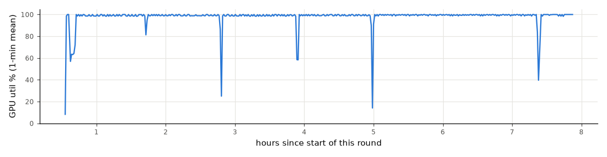
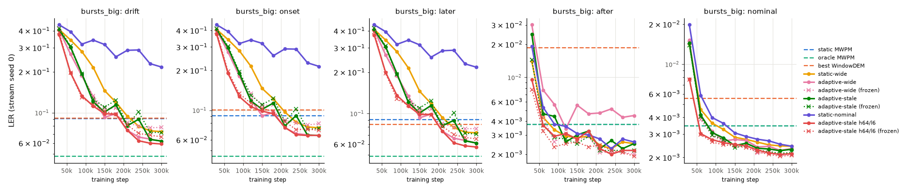
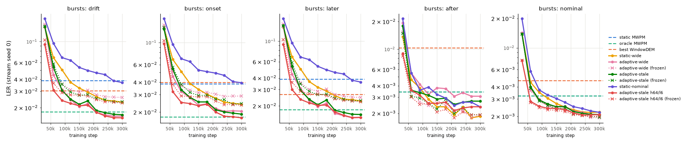
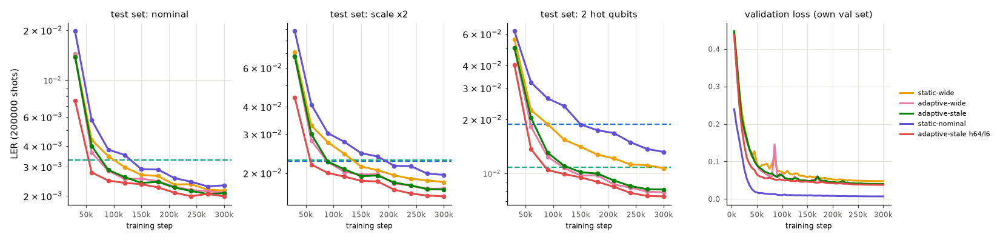

# d=5 learning curves: is it under-training? (report 4)

Run on 2026-11-07 on the cloud VM (GCP g2-standard-8, NVIDIA L4 24 GB, 4 cores / 8 threads, 31 GB RAM), following `results/report3.md`. Round start 11:37 UTC (`results/exp4/t_start`); 12-hour cap at 23:37 UTC. Tables come from `python results/exp4/report4.py` (`results/exp4/report4_tables.md`); the prose is written by hand. Everything here is d=5, 5 rounds, p=0.003.

## Short answer

**Yes. Report 3's d=5 failures were caused by too little training.** The same h48/l4 networks, trained 5× longer (300k steps instead of 60k) on 5× more data, fix most of report 3's d=5 failures. Using final checkpoints only:

1. **static-nominal now beats MWPM on nominal noise:** 0.00232 vs 0.00329 (p = 8e-18), against 0.00400 in report 3. It is still not the best decoder on nominal noise. static-wide (0.00216, p = 0.04, weak) and adaptive-wide (0.00210, p = 0.003) are better.
2. **Every wide-trained model beats static MWPM and the best WindowDEM on bursts_big drift.** adaptive-wide 0.0516, adaptive-stale 0.0514, static-wide 0.0629, h64/l6 0.0484, against static MWPM 0.0980 and WindowDEM-2000 0.0896 (all p < 1e-300). In report 3 every neural model lost here.
3. **The gap to oracle MWPM on later burst steps mostly closes.** On bursts, adaptive-wide now *beats* oracle on later steps (−0.0029, p = 3e-25); in report 3 it was +0.0102 behind (seed 0). On bursts_big the gap shrinks from +0.0817 to +0.0071 but does not close (p = 2e-47). On hot_qubit later steps adaptive beats oracle (−0.0028).
4. **Live minus frozen stays about the same in absolute terms** (bursts_big drift −0.0238 → −0.0213, bursts −0.0103 → −0.0097, hot_qubit −0.0032 → −0.0033). Both live and frozen LERs fall a lot, so the *relative* adaptation gain grows: frozen/live on bursts_big drift goes from 1.19 to 1.41. On telegraph live and frozen still tie.
5. **h64/l6 beats h48/l4 at the same number of steps, but by a little:** adaptive-stale on bursts_big drift 0.0484 vs 0.0514 (−0.0031, p = 8e-14) and nominal 0.00199 vs 0.00208 (p = 0.1, not significant). It cost 2.2× the GPU time (2 h 22 min vs 65 min), so at equal *compute* it is not a clear win. One seed only.

**Training is not finished.** Between 240k and 300k steps all five models improved on bursts_big drift (stream seed 0) by more than 2 SE. None improved on the nominal test set by more than 2 SE. So Part C took the **STILL FALLING** branch, and seeds 1–2 were queued (see "Part C").

Unchanged problems:

- adaptive-wide's **after-burst regression** remains. On bursts_big "after" steps it is worse than static MWPM (+0.0024, p = 1e-13); adaptive-stale and h64/l6 do not have this problem.
- Static MWPM still has the smallest decode latency (report 3; not re-measured).

SEEDS-PLACEHOLDER

## What was run and every decision taken

| decision | choice | why |
|---|---|---|
| Data path | Packed training chunks loaded onto the GPU once. Unpacking, fingerprint and grid layout run there with torch ops. Fingerprints are computed once per chunk; packed windows are kept only for `--stale-prob` | Removes all per-step CPU work. Inputs checked bit-identical to the CPU path |
| Pinned memory / non-blocking copies | not needed | Nothing is copied host→device per step any more. The per-step `loss.item()` sync was replaced by a buffer read every 250 steps (same running-mean values) |
| channels_last_3d + cudnn.benchmark | **on** | +4% alone (64.8 → 67.3 steps/s). The losses differ from the old path by float noise only (below) |
| torch.compile | **on** | +6–8% more on top (→ 71.4–72.9 steps/s); val loss after 500 steps within noise (0.4617 vs 0.4614) |
| fp32, batch 512 | kept | Comparability with report 3. As in report 3, PyTorch's default TF32 for cuDNN convolutions is left on |
| Concurrent jobs | **1** | 2–4 jobs give *less* total throughput (65 steps/s vs 71), with or without CUDA MPS. One job already saturates the L4 |
| Start training on early chunks while generating | not done | Each epoch's order is a permutation over all 150000 chunks, so starting early would change the results. Generation took ~25 min while Part A benchmarks used the GPU, so nothing was lost |
| Data size | `d5_wide_x5`, `d5_nominal_x5`: 150000 train chunks each, so `--epochs 2` = 300000 steps with the same 2-pass reuse as report 3 | "LR schedule stretched to 300000 steps": OneCycle over 300000 steps |
| Evals for learning curves | Only the neural decoders run, on the GPU, one eval at a time (~45 s each), with ≤ 2 CPU threads. Static MWPM, WindowDEM and oracle per-shot errors are reused from report 3's eval files | The baselines are deterministic. `curve_eval.py` reproduces report 3's per-shot errors exactly (0 of 300000 bursts_big shots differ for adaptive-wide s0 live and frozen, and for static-wide s0). It saves ~95% of the CPU work, and nothing on the CPU competed with training |
| Curve eval set | 3 test sets (200000 shots each) + bursts_big and bursts stream seed 0, live and frozen, update every 200 shots. All 5 WindowDEM histories are kept (they came for free) | as asked |
| Full eval of final checkpoints | 4 regimes × 5 stream seeds, live and frozen, WindowDEM 500–10000 (reused), update 200 | as asked |
| Part C rule | For each model compare step 240k vs 300k on the nominal test set and on bursts_big drift (stream 0), unpaired 2-SE rule. STILL FALLING if more than half the models improve on either | the rule in the brief |
| "h64/l6 clearly won" | more than 1 percentage point better than h48/l4 adaptive-stale on bursts_big drift (stream 0) at 300k | needed a threshold; it was 0.0590 vs 0.0620 (0.3 points), so h48/l4 seeds were queued |
| Seed order under the cap | all seeds of one model before the next: adaptive-wide s1, s2, then static-nominal s1, s2, then adaptive-stale, static-wide | So that the cap leaves complete 3-seed sets for the models behind questions 1–4 rather than seed 1 of everything |
| Cap | **A job starts only if it is expected to finish before 12 h** (h48/l4 ≈ 1.25 h) | Cost rule. The literal rule (stop *queuing* at 12 h) would let one more job run past the cap and yield a partial seed set |
| GPU-util rule | the queue starts the next job if the mean utilisation over 10 min drops below 70% with work queued | It never fired: utilisation stayed ≥ 85% in 97% of minutes |

Every run is resumable: `train.py --resume` continues from the latest `_step<k>.pt` (which stores optimiser, scheduler, RNG and epoch-order state), and the queue adopts a training process that is already running. The queue was restarted twice (once to add adoption, once for the cap rule) without interrupting training.

## Part A: GPU efficiency

### Profile of the old (report 3) path

One d=5 job (`results/exp4/profile_train.py`), steps 100–600, alone on the L4:

| part of a step | adaptive | static |
|---|---|---|
| unpack bits (numpy) | 0.14 ms (1%) | 0.14 ms (1%) |
| `build_input` (grid layout + fingerprint, CPU) | 0.74 ms (5%) | 0.26 ms (2%) |
| host → device copy | 0.37 ms (2%) | 0.24 ms (2%) |
| GPU forward + backward + AdamW | **13.9 ms (92%)** | **14.0 ms (96%)** |

**The old path was already GPU-bound.** A first profile showed `build_input` at 15.6 ms, but that was CPU contention from the dataset generation running at the same time; the table above is the clean rerun (training paused). The step is dominated by the 3D convolutions: batch 512 × 48 channels × 216 voxels, about 130 GFLOP per step.

### Before / after

Single job, steps 500→2000, d5_wide, alone on the GPU (`results/exp4/clean_speed.txt`):

| path | adaptive steps/s | static steps/s |
|---|---|---|
| old (CPU data, report 3) | 57.7 | 60.0 |
| new (GPU data + channels_last + compile) | **71.4** | **71.4** |

In the full 300k-step runs (including validation every 5000 steps): **77–78 steps/s** for static and adaptive-stale (3830–3890 s), 72 steps/s for adaptive-wide (its time includes a 2-min pause for the clean benchmark above and the first curve evals), and **35 steps/s** for h64/l6. Report 3 trained 4 jobs at once at 68 steps/s in total.

GPU-only step time under the options (`results/exp4/bench_gpu_step.py`, synthetic input):

| | default | cudnn.benchmark | + channels_last | benchmark + compile | + both |
|---|---|---|---|---|---|
| h48/l4 ms/step | 13.78 | 13.83 | 12.37 | 12.95 | **11.49** |
| h64/l6 ms/step | 29.80 | 29.96 | 27.29 | 28.77 | **26.23** |

### Same maths

adaptive-stale (exercises fingerprints and stale windows), `--steps 500`, d5_wide:

| path | loss @250 | val @250 | loss @500 | val @500 |
|---|---|---|---|---|
| old | 0.4804 | 0.4770 | 0.4337 | 0.4614 |
| old, rerun | 0.4804 | 0.4770 | 0.4337 | 0.4614 |
| new, channels_last off | 0.4804 | 0.4770 | 0.4337 | 0.4614 |
| new, channels_last on | 0.4803 | 0.4771 | 0.4341 | 0.4619 |
| new, channels_last on + compile | 0.4803 | 0.4773 | 0.4340 | 0.4617 |

The GPU inputs (events grid, fingerprint, stale fingerprints, labels) are **bit-identical** to `build_input`'s on 27 val chunks × 5 fingerprint variants. With the old memory layout the new path reproduces the old losses to 4 decimals. channels_last and compile change the convolution algorithms, which gives differences of ≤ 0.0005 in loss after 500 steps (float noise; training is chaotic). The long runs therefore are *not* bit-reproductions of what the old path would give, but are the same computation.

### Concurrency

Aggregate steps/s for N concurrent jobs (real model mix, new path + compile, `results/exp4/concurrency.txt`):

| N | 1 | 2 | 3 | 4 |
|---|---|---|---|---|
| plain | **71.4** | 65.2 | 64.9 | 65.4 |
| CUDA MPS | 71.4 | 65.9 | 57.2 | 59.6 |
| GPU util (nvidia-smi) | 79% | 90–92% | 94–95% | 96–97% |

Utilisation rises with N but throughput falls: the GPU switches between processes and does no more useful work. **1 job** was used. (Parts of this sweep overlapped the end of dataset generation; the clean single-job rerun gives the same 71.4.)

### Utilisation over the round



GPU-UTIL-PLACEHOLDER

nvidia-smi "utilisation" is the fraction of time any kernel runs, not how full the SMs are.

### Data (Part A.4)

| dataset | train chunks | on disk | generation |
|---|---|---|---|
| `data/d5_wide_x5` | 150000 × (512 + 2000 window) shots | **2.3 GB** | 262 s sampling with 6 workers + ~10 min single-threaded compression, ~25 min with streams |
| `data/d5_nominal_x5` | 150000 × 512 shots (no window) | **393 MB** | 20 s sampling, ~4 min total |

`make_dataset.py --workers N` draws every chunk's NoiseState and Stim seed first, in the original order from the original RNG, then samples in a process pool. It gives the same chunks as `--workers 1` (checked on 300 chunks, both modes). Checks against the originals (`results/exp4/check_x5.json`, `check_x5_detail.txt`):

- All 3 test sets and all 20 eval streams (4 regimes × stream seeds 0–4, plus `static`) are **byte-identical** to `d5_wide`'s (same SHA-256).
- The first 30000 train chunks and all 1000 val chunks have **identical shots** (det, obs, window, hot qubits, hot_p) to `d5_wide`'s. Likewise `d5_nominal_x5` vs `d5_nominal`.
- The only difference: the float64 `scale` label of 4–5% of chunks (and 7 steps of the unused `wander` stream) differs in the last bit (relative 2.2e-16). This comes from `exp`/`log` rounding on the laptop CPU vs the VM. Training never reads `scale`; the sampled shots are the same.
- `d5_nominal_x5` also has the extra stream seeds 1–4 (identical to `d5_wide`'s), which `d5_nominal` lacked.

## Part B: learning curves (seed 0)

Five models, seed 0, 300000 steps each (2 epochs over 150000 chunks), AdamW lr 1e-3 OneCycle over 300000 steps, batch 512, fp32. Checkpoints every 30000 steps (`decoder_<model>_d5_long_s0_step<k>.pt`); every one was scored with `curve_eval.py`. The horizontal lines are static MWPM, the best WindowDEM (picked per phase after the fact, among histories 500–10000) and oracle MWPM on the same shots. Solid = live fingerprint, dotted × = frozen at the nominal fingerprint. **All curves are for stream seed 0 only** (one stream per regime), so single points are noisy; the final-checkpoint tables below use all 5 streams.







CURVE-TABLES-PLACEHOLDER

What the curves show:

- **Nominal noise.** Every model crosses static MWPM between 60k and 150k steps (h64/l6 by 60k, adaptive-wide and adaptive-stale by 90k, static-wide by 120k, static-nominal last at 150k). From 210k on they are all within 0.0002–0.0003 of each other, and the last 60k steps change none of them by more than 2 SE. The model trained on nominal data only is the *slowest* to learn nominal noise: its val loss is low (0.007: few errors to learn from), and its nominal test LER at every checkpoint is above static-wide's. Nominal chunks carry very few logical errors per batch (≈ 0.3% of 512 shots), so they teach less per step than wide chunks.
- **bursts_big drift** keeps falling to the end for every wide model (e.g. adaptive-wide 0.066 → 0.062 from 240k to 300k on stream 0). The wide models first get below static MWPM and the best WindowDEM at 210k (adaptive-wide, adaptive-stale, h64/l6) or 240k (static-wide) steps, far beyond report 3's 60k budget.
- **adaptive-wide is ahead of static-wide on bursts_big drift at every checkpoint.** The gap shrinks from 0.073 at 60k to 0.011 at 300k (stream 0). On the 5-stream final eval it is 0.0516 vs 0.0629.
- **The h64/l6 model learns faster per step** (nominal 0.00278 at 60k vs 0.00402 for h48 adaptive-stale) and ends a little ahead.
- Validation loss falls steadily after the OneCycle learning-rate peak (~90k, where it briefly spikes) for all models. Its last-60k drop is small (e.g. adaptive-wide 0.0415 → 0.0393).

## Answers (final checkpoints, 5 streams pooled)

All comparisons use the step-300000 checkpoints; no checkpoint was picked on eval streams. Cells: diff = LER(a) − LER(b) (negative = a better), exact two-sided McNemar p on the pooled shots, (k/n) = seeds where a had fewer errors, **bold** = every seed p < 0.05 in the same direction, "tie" = 2-SE rule. p between 0.001 and 0.05 is weak evidence; there is no multiple-testing correction. Full tables: `results/exp4/report4_tables.md`.

ANSWERS-PLACEHOLDER

## Part C: which branch, and why

`results/exp4/partC_decision.json` (written by the queue at 18:59 UTC, 7.37 h into the round):

| model | nominal 240k → 300k | improves > 2 SE? | bursts_big drift (st0) 240k → 300k | improves > 2 SE? |
|---|---|---|---|---|
| static-wide | 0.00236 → 0.00216 | no | 0.0798 → 0.0728 | **yes** |
| adaptive-wide | 0.00218 → 0.00210 | no | 0.0663 → 0.0618 | **yes** |
| adaptive-stale | 0.00215 → 0.00208 | no | 0.0898 → 0.0620 | **yes** |
| static-nominal | 0.00244 → 0.00232 | no | 0.2889 → 0.2167 | **yes** |
| adaptive-stale h64/l6 | 0.00200 → 0.00199 | no | 0.0623 → 0.0590 | **yes** |

**STILL FALLING** (5/5 models, all on bursts_big drift). h64/l6 did not clearly win (0.3 points on bursts_big drift, threshold 1 point), so seeds 1 and 2 of the h48/l4 long models were queued, followed by the full eval of every finished checkpoint.

A caveat on this rule: bursts_big drift on a single stream is noisy between checkpoints (adaptive-stale went 0.114 → 0.080 → 0.090 → 0.064 → 0.062 from 180k to 300k). The trend over 150k–300k is clearly downward for every wide model, so the decision would be the same with a smoother rule. The nominal test set, by contrast, is flat at the 2-SE level.

SEEDS12-PLACEHOLDER

## Limitations

- **Mostly one seed.** The learning curves, h64/l6, static-wide and adaptive-stale results are seed 0 only. SEEDS-LIMIT-PLACEHOLDER Report 3 showed a seed spread of ±0.02 on bursts_big for static-wide, so single-seed differences of a few tenths of a percent between models are not reliable even when McNemar p is tiny (McNemar tests the shots, not the training seed).
- **Long vs report 3 changes two things at once:** 5× more steps *and* 5× more distinct data (with the same 2-pass reuse). The curves show what happens with more steps at this data size. They do not separate steps from data; a 300k-step run on the old 30k-chunk data would.
- **Learning curves use one stream per regime** (stream seed 0) and only bursts and bursts_big. Their single points have SE ≈ 0.001–0.002 on drift phases.
- **The Part C rule** compared only two checkpoints on one stream (see above).
- **Training is not converged.** 300k steps is still on a falling curve for drift, so every "neural vs X" gap here is a snapshot at this budget.
- **The new GPU path is not bit-identical to report 3's** (channels_last / compile: float-noise differences, checked over 500 steps). Seed 0 of report 3 was trained on the laptop GPU anyway.
- **The full-eval baselines are reused** from report 3's eval files, not recomputed. This is exact (deterministic decoders, verified bit-for-bit for the neural decoders, and report 3 verified MWPM/WindowDEM across machines).
- **h64/l6 is compared at equal steps, not equal compute.**
- **Best WindowDEM per phase is picked after the fact**, which favours WindowDEM; it still loses everywhere except where noted.
- **Uncorrected multiple testing**, as in reports 2–3.

## Next steps

1. **Keep training.** Continue the long models (resume from `_step300000.pt` with a new, longer schedule, or train 600k-step runs) until bursts_big drift flattens. Then decide architecture at a matched compute budget, not matched steps.
2. **Separate steps from data:** one 300k-step run on the old `d5_wide` (30k chunks, 10 passes). If it matches the `_x5` run, data was never the bottleneck.
3. **Fix the after-burst regression** of adaptive-wide (still +0.0024 vs static MWPM on bursts_big after-steps). adaptive-stale does not have it, so stale-fingerprint training is the cheap fix; make it the default adaptive recipe.
4. **Nominal specialist:** train on a mix of mostly-nominal and some wide chunks, or fine-tune static-wide on nominal. Pure-nominal data gives few errors per batch, and here it never beat static-wide.
5. **bursts_big vs oracle** is the one gap left (+0.007 on later steps). Hybrid decoding (neural model reads the fingerprint and outputs MWPM edge weights) is the natural way to get oracle-like behaviour on localized noise with MWPM's latency; not implemented here.
6. **Rescale drift regimes with distance** and re-measure latency for the long models (same architecture, so report 3's latency numbers apply to the h48/l4 models; h64/l6 is ~2.3× more compute per shot).

## Files to copy back to the laptop

FILES-PLACEHOLDER

## Reproduce

```
# Part A
python results/exp4/profile_train.py [--static]                    # old-path profile
python results/exp4/bench_gpu_step.py                               # GPU step under options
python make_dataset.py --distance 5 --rounds 5 --name d5_wide_x5 --train-chunks 150000 --workers 6
python make_dataset.py --streams-only --name d5_wide_x5 --stream-seeds 1,2,3,4 --regimes hot_qubit,bursts,bursts_big,telegraph
python make_dataset.py --distance 5 --rounds 5 --nominal-only --window 0 --name d5_nominal_x5 --train-chunks 150000 --workers 6
python make_dataset.py --streams-only --name d5_nominal_x5 --stream-seeds 1,2,3,4 --regimes hot_qubit,bursts,bursts_big,telegraph
python results/exp4/check_x5.py
# Parts B and C (one detached, resumable queue: training, curve evals, Part C decision, full evals)
setsid nohup python results/exp4/run_queue.py >> results/exp4/queue.out 2>&1 &
#   each training job is e.g.
python train.py --data data/d5_wide_x5 --adaptive --epochs 2 --val-every 5000 --save-every 30000 \
    --device cuda --compile --resume --seed 0 --out decoder_adaptive_wide_d5_long_s0.pt
python curve_eval.py --checkpoint decoder_adaptive_wide_d5_long_s0_step30000.pt --out results/exp4/curves
python curve_eval.py --checkpoint decoder_adaptive_wide_d5_long_s0.pt --streams bursts,bursts_big,hot_qubit,telegraph \
    --stream-seed 0 --out results/exp4/full/st0          # stream seeds 0-4
# Part D
python results/exp4/report4.py
```
